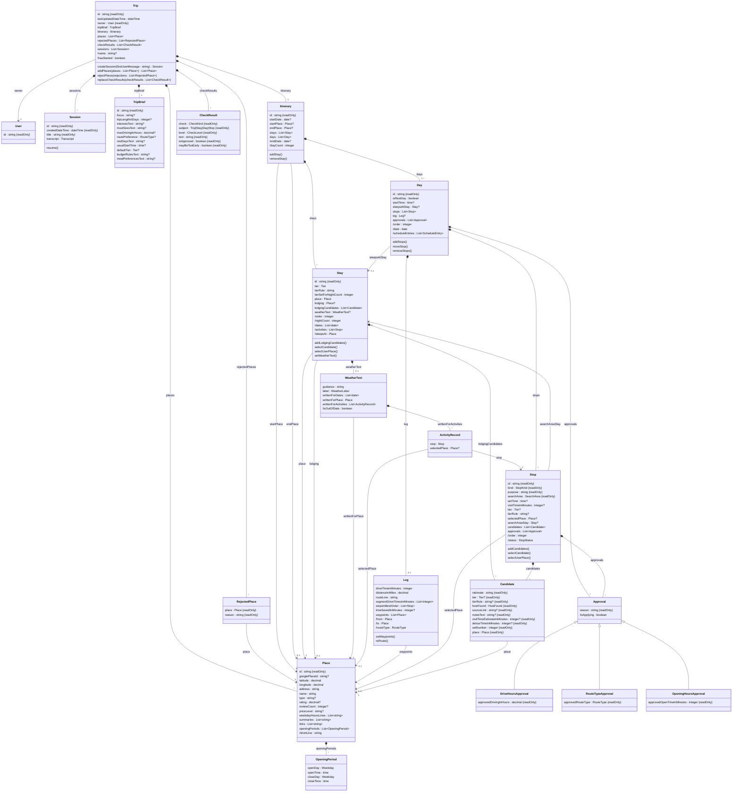
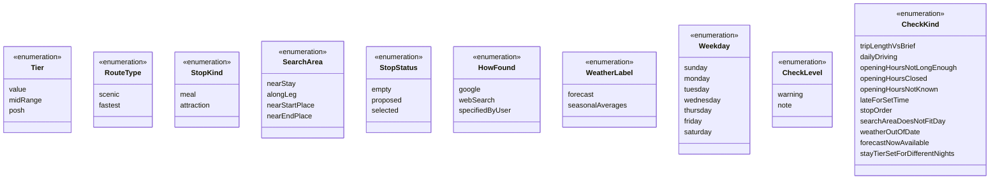

# Road Trip Planner: Domain Model (MVP)

This document lists the objects in the trip planner, such as trip, stay, day, and stop. For each one it gives its properties, how it relates to the others, the operations on it, and the rules that always hold. It stays at the level of design. It has no code types and no database tables. Those come from the code during development. It's kept by hand, and when development finds something it needs, it goes here.

For the planning behavior, see the [functional spec](functional-spec.md). For the agents, workers, and feasibility checks, see the [technical spec](technical-spec.md). For each tool's inputs, see the [tool design](tool-design.md).

**Left out on purpose:**

- **Memory.** Memory design is technical spec open question 5. Memory joins this model once it's designed.
- **Worker briefs and option cards.** Neither is stored. A worker brief is written fresh for each worker call (technical spec 5.3). An option card is how the UI shows the newest candidate set of one stop or stay (functional spec 7.5). The rules they depend on, such as which candidate set a card shows, are on the objects here.

**Draft status.** Only the Trip is written so far. The diagram shows the other objects as technical spec section 3 has them, and each gets its own section as it's reviewed. Their operations are a first placement, settled when each object is reviewed. `ScheduleEntry` on the Day is defined when the Day is reviewed.

---

## 1. How to read this

**Names.** Classes are in PascalCase, such as `TripBrief`. Properties and operations are in camelCase, such as `startDate` and `rejectPlaces()`. Names have no spaces or dashes. Property names follow these rules:

- **A plural name means a list, and every list has a plural name,** such as `stops` or `scheduleEntries`.
- **A count ends in `Count`,** such as `nightCount` or `reviewCount`.
- **A measure ends in `In` and its unit,** such as `tripLengthInDays`, `visitTimeInMinutes`, or `distanceInMiles`. A plural unit doesn't make the name plural.
- **Text about several things ends in `Text`,** such as `mustSeesText` or `notesText`. It's one string in the user's or an agent's words, not a list, because only the agents read it. Other text has a plain singular name, such as `purpose` or `rationale`.
- **A yes-or-no property starts with `is` or `has`,** such as `isRestDay`.

**Stored or worked out.** A stored property is saved. A worked-out property is looked up from other stored data when it's read, and never saved. Examples: a stay's nights, a day's date, and a leg's from and to. Storing these would add a second copy that can go stale. Values that need a call to an outside service, such as a leg's drive time, are different. They're computed once and stored. In the diagram, a worked-out property starts with a slash, such as `/nightCount`.

**Types.** Each property gives the type of value it holds:

| Type | Holds | Example |
|---|---|---|
| `string` | Text | A stop's `purpose`, "dessert" |
| `integer` | A whole number | A candidate's `setNumber`, 0 |
| `decimal` | A number that can have a fraction | A place's `rating`, 4.6 |
| `boolean` | Yes or no | A day's `isRestDay` |
| `date` | A calendar date, with no time | The itinerary's `startDate`, May 13, 2027 |
| `time` | A time of day, with no date | A stop's `setTime`, 7:00 p.m. |
| `dateTime` | A date and a time together | A trip's `lastUpdatedDateTime` |
| An enumeration, such as `Tier` | One value from a fixed list. The second diagram in section 2 lists them | `value`, `midRange`, or `posh` |
| A class name, such as `Place` | A link to one object of that class | A worked-out leg's `from` |
| `List<X>` | A list of X. The notes say whether it's in order | `List<date>` for a stay's `dates` |

A `?` after the type means the property can be empty, such as `setTime : time?`. The notes say what empty means. Example: a stop's `setTime` is empty when the stop follows the one before it.

**How an object is held.** An object with an `id` is an **entity**. The `id` is one we create (technical spec 7.1). An object with no `id` is **held by** the one object whose property holds it, such as a leg held by its day's `leg`. It exists only inside that object and goes away with it. An entity can be held too: a day holds its `stops`, and they go away with it. IDs from outside sources, such as Google's place ID, are ordinary properties.

**Order.** A list in order stores the order. An item's number is its position in that list, worked out when read. Numbers start at 0. The UI counts from 1 for people, so the day stored as 0 shows as Day 1. The examples use the people-facing labels.

**Who creates and changes it.** The coordinator, a worker, code, or the app itself, outside any agent. Each object says which.

**What this model holds.** The rules about the objects themselves. It isn't all of the app's logic. Code built on top of it adds more, and the agents' tools sit above that. One tool can use several operations here, or set properties directly.

**Setting properties.** A stored property can be set directly, as long as the value fits its type. Worked-out properties can't be set. A property marked `{readOnly}` never changes once its object exists, such as a stop's `kind`. In the diagram's source it's written `#123;readOnly#125;`, because Mermaid can't take braces there.

**Operations** are listed only where a change has a rule beyond the property's type, such as a refusal, or another stored change that has to happen with it. An operation sits on the object whose property it changes, and is named for what it changes, such as `Trip.addPlaces()`. An object never creates itself. Code outside it does, or the object that holds it, such as `Trip.createSession()`. For each one, the object's section says what it changes, what follows on from it, and what it refuses.

**Arguments and returns.** Each operation gives its arguments and what it returns, such as `addPlaces(places : List<Place>) : List<Place>`. An argument that can be empty has a `?` after its type. An operation with nothing after its parentheses returns nothing. These are guidance for development. Development can change them, but each change is flagged and written back here.

**At the end of every write.** Some follow-ons come from a whole write, not from one property. A write is one set of changes saved together. Code runs these once, at the end of every write that isn't refused:

- **Re-route legs.** Every leg whose start, end, selected places in order, or waypoints differ from before the write is re-routed (technical spec 3.5).
- **Check results.** When a write runs the checks, the `FeasibilityChecker` works out the current check results, compares them with the trip's saved list, and replaces the list (see Trip). Only the coordinator's writes run the checks. A worker's write doesn't (technical spec section 8).
- **Last updated.** The trip's `lastUpdatedDateTime` is set to now.

A write to a started trip is refused before anything changes (see Trip).

---

## 2. Class diagram

The diagram shows only classes that hold stored data. Classes that only do work, such as the `FeasibilityChecker`, are described in the text.

How to read the lines: a filled diamond means the object at that end holds the other one, which goes away with it. An arrow means the object points to another one it doesn't hold. An open triangle means the object below is one kind of the object above. The label on a line is the property, in the box at the line's start, that holds the link. The numbers say how many: `1` is exactly one, `0..1` is zero or one, `*` is any number, and `1..*` is one or more. Operations end in `()`.

The fixed lists that properties above use:

---

## 3. Objects

### 3.1 Trip

The trip is one planned road trip. Everything else in this model belongs to a trip, except the user.

**Held as:** an entity. Its `id` is one we create. It has the prefix `trip_` (technical spec 7.1). Agents never see it: each session's tools are made with the trip already set, so no tool takes a trip ID (tool design section 4).

**Created and changed by:** the app creates it when the user starts a new conversation from the home screen (functional spec 10.1), and creates its sessions. The coordinator rejects places. Code adds its places, replaces its check results, and sets when it was last updated. Everything else changes through the objects it holds.

| Property | Stored or worked out | Type | Notes |
|---|---|---|---|
| `id` | Stored | `string`, read only | Never shown to agents or users |
| `owner` | Stored | `User`, read only | Set when the trip is created. A user holds nothing else in this model yet: sign-in details are settled during development, and memory is left out |
| `tripBrief` | Stored | `TripBrief`, an entity held by the trip | Created empty with the trip |
| `itinerary` | Stored | `Itinerary`, an entity held by the trip | Created holding only its last day |
| `places` | Stored | `List<Place>`, in no order | Every place a tool has returned for this trip, including search results never offered. Each is stored once. Only `addPlaces()` adds to it, and nothing removes from it |
| `rejectedPlaces` | Stored | `List<RejectedPlace>`, in the order rejected | Only `rejectPlaces()` adds to it, and nothing removes from it: taking a rejection back is out of scope (functional spec 2) |
| `checkResults` | Stored | `List<CheckResult>`, in no order | The check results that applied after the last coordinator write. Only replaced as a whole, never added to. See `replaceCheckResults()` |
| `sessions` | Stored | `List<Session>`, in the order created | Only `createSession()` adds to it, and nothing removes from it. See Session, below |
| `lastUpdatedDateTime` | Stored | `dateTime` | Set at the end of every write. See below |
| `name` | Worked out | `string?` | The trip brief's `focus` and the start month, such as "Pacific Coast Highway, May 2027." See below |
| `hasStarted` | Worked out | `boolean` | True when today's date is on or after the itinerary's `startDate`. False while the itinerary has no `startDate`. Today's date is looked up when needed, in the start place's time zone (see Rules) |

**RejectedPlace.** Held by the trip, with no `id` of its own. It holds `place : Place` and `reason : string`, both read only. The reason is the user's, such as "too kitschy for us." The place itself stays in the trip's `places`, so the tool `find_place` can still return it, marked rejected with the reason (technical spec 3.2).

**`name`.** It's built from the trip brief's `focus` and the itinerary's start month, such as "Pacific Coast Highway, May 2027" (functional spec 10.1). While `focus` is empty, the name is empty, and the home screen shows "New trip." While the itinerary has no `startDate`, the name is `focus` alone. Renaming a trip isn't in the MVP.

**`lastUpdatedDateTime`.** Code sets it at the end of every write (section 1): to the trip brief, the itinerary, candidates, weather text, or rejected places. That includes worker writes. A refused write changes nothing, so it doesn't count. Neither does a read, or saving places from a search, since the plan doesn't change. The home screen shows it (functional spec 3).

**Session.** One conversation with the agent about this trip (functional spec 10.1). It's an entity held by the trip. Its `id` has the prefix `session_`, and agents never see it.

| Property | Stored or worked out | Type | Notes |
|---|---|---|---|
| `id` | Stored | `string`, read only | Never shown to agents or users |
| `createdDateTime` | Stored | `dateTime`, read only | The trip's session list shows its date |
| `title` | Stored | `string`, read only | A few words for the trip's session list. Set when the session is created, from the user's first message, cut to about 60 characters at a word break. Example: "Can we add a night in Big Sur and drop one in…" |
| `transcript` | Stored | `Transcript` | The conversation, restored when the user resumes the session. The Agent SDK may keep it, so its shape isn't part of this model |

A session is created and begins at the same moment, so it has no separate "start." It's never closed. The user just leaves, and can resume it later.

- **`resume()`.** The app runs it when the user picks a session from the trip's list. It restores the transcript, and the coordinator continues with that conversation's context. It works on a started trip too.

**A new trip** is created by code outside the trip, when the user starts a new conversation from the home screen. It starts with an empty trip brief, an itinerary holding only its last day, and empty `places`, `rejectedPlaces`, and `checkResults`. Then `createSession()` creates its first session.

**Operations:**

- **`createSession(firstUserMessage : string) : Session`.** The app runs it when the user sends the first message of a new trip, or of a new session on a trip. It creates a session, sets its `title` from `firstUserMessage`, adds it to `sessions`, and returns it. The coordinator gets no earlier transcripts. It begins by reading the itinerary, the trip brief, and memory (technical spec 5.2). It works on a started trip too.
- **`rejectPlaces(rejections : List<RejectedPlace>)`** (the tool `reject_places`, used by the coordinator). Takes one or more rejections, each a place and the user's reason. It adds each one to `rejectedPlaces`. It removes the place from every stop's and stay's candidates. Where the place was selected, it clears the selection. A rejection undoes picks, meaning candidates and the selections made from them. It doesn't change the trip's structure.
  - **Follows on:** clearing a stop's selection clears its `visitTimeInMinutes` and removes its opening-hours approval. Clearing a stay's lodging means the party sleeps in the stay's town again. Every leg whose selected places, start, or end changed is re-routed (technical spec 3.5). A stay whose activities changed has its weather text marked out of date.
  - **Leaves alone:** the trip's structure, meaning a stay's town, the start and end places, and waypoints. None of them is picked from candidates. Changing them needs a conversation with the user, such as which days move when a stay's town goes, so the coordinator does that afterward. The rejection still keeps the place out of later searches and candidates.
  - **Already rejected:** a place already in `rejectedPlaces` is skipped without a word, like adding to a set. It keeps its first reason, and the new one is dropped.
  - **Refused:** the whole call, when a place isn't in this trip or a reason is missing.
- **`addPlaces(places : List<Place>) : List<Place>`** (code, whenever a search or lookup returns places). Takes one or more places and adds each to `places`. A place the trip already has, matched by `googlePlaceId`, isn't added again: the stored record is reused (see Place). Returns the stored places in the order given, so the caller gets the existing record's `id` for a place the trip already had.
- **`replaceCheckResults(checkResults : List<CheckResult>)`** (the `FeasibilityChecker`, at the end of every write that runs the checks). Takes the full list of current check results, which can be empty. Replaces the whole of `checkResults` in one step. Nothing can add to the list or remove one result from it. The trip only stores the list. Working out the results and comparing them with the saved list is the `FeasibilityChecker`'s job (see Check result).

**Rules:**

- **A trip belongs to one user.** Only that user, and the agents in that user's sessions, can reach it (functional spec 10.4).
- **A started trip can't be changed.** Once `hasStarted` is true, every write to the trip is refused, and the error says the trip has started (technical spec section 8). That covers the trip brief, the itinerary, candidates, weather text, and rejected places. Reads still work, sessions can still be created and resumed, and searches can still save places, since none of them changes the plan.
- **Today's date is the date in the start place's time zone,** since that's where the trip begins. It isn't a property of the trip. Code looks it up when a rule needs it. The start-date check, the started-trip lock, and the forecast rules all use it (technical spec 5.2).
- **All of a trip's times are in the start place's time zone.** A trip that crosses into another time zone shows times off by the difference after the border. That's a known limit of this version.
- **The trip brief holds what the user wants. The itinerary holds the plan.** No fact is stored in both. Changing the brief never changes the itinerary. The checks compare them, and the coordinator changes the plan with the user (technical spec 3.1).
- **Places are kept per trip.** A place found for one trip, such as a friend's address, is never visible from another trip (functional spec 10.4).
