# Road Trip Planner: Domain Model (MVP)

This document lists the objects in the trip planner, such as trip, stay, day, and stop. For each one it gives its properties, how it relates to the others, the operations on it, and the rules that always hold. It stays at the level of design. It has no code types and no database tables. Those come from the code during development. It's kept by hand, and when development finds something it needs, it goes here.

For the planning behavior, see the [functional spec](functional-spec.md). For the agents, workers, and feasibility checks, see the [technical spec](technical-spec.md). For each tool's inputs, see the [tool design](tool-design.md).

**Left out on purpose:**

- **Memory.** Memory design is technical spec open question 5. Memory joins this model once it's designed.
- **Worker briefs and option cards.** Neither is stored. A worker brief is written fresh for each worker call (technical spec 5.3). An option card is how the UI shows the newest candidate set of one stop or stay (functional spec 7.5). The rules they depend on, such as which candidate set a card shows, are on the objects here.

---

## 1. How to read this

**Names.** Classes are in PascalCase, such as `TripBrief`. Properties and operations are in camelCase, such as `startDate` and `rejectPlaces()`. Names have no spaces or dashes. Property names follow these rules:

- **A plural name means a list, and every list has a plural name,** such as `stops` or `lodgingCandidates`.
- **A count ends in `Count`,** such as `nightCount` or `reviewCount`.
- **A measure ends in `In` and its unit,** such as `tripLengthInDays`, `visitTimeInMinutes`, or `distanceInMiles`. A plural unit doesn't make the name plural.
- **Text about several things ends in `Text`,** such as `mustSeesText` or `notesText`. It's one string in the user's or an agent's words, not a list, because only the agents read it. Other text has a plain singular name, such as `purpose` or `rationale`.
- **A yes-or-no property starts with `is` or `has`,** such as `isRestDay`.

**Stored or worked out.** A stored property is saved. A worked-out property is looked up from other stored data when it's read, and never saved. Examples: a stay's nights and a stop's status. Storing these would add a second copy that can go stale. A worked-out property needs only its object's own data, or data the object holds. A value that needs more, such as a day's date, which needs the days before it, is a calendar function instead (section 4.1). Values that need a call to an outside service, such as a leg's route, are different. They're computed once and stored. In the diagram, a worked-out property starts with a slash, such as `/nightCount`.

**Types.** Each property gives the type of value it holds:

| Type | Holds | Example |
|---|---|---|
| `string` | Text | A stop's `purpose`, "dessert" |
| `integer` | A whole number | A candidate's `setNumber`, 0 |
| `decimal` | A number that can have a fraction | A place's `rating`, 4.6 |
| `boolean` | Yes or no | A day's `isRestDay` |
| `date` | A calendar date, with no time | The itinerary's `startDate`, May 13, 2027 |
| `time` | A time of day, with no date | A day's `ownStartTime`, 5:30 a.m. |
| `scheduleTime` | A time in a day's schedule. It's a time of day, plus whether it falls after midnight, on the next calendar date | A stop's `setTime`, 1:00 a.m., next day |
| `dateTime` | A date and a time together | A trip's `lastUpdatedDateTime` |
| An enumeration, such as `Tier` | One value from a fixed list. The table at the end of section 2 lists them | `value`, `midRange`, or `posh` |
| A class name, such as `Place` | A link to one object of that class | A stop's `selectedPlace` |
| `List<X>` | A list of X. The notes say whether it's in order | `List<date>` for a weather text's `writtenForDates` |

A `?` after the type means the property can be empty, such as `setTime : scheduleTime?`. The notes say what empty means. Example: a stop's `setTime` is empty when the stop follows the one before it.

A value after `=` is the property's default, the value it has when its object is created, such as `usualStartTime : time = 8:00 a.m.`

**How an object is held.** An object with an `id` is an **entity**. The `id` is one we create (technical spec 7.1). An object with no `id` is **held by** the one object whose property holds it, such as a leg held by its day's `leg`. It exists only inside that object and goes away with it. An entity can be held too: a day holds its `stops`, and they go away with it. IDs from outside sources, such as Google's place ID, are ordinary properties.

**Order.** A list in order stores the order. An item's number is its position in that list. The calendar's `orderOf()` works it out when it's read (section 4.1). Numbers start at 0. The UI counts from 1 for people, so the day stored as 0 shows as Day 1. The examples use the people-facing labels. Most come from the two example trips in section 5.

**Who creates and changes it.** The coordinator, a worker, code, or the app itself, outside any agent. Each object says which.

**What this model holds.** The rules about the objects themselves. It isn't all of the app's logic. Code built on top of it adds more, and the agents' tools sit above that. One tool can use several operations here, or set properties directly. A tool's inputs don't have to match an operation's arguments. Example: the tool `add_stay` takes "first" where `StaysService.addStay()` takes an empty `after`.

**Three layers hold the rules.** The agents' tools are only one way to change the data. A later version might let the user edit the trip brief in a web form, and it has to hit the same rules. So the rules can't live in the tools. Each rule has one home, in one of three layers:

- **Objects** hold the data, and its integrity rules. An integrity rule looks only at the object's own properties and the items in its own lists. It doesn't look inside those items' own lists. Examples: a visit time is more than 0, a meal stop needs a tier when it's created, and a stop's selected place is one of its candidates. A stop can check its candidates' places for a repeat, since it's managing its candidates. A stay checking whether its days still hold stops looks one list deeper, so that's a business rule. An object never reads the object that holds it.
- **Services** hold the business rules. A business rule is any rule that needs a setting, the trip brief, or another object, including one inside the items of a list. Examples: a trip is at most the maximum trip length, a candidate isn't a rejected place, and a stop's search area fits its day. See section 4.
- **Persistence** holds one rule: a started trip can't be changed. `TripWriter` refuses a write to a started trip right after loading it, before anything changes. The save refuses it again ([persistence design](persistence.md), section 5). Objects, services, and tools don't check it (see Trip).

A tool can add its own checks on what an agent passes in, but it never holds a rule about the data.

**Hard and soft rules.** A hard rule refuses the change. A soft rule lets the change through, and the `FeasibilityChecker` gives a warning (section 4.8). Soft rules are kept to a minimum. Today there's one: a stop's search area has to fit its day. It's hard when the stop is added. It's soft after a move or a change to the stays, so the coordinator can sort stops out in steps. The other checks, such as daily driving and opening hours, aren't rules about the data. They describe problems with the plan.

**Setting properties.** A stored property can be set directly, unless it's marked `{readOnly}` or `{viaService}`. The value has to fit its type and the property's own rules, such as a range. Setting the property runs those rules, and refuses a value that breaks one. The properties table and the object's rules say what they are. How code runs them, such as with a setter, is settled during development. Worked-out properties can't be set.

**Three markers** go after a property's type. In the diagram's source, each is written with `#123;` and `#125;` for the braces, because Mermaid can't take braces there.

- **`{readOnly}`:** the property is never set directly. Either it never changes once its object exists, such as a stop's `kind`, or it changes only through the object's own operation, which its notes name. Example: the itinerary's `checkResults` changes only through `Itinerary.replaceCheckResults()`.
- **`{viaService}`:** the property changes only through a service operation, which its notes name. Example: a stop's `setTime` changes only through `StopsService.setStopTime()`, since a rest day's stops each need a set time. A property is `{viaService}` when any change to it needs a business rule. Then every change to it goes through a service, even one that needs no business rule, so there's one way to change it. Example: adding a stay needs the maximum trip length, so moving one goes through `StaysService` too. In TypeScript, the object's change method for the property is kept out of the domain package's public API, so only services can reach it. That change method still runs the object's own rules. It isn't listed as an operation.
- **`{keepsValue}`:** the property starts empty, and can't be emptied once it has a value. Setting it to empty is refused. Example: the itinerary's `startPlace`.

A property has at most one of `{readOnly}` and `{viaService}`. `{keepsValue}` can go with either, such as the trip brief's `tripLengthInDays`. Reading a read-only or via-service list gives a copy that can't be changed, frozen where the language allows. So changing the copy can never change the stored list. In the properties tables, the type says "read only," "via service," or "keeps its value" instead.

**Operations** are listed only for a change that goes beyond setting one property: one that creates or removes objects, changes a list, or has to change other stored data with it. An operation on an object runs only that object's integrity rules, and is named for what it changes, such as `Itinerary.replaceCheckResults()`. A change that needs a business rule is a service operation instead (section 4). An object never creates itself. Code outside it does, such as a service, or the object that holds it, such as a stay creating its days. An object's own rules also run when it's created, and creating one that breaks them is refused. Example: a meal stop needs a tier. For each operation, the object's or service's section says what it changes, what follows on from it, and what it refuses.

**Arguments and returns.** Each operation gives its arguments and what it returns, such as `isRejected(place : Place) : boolean`. An argument that can be empty has a `?` after its type. An operation with nothing after its parentheses returns nothing. These are guidance for development. Development can change them, but each change is flagged and written back here.

**Services** hold the business rules, and no data. There's one for each kind of object with business rules: `TripBriefService`, `ItineraryService`, `RejectionsService`, `StaysService`, `DaysService`, `StopsService`, and `LegsService`. The `FeasibilityChecker` is one too. Each is created for one trip, and its operations take the itinerary and the objects to change. Services never call each other. Each section says what its service is given. A refused call changes nothing, because the write it's part of is thrown away (below). They hold no stored data, so they aren't in the diagram. See section 4.

**Places aren't held by the trip.** Each place is stored on its own, per trip. A search saves it before any write uses it, and the plan links to the places it uses ([persistence design](persistence.md), section 8). The places the user rejected are part of the plan, so the itinerary holds them (section 3.4).

**The calendar** is a set of lookup functions over the itinerary, such as a day's date, the day before it, or the stay it starts from. It holds no data, so it isn't in the diagram. It's there because an object can't see the object that holds it, or the one beside it. Example: San Francisco Day 2 starts at the Monterey stay only because the day before it sleeps there, and only the itinerary sees which day comes before. So "where Day 2 starts" is the calendar's `startStayOf()`, not a property of the day. Code passes the calendar into the services that need it. See section 4.1.

**A write** is one set of changes saved together. Each tool call that changes the trip is one write. So would be each save from a later web form. The same code runs every write, whichever way it comes in. It isn't a service: it calls them. It runs four steps:

1. **Load** the trip.
2. **Change** it, with the services and the objects' operations.
3. **Finish** the write, in this order:
   - **Legs.** `LegsService.updateLegs()` compares each day with what its leg was routed for, and adds, re-routes, or removes its leg (section 4.7). This comes first, because the checks need the new drive times.
   - **Check results.** After a coordinator write, the `FeasibilityChecker` works out the current check results, compares them with the itinerary's saved list, and replaces the list (section 4.8). A worker's write doesn't run the checks (technical spec section 8).
   - **Last updated.** The trip's `lastUpdatedDateTime` is set to now.
4. **Save** the trip. Persistence checks the started-trip lock here (see Trip).

**What a write hands back.** Once the trip is saved, the write returns three things to the caller: what the change returned, such as the new stops' IDs, or the stops and stays a rejection changed; the leg changes from `updateLegs()` (section 4.7); and, after a coordinator write, the check comparison from the `FeasibilityChecker` (section 4.8). The finish makes the last two after the change is done, so the change can't return them itself. A tool builds its reply from all three ([tool design](tool-design.md), 2.1). Example: rejecting the selected Moab hotel returns the Moab stay as changed, the re-routed legs of Days 1, 2, and 4, which start or end at the hotel, and the check results that are new or went away.

**A refusal throws the write away.** When anything refuses along the way, including a call to Google while the legs are updated, the loaded trip is thrown away and never saved. Storage still holds the trip as it was, and the error goes back to the caller. So nothing is left half changed. Example: `StopsService.moveStop()` takes a stop off Day 2, then Day 3 refuses it. The changed trip is thrown away, so the stored Day 2 never lost the stop. The same goes for a tool call that makes several changes, such as the tool `update_trip_brief` setting five items when one is refused.

**Saving places from a search isn't a write.** It adds places without loading or saving the plan. So it runs no finish: no legs, no checks, and no last updated ([persistence design](persistence.md), section 3).

**Two writes to one trip take turns.** The second waits until the first is saved or thrown away. So two stay researchers writing at the same time never save a copy without the other's candidates. See the [persistence design](persistence.md), section 4.

The sections below say a follow-on happens "at the end of the write" when it runs in the finish step.

---

## 2. Class diagram

The diagram shows only classes that hold stored data. The services and the calendar hold none, so they're in section 4 instead.

How to read the lines: a filled diamond means the object at that end holds the other one, which goes away with it. An arrow means the object points to another one it doesn't hold. An open triangle means the object below is one kind of the object above. The label on a line is the property, in the box at the line's start, that holds the link. The numbers say how many: `1` is exactly one, `0..1` is zero or one, `*` is any number, and `1..*` is one or more. Operations end in `()`.

```mermaid
classDiagram
    direction TB

    class User {
        id : string #123;readOnly#125;
    }

    class Trip {
        id : string #123;readOnly#125;
        lastUpdatedDateTime : dateTime
        owner : User #123;readOnly#125;
        tripBrief : TripBrief #123;readOnly#125;
        itinerary : Itinerary #123;readOnly#125;
        /name : string?
        /hasStarted : boolean
    }

    class RejectedPlace {
        place : Place #123;readOnly#125;
        reason : string #123;readOnly#125;
    }

    class TripBrief {
        id : string #123;readOnly#125;
        focus : string? #123;keepsValue#125;
        tripLengthInDays : integer? #123;keepsValue#125; #123;viaService#125;
        interestsText : string? #123;keepsValue#125;
        mustSeesText : string? #123;keepsValue#125;
        maxDrivingInHours : decimal? #123;keepsValue#125; #123;viaService#125;
        routePreference : RouteType? #123;keepsValue#125;
        restDaysText : string? #123;keepsValue#125;
        usualStartTime : time = 8:00 a.m.
        defaultTier : Tier? #123;keepsValue#125;
        budgetRulesText : string? #123;keepsValue#125;
        mealPreferencesText : string? #123;keepsValue#125;
    }

    class Itinerary {
        id : string #123;readOnly#125;
        startDate : date? #123;keepsValue#125; #123;viaService#125;
        startPlace : Place? #123;keepsValue#125;
        endPlace : Place? #123;keepsValue#125;
        stays : List~Stay~ #123;viaService#125;
        lastDay : LastDay #123;readOnly#125;
        rejectedPlaces : List~RejectedPlace~ #123;viaService#125;
        checkResults : List~CheckResult~ #123;readOnly#125;
        /days : List~Day~
        /endDate : date?
        /dayCount : integer
        /totalDriveTimeInMinutes : integer
        isRejected(place : Place) boolean
        replaceCheckResults(checkResults : List~CheckResult~)
    }

    class Stay {
        id : string #123;readOnly#125;
        place : Place
        lodging : Place? #123;readOnly#125;
        lodgingCandidates : List~Candidate~ #123;viaService#125;
        tier : Tier #123;readOnly#125;
        tierRule : string #123;readOnly#125;
        tierSetForNightCount : integer #123;readOnly#125;
        days : List~StayDay~ #123;viaService#125;
        weatherText : WeatherText? #123;viaService#125;
        /nightCount : integer
        /sleepsAt : Place
        setTier(tier : Tier, tierRule : string)
        selectCandidate(place : Place)
    }

    class WeatherText {
        guidance : string #123;readOnly#125;
        label : WeatherLabel #123;readOnly#125;
        writtenOnDate : date #123;readOnly#125;
        writtenForPlace : Place #123;readOnly#125;
        writtenForDates : List~date~ #123;readOnly#125;
        writtenForActivities : List~ActivityRecord~ #123;readOnly#125;
    }

    class ActivityRecord {
        stopId : string #123;readOnly#125;
        selectedPlace : Place? #123;readOnly#125;
    }

    class Day {
        id : string #123;readOnly#125;
        ownStartTime : time?
        stops : List~Stop~ #123;viaService#125;
        waypoints : List~Place~ #123;readOnly#125;
        leg : Leg? #123;viaService#125;
        approvals : List~Approval~ #123;viaService#125;
        setWaypoints(waypoints : List~Place~)
    }

    class StayDay {
        isRestDay : boolean = false #123;viaService#125;
    }

    class LastDay {
    }

    class Leg {
        segmentDriveTimesInMinutes : List~integer~ #123;readOnly#125;
        distanceInMiles : decimal #123;readOnly#125;
        routeLine : string #123;readOnly#125;
        stopsInBestOrder : List~Stop~ #123;readOnly#125;
        timeSavedInMinutes : integer #123;readOnly#125;
        routedFromPlace : Place #123;readOnly#125;
        routedToPlace : Place #123;readOnly#125;
        routedStopPlaces : List~Place~ #123;readOnly#125;
        routedWaypoints : List~Place~ #123;readOnly#125;
        /driveTimeInMinutes : integer
    }

    class Stop {
        id : string #123;readOnly#125;
        kind : StopKind #123;readOnly#125;
        purpose : string #123;readOnly#125;
        searchArea : SearchArea #123;readOnly#125;
        searchAreaStay : Stay? #123;readOnly#125;
        setTime : scheduleTime? #123;viaService#125;
        visitTimeInMinutes : integer?
        tier : Tier? #123;readOnly#125;
        tierRule : string? #123;readOnly#125;
        selectedPlace : Place? #123;viaService#125;
        candidates : List~Candidate~ #123;viaService#125;
        approvals : List~Approval~ #123;viaService#125;
        /status : StopStatus
        setTier(tier : Tier, tierRule : string)
    }

    class Candidate {
        place : Place #123;readOnly#125;
        rationale : string #123;readOnly#125;
        howFound : HowFound #123;readOnly#125;
        sourceLink : string? #123;readOnly#125;
        notesText : string? #123;readOnly#125;
        tier : Tier? #123;readOnly#125;
        tierRule : string? #123;readOnly#125;
        visitTimeInMinutes : integer? #123;readOnly#125;
        detourTimeInMinutes : integer? #123;readOnly#125;
        setNumber : integer #123;readOnly#125;
    }

    class Place {
        id : string #123;readOnly#125;
        googlePlaceId : string #123;readOnly#125;
        name : string? #123;readOnly#125;
        type : string? #123;readOnly#125;
        address : string #123;readOnly#125;
        latitude : decimal #123;readOnly#125;
        longitude : decimal #123;readOnly#125;
        rating : decimal? #123;readOnly#125;
        reviewCount : integer? #123;readOnly#125;
        priceLevel : PriceLevel? #123;readOnly#125;
        openingPeriods : List~OpeningPeriod~ #123;readOnly#125;
        weekdayHoursLines : List~string~ #123;readOnly#125;
        summaries : List~string~ #123;readOnly#125;
        links : List~string~ #123;readOnly#125;
        /shortLine : string
        fillName(name : string)
    }

    class OpeningPeriod {
        openDay : Weekday #123;readOnly#125;
        openTime : time #123;readOnly#125;
        closeDay : Weekday? #123;readOnly#125;
        closeTime : time? #123;readOnly#125;
    }

    class Approval {
        reason : string #123;readOnly#125;
    }

    class DriveHoursApproval {
        approvedDrivingInHours : decimal #123;readOnly#125;
    }

    class RouteTypeApproval {
        approvedRouteType : RouteType #123;readOnly#125;
    }

    class OpeningHoursApproval {
        approvedOpenTimeInMinutes : integer #123;readOnly#125;
    }

    class CheckResult {
        check : CheckKind #123;readOnly#125;
        subjectId : string #123;readOnly#125;
        text : string #123;readOnly#125;
        isApproved : boolean #123;readOnly#125;
        hasEmptyStopBefore : boolean #123;readOnly#125;
        /level : CheckLevel
    }

    Trip --> "1" User : owner
    Trip *-- "1" TripBrief : tripBrief
    Trip *-- "1" Itinerary : itinerary
    RejectedPlace --> "1" Place : place

    Itinerary --> "0..1" Place : startPlace
    Itinerary --> "0..1" Place : endPlace
    Itinerary *-- "*" Stay : stays
    Itinerary *-- "1" LastDay : lastDay
    Itinerary *-- "*" RejectedPlace : rejectedPlaces
    Itinerary *-- "*" CheckResult : checkResults

    Stay --> "1" Place : place
    Stay --> "0..1" Place : lodging
    Stay *-- "1..*" StayDay : days
    Stay *-- "*" Candidate : lodgingCandidates
    Stay *-- "0..1" WeatherText : weatherText

    WeatherText --> "1" Place : writtenForPlace
    WeatherText *-- "*" ActivityRecord : writtenForActivities
    ActivityRecord --> "0..1" Place : selectedPlace

    Day *-- "*" Stop : stops
    Day --> "*" Place : waypoints
    Day *-- "0..1" Leg : leg
    Day *-- "*" Approval : approvals

    Leg --> "*" Stop : stopsInBestOrder
    Leg --> "1" Place : routedFromPlace
    Leg --> "1" Place : routedToPlace
    Leg --> "*" Place : routedStopPlaces
    Leg --> "*" Place : routedWaypoints

    Stop --> "0..1" Place : selectedPlace
    Stop --> "0..1" Stay : searchAreaStay
    Stop *-- "*" Candidate : candidates
    Stop *-- "*" Approval : approvals

    Candidate --> "1" Place : place

    Place *-- "*" OpeningPeriod : openingPeriods

    Day <|-- StayDay
    Day <|-- LastDay

    Approval <|-- DriveHoursApproval
    Approval <|-- RouteTypeApproval
    Approval <|-- OpeningHoursApproval
```



The fixed lists that properties above use:

| Name | Values |
|---|---|
| `Tier` | `value`<br>`midRange`<br>`posh` |
| `RouteType` | `scenic`<br>`fastest` |
| `StopKind` | `meal`<br>`attraction` |
| `SearchArea` | `nearStay`<br>`alongLeg`<br>`nearStartPlace`<br>`nearEndPlace` |
| `StopStatus` | `empty`<br>`proposed`<br>`selected` |
| `HowFound` | `google`<br>`webSearch`<br>`specifiedByUser` |
| `WeatherLabel` | `forecast`<br>`seasonalAverages` |
| `PriceLevel` | `free`<br>`inexpensive`<br>`moderate`<br>`expensive`<br>`veryExpensive` |
| `Weekday` | `sunday`<br>`monday`<br>`tuesday`<br>`wednesday`<br>`thursday`<br>`friday`<br>`saturday` |
| `ApprovalKind` | `driveHours`<br>`routeType`<br>`openingHours` |
| `CheckLevel` | `warning`<br>`note` |
| `CheckKind` | `tripLengthVsBrief`<br>`dailyDriving`<br>`openingHoursNotLongEnough`<br>`openingHoursClosed`<br>`openingHoursNotKnown`<br>`lateForSetTime`<br>`stopOrder`<br>`searchAreaDoesNotFitDay`<br>`weatherOutOfDate`<br>`forecastNowAvailable`<br>`stayTierSetForDifferentNights` |

---

## 3. Objects

### 3.1 Trip

The trip is one planned road trip. Everything else in this model belongs to a trip, except the user.

**Held as:** an entity. Its `id` is one we create. It has the prefix `trip_` (technical spec 7.1). Agents never see it: each session's tools are made with the trip already set, so no tool takes a trip ID (tool design section 4).

**Created and changed by:** the app creates it when the user starts a new conversation from the home screen (functional spec 10.1). Code sets when it was last updated. Everything else changes through the objects it holds, or through the services (section 4).

| Property | Stored or worked out | Type | Notes |
|---|---|---|---|
| `id` | Stored | `string`, read only | Never shown to agents or users |
| `owner` | Stored | `User`, read only | Set when the trip is created. A user holds nothing else in this model yet: sign-in details are settled during development, and memory is left out |
| `tripBrief` | Stored | `TripBrief`, an entity held by the trip, read only | Created with the trip, empty except for its usual start time |
| `itinerary` | Stored | `Itinerary`, an entity held by the trip, read only | Created holding only its last day |
| `lastUpdatedDateTime` | Stored | `dateTime` | Set at the end of every write. See below |
| `name` | Worked out | `string?` | The trip brief's `focus` and the start month, such as "Pacific Coast Highway, May 2027." See below |
| `hasStarted` | Worked out | `boolean` | True when today's date is on or after the itinerary's `startDate`. False while the itinerary has no `startDate`. Today's date is looked up when needed, in the start place's time zone (see Rules) |

**`name`.** It's built from the trip brief's `focus` and the itinerary's start month, such as "Pacific Coast Highway, May 2027" (functional spec 10.1). While `focus` is empty, the name is empty, and the home screen shows "New trip." While the itinerary has no `startDate`, the name is `focus` alone. Renaming a trip isn't in the MVP.

**`lastUpdatedDateTime`.** Code sets it at the end of every write (section 1): to the trip brief, the itinerary, candidates, weather text, or rejected places. That includes worker writes. A refused write changes nothing, so it doesn't count. Neither does a read, or saving places from a search, since the plan doesn't change. The home screen shows it (functional spec 3).

**Sessions aren't part of the trip.** A session is a conversation about the trip, not part of the plan, so it isn't in this model. The trip doesn't hold its sessions, and nothing here creates one. The [persistence design](persistence.md), section 8.5, covers them.

**A new trip** is created by code outside the trip, when the user starts a new conversation from the home screen. It starts with a trip brief that holds only its usual start time, and an itinerary holding only its last day, with no rejected places or check results.

**Rules:**

- **A trip belongs to one user.** Only that user, and the agents in that user's sessions, can reach it (functional spec 10.4).
- **A started trip can't be changed.** Once `hasStarted` is true, every write that changes the plan is refused, and the error says the trip has started, with the date it used (technical spec section 8). That covers the trip brief, the itinerary, candidates, weather text, and rejected places. Objects, services, and tools don't check this. Persistence does, before the write changes anything and again when the trip is saved (section 1). Persistence still saves places from searches on a started trip, since they don't change the plan. Reads still work. Sessions aren't part of the trip, so they can still be started and resumed.
- **Today's date is the date in the start place's time zone,** since that's where the trip begins. It isn't a property of the trip. Code looks it up when a rule needs it, with the calendar's `today()` (section 4.1). The time zone is worked out from the start place's coordinates. The start-date check, the started-trip lock, and the forecast rules all use it (technical spec 5.2).
- **All of a trip's times are in the start place's time zone.** A trip that crosses into another time zone shows times off by the difference after the border. That's a known limit of this version.
- **The trip brief holds what the user wants. The itinerary holds the plan.** No fact is stored in both. Changing the brief never changes the itinerary. The checks compare them, and the coordinator changes the plan with the user (technical spec section 8).
- **Places are kept per trip.** Each trip has its own places (see Place). A place found for one trip, such as a friend's address, is never visible from another trip (functional spec 10.4).

### 3.2 Trip brief

The trip brief holds what the user wants from the trip: the items in functional spec 5.2. The itinerary holds the plan, and the checks compare the two (see Trip).

**Held as:** an entity held by the trip. Its `id` has the prefix `brief_` (technical spec 7.1). Agents never see it: a trip has one brief, so the tools find it from the trip.

**Created and changed by:** the app creates it with the trip, empty except for `usualStartTime`. Each item is set directly, except `tripLengthInDays` and `maxDrivingInHours`. Their limits are settings, so they change through `TripBriefService` (section 4.2). Today only the coordinator sets them, through the tool `update_trip_brief`. Workers never read it. Each gets the parts it needs in its worker brief (technical spec 5.3).

| Property | Stored or worked out | Type | Notes |
|---|---|---|---|
| `id` | Stored | `string`, read only | Never shown to agents or users |
| `focus` | Stored | `string?`, keeps its value | What the trip is about: a region, a route, or a theme, such as "Pacific Coast Highway" or "Texas barbecue." The trip's `name` starts with it |
| `tripLengthInDays` | Stored | `integer?`, keeps its value, via service | How many days the user wants. At least 1. Changes only through `TripBriefService.setTripLength()`, which also refuses more than the maximum trip length (section 4.2). The trip length check compares the itinerary's `dayCount` with it |
| `interestsText` | Stored | `string?`, keeps its value | In the user's words, with why they matter |
| `mustSeesText` | Stored | `string?`, keeps its value | In the user's words, with why they matter. A must-see can be one place, an area, a road, or an activity. It records no kind and links to no place. A must-see that is one place is linked through the stop the coordinator selects for it |
| `maxDrivingInHours` | Stored | `decimal?`, keeps its value, via service | The most driving the user wants in one day. More than 0. Changes only through `TripBriefService.setMaxDriving()`, which also refuses more than the maximum daily driving (section 4.2). The daily driving check compares each day with it. It's a default, not a hard limit: a day can go over it with a drive hours approval |
| `routePreference` | Stored | `RouteType?`, keeps its value | Scenic or fastest. The coordinator steers each day's drive toward it with waypoints, except on a day that holds a route type approval. Code doesn't read it (see Leg) |
| `restDaysText` | Stored | `string?`, keeps its value | In the user's words, such as "one day off in Moab." The coordinator decides which days, and marks them on the days |
| `usualStartTime` | Stored | `time`, 8:00 a.m. by default | When the party usually gets going. A day without a start time of its own starts at this time |
| `defaultTier` | Stored | `Tier?`, keeps its value | The tier for lodging and meals when no budget rule covers them. The coordinator reads it when it resolves each stay's and meal stop's tier (technical spec section 9). Code doesn't read it |
| `budgetRulesText` | Stored | `string?`, keeps its value | In the user's words, such as "mid-range for stays of 2+ nights" |
| `mealPreferencesText` | Stored | `string?`, keeps its value | In the user's words, such as "local cafés over hotel breakfast" |

**Required items can still be empty.** Functional spec 5.2 marks most items as required. That means the coordinator establishes each one during discovery. It doesn't mean the brief refuses to be empty while discovery is still going.

**Code reads only a few items.** It reads `focus` for the trip's name, and `tripLengthInDays`, `maxDrivingInHours`, and `usualStartTime` for the checks and the schedule. Only the agents read the rest. That's why each text item is one string, not a list.

**Operations:** none. Each item is set directly, or through `TripBriefService`, and its own rules run when it's set. When the tool `update_trip_brief` sets several items in one write and one is refused, the whole write is refused, and nothing changes. The error names the item and the rule.

**Rules:**

- **An item can be changed, but never emptied** (functional spec 10.5: trip brief items can be changed but not forgotten). Every item but `usualStartTime` is `{keepsValue}`, and `usualStartTime` is never empty. The coordinator needs every item it has to plan.
- **`tripLengthInDays` is at least 1.** The maximum trip length is a setting, so `TripBriefService` holds that limit (section 4.2).
- **`maxDrivingInHours` is more than 0.** The maximum daily driving is a setting, so `TripBriefService` holds that limit (section 4.2).
- **A check that compares against an empty item is skipped** (technical spec section 8). Example: during discovery, setting the start and end places routes the last day's leg before the user has given max driving hours, so the daily driving check doesn't run yet.
- **Changing the brief never changes the itinerary** (see Trip). Example: if the user shortens the trip from five days to four, nothing in the itinerary moves. The trip length check warns, and the coordinator removes a night with the user.

### 3.3 Check result

A check result is one finding from the feasibility checks in technical spec section 8, such as a day that drives longer than the user's max. Each one is a warning or a note. A check that refuses a write, such as a trip over the maximum length, gives an error, not a check result.

**Held as:** held by the itinerary's `checkResults`, with no `id`. That list holds the check results that applied after the last coordinator write. It's kept only so later writes and reads can tell which check results are new.

**Created and changed by:** the `FeasibilityChecker`, in code (section 4.8). A saved check result never changes. The whole list is replaced instead (`Itinerary.replaceCheckResults()`).

| Property | Stored or worked out | Type | Notes |
|---|---|---|---|
| `check` | Stored | `CheckKind`, read only | Which check found it. Each kind is one row of the table in technical spec section 8 |
| `subjectId` | Stored | `string`, read only | The ID of what it's about: the itinerary, a stay, a day, or a stop. It's an ID, not a link, because a write can remove the stop or stay before the compare runs (below) |
| `text` | Stored | `string`, read only | What the check found, such as "Day 4 needs about 5 h 20 m of driving. You agreed to 5." A current check result always has current text. The saved text is used only to describe a check result that went away |
| `isApproved` | Stored | `boolean`, read only | True when an approval that covers it applies (see Approval, and `FeasibilityChecker.isApplying()` in section 4.8). Always false for a check no approval covers |
| `hasEmptyStopBefore` | Stored | `boolean`, read only | For `openingHoursNotLongEnough` and `openingHoursClosed` only: true when an earlier stop on the same day is still empty, so the time checked may be too early (technical spec section 8). False for every other check. See the rules |
| `level` | Worked out | `CheckLevel` | Warning or note. It comes from `check`, in the table below |

**The checks.** Each `CheckKind` has one level and one kind of subject:

| `check` | Technical spec section 8 row | Level | About | Approval that covers it |
|---|---|---|---|---|
| `tripLengthVsBrief` | Trip length vs the brief | Warning | The itinerary | None |
| `dailyDriving` | Daily driving | Warning | A day | Drive hours |
| `openingHoursNotLongEnough` | Opening hours: open, but not long enough | Warning | A stop | Opening hours |
| `openingHoursClosed` | Opening hours: closed for the whole visit | Warning | A stop | Opening hours |
| `openingHoursNotKnown` | Opening hours: not known | Note | A stop | None |
| `lateForSetTime` | Late for a set time | Warning | A stop | None |
| `stopOrder` | Stop order | Note | A day | None |
| `searchAreaDoesNotFitDay` | Search area doesn't fit the day | Warning | A stop | None |
| `weatherOutOfDate` | Weather out of date | Note | A stay | None |
| `forecastNowAvailable` | Forecast now available | Note | A stay | None |
| `stayTierSetForDifferentNights` | Stay tier set for different nights | Note | A stay | None |

**The `FeasibilityChecker`** works out the check results, compares them with the saved list, and decides which are new. It's a service, so it's in section 4.8, with when it runs and which check results count as new.

**Rules:**

- **At most one check result per check and subject.** `Itinerary.replaceCheckResults()` refuses a list that breaks this.
- **Only the two opening-hours warnings can have an empty stop before.** A check result with `hasEmptyStopBefore` true and any other `check` is refused when it's created. An empty stop takes no time, so the stops after it may really come later. A place that looks closed at 1:10 may be open by 2:00, so an opening-hours warning may go away. A late or driving warning would only get worse, so it's real. `openingHoursNotKnown` doesn't depend on the time at all (technical spec section 8).

### 3.4 Itinerary

The itinerary is the plan: where the trip starts and ends, when it starts, its stays, and its days. It also holds the places the user rejected, and the check results from the last coordinator write.

**Held as:** an entity held by the trip. Its `id` has the prefix `itin_` (technical spec 7.1). Agents never see it: a trip has one itinerary, so the tools find it from the trip.

**Created and changed by:** the app creates it with the trip, and code creates its last day at the same time. The coordinator sets the start place and end place directly, and the start date through `ItineraryService` (section 4.9), all with the tool `update_itinerary`. It adds, moves, and removes stays, and sets their nights, through `StaysService`, with the tools `add_stay`, `update_stay`, and `remove_stay` (section 4.4). `StaysService` adds and removes a stay's days as its nights change. Nothing else adds or removes a day. `RejectionsService` adds rejected places (section 4.3). The `FeasibilityChecker` replaces the check results (section 4.8).

| Property | Stored or worked out | Type | Notes |
|---|---|---|---|
| `id` | Stored | `string`, read only | Never shown to agents or users |
| `startPlace` | Stored | `Place?`, keeps its value | Where the trip starts. Empty until the coordinator sets it during discovery. See below |
| `endPlace` | Stored | `Place?`, keeps its value | Where the trip ends. The same place as `startPlace` on a loop trip. Empty until the coordinator sets it during discovery. See below |
| `startDate` | Stored | `date?`, keeps its value, via service | The first day's date. Empty until the coordinator sets it during discovery. Changes only through `ItineraryService.setStartDate()` (section 4.9). See below |
| `stays` | Stored | `List<Stay>`, in order, via service | The shape of the trip. Each stay is an entity held by the itinerary, and holds its own days. Changes only through `StaysService.addStay()`, `moveStay()`, and `removeStay()` (section 4.4) |
| `lastDay` | Stored | `LastDay`, an entity held by the itinerary, read only | Created with the itinerary. Never replaced or removed |
| `rejectedPlaces` | Stored | `List<RejectedPlace>`, in the order rejected, via service | Only `RejectionsService.rejectPlaces()` adds to it, and nothing removes from it: taking a rejection back is out of scope (functional spec 2). It's via service so that a rejection is never recorded without the place also leaving every stop's and stay's candidates (section 4.3). See below |
| `checkResults` | Stored | `List<CheckResult>`, in no order, read only | The check results that applied after the last coordinator write. Only replaced as a whole, never added to. See `replaceCheckResults()` |
| `days` | Worked out | `List<Day>`, in order | Each stay's days, in the stays' order, then `lastDay`. The calendar works out a day's date and number from its place in this list (section 4.1) |
| `endDate` | Worked out | `date?` | The last day's date: `startDate` plus `dayCount` minus one day. Empty while there's no `startDate` |
| `dayCount` | Worked out | `integer` | How many days the trip has, counting the last day. This is the trip's length. At least 1. `StaysService` holds the maximum (section 4.4) |
| `totalDriveTimeInMinutes` | Worked out | `integer` | The sum of every leg's `driveTimeInMinutes`, without the drive buffer. The trip summary shows it (functional spec 9.1). A day with no leg adds nothing |

**Stays hold their days.** Each stay holds the days that end with a night there, so a stay's nights are the days it holds (functional spec 4, Night). The last day ends at the end place with no night, so the itinerary holds it on its own (functional spec 4, Last day). The stays are the shape of the trip, and are what the user and coordinator change. `days` puts all the days together in order.

A day touches two stays: it starts where the party slept and ends where it sleeps. It's held by the stay where it sleeps. Where it starts is worked out from the day before in `days`, or from the start place on the first day. The day can't see the day before it, so the calendar works that out (`startStayOf()`, section 4.1). Example: San Francisco Day 2 is held by the San Luis Obispo stay, and starts from the Monterey stay. A stop on Day 2 can still be near the Monterey stay, such as breakfast before the drive. That's a link from the stop to the stay, not ownership (see Stop).

**Total drive time leaves out the buffer.** It adds up the drive times Google gave, the same figure each leg shows (functional spec 9.4). The buffer for fuel and short breaks is part of the daily driving check and the day's schedule, where it spaces out the times (technical spec section 8).

**Start and end places.** Each is set directly, and can't be emptied once set. When Google has no name for the place, such as "Mike's house," the place takes the name the coordinator gives it (see Place). A new start or end place re-routes the first or last day's leg at the end of the write. Stops near the start or end place keep their candidates and selection. Nothing checks that a place is in the contiguous US (functional spec 1). That check is hard to do well at this level, so the risk is accepted. The coordinator keeps the trip in the US.

**Start date.** Set through `ItineraryService.setStartDate()` (section 4.9), since the rule that it's after today needs today's date, and only services get the calendar. It can't be emptied once set. A new start date moves every day's date, since dates are worked out. Nothing is re-routed. The checks at the end of the write see the new dates, such as a stop that now falls on a day its place is closed. Setting it is refused:

- **While `startPlace` is empty,** by the itinerary's own rule, since today's date comes from the start place's time zone. When the tool `update_itinerary` gets a start place and a start date in one call, it sets the place first.
- **When the date isn't after today,** by `ItineraryService`.

**Rejected places.** A place the user turned down for the whole trip. It's never offered again (functional spec 10.2).

**RejectedPlace.** Held by the itinerary, with no `id` of its own. It holds `place : Place` and `reason : string`, both read only. The reason is the user's, such as "too kitschy for us." Creating one with an empty reason is refused. The place itself is still stored, so the tool `find_place` can still return it, marked rejected with the reason (tool design 2.3).

The itinerary keeps a change method for `rejectedPlaces` that only services reach (section 1). It runs the itinerary's own rule: **a place already rejected is skipped** without a word, like adding to a set. It keeps its first reason, and the new one is dropped.

**Rejecting places** is `RejectionsService.rejectPlaces()` (section 4.3), the tool `reject_places`. It changes stops and stays all over the itinerary, as well as `rejectedPlaces`.

**Operations:**

- **`isRejected(place : Place) : boolean`.** True when the place is in `rejectedPlaces`, matched by its `id`. `StaysService` and `StopsService` use it to refuse a rejected place as a candidate. The search tools use it to leave rejected places out of their results, and `find_place` to mark them.
- **`replaceCheckResults(checkResults : List<CheckResult>)`** (the `FeasibilityChecker`, at the end of every write that runs the checks). Takes the full list of current check results, which can be empty. Replaces the whole of `checkResults` in one step. Nothing can add to the list or remove one result from it. The itinerary only stores the list. Working out the results and comparing them with the saved list is the `FeasibilityChecker`'s job (section 4.8).
  - **Refused:** the whole call, when two check results have the same `check` and `subjectId`. Example: a stop can have an `openingHoursClosed` result and a `lateForSetTime` result, but not two of either.

**Stays change through a service.** Its `stays` change only through `StaysService`, because adding a stay or changing its nights needs the maximum trip length, a setting. The itinerary keeps a change method for `stays` that only services reach (section 1). It runs the itinerary's own rules: a stay is in the list once, and `after` is one of its stays and isn't the stay being placed. The operations that were drafted here moved to services:

- **Adding, moving, and removing a stay** are `StaysService.addStay()`, `moveStay()`, and `removeStay()` (section 4.4).
- **Setting a stay's nights** is `StaysService.setNightCount()` (section 4.4). It changes one stay's days, and the trip length limit is a setting.
- **Moving a stop** is `StopsService.moveStop()` (section 4.6). It can take a stop off one day and put it on another.

**Rules:**

- **A trip has at least 1 day,** since it always has its last day. The maximum trip length is a setting, so `StaysService` refuses a change that would go over it (section 4.4).
- **The last day is created with the itinerary and never removed.** It has no stay: the party drives to the end place and doesn't sleep anywhere on the trip. A day trip is just the last day. Example: on the San Francisco trip, the Monterey stay holds Day 1, the San Luis Obispo stay holds Day 2, and Day 3 is the last day.
- **A day keeps its ID when its number or date changes.** Removing a night removes that stay's last day. Every later day keeps its ID and moves up one. Check results match by their subject's ID, and approvals sit on days, so both depend on this.
- **The start date is after today when it's set.** `ItineraryService` checks it (section 4.9). Once today reaches it, the trip has started and can't change (see Trip).

### 3.5 Stay

A stay is an overnight location, for one or more nights (functional spec 4). It holds the days that end with a night there.

**Held as:** an entity held by the itinerary, in `stays`. Its `id` has the prefix `stay_` (technical spec 7.1).

**Created and changed by:** `StaysService.addStay()` creates it when the coordinator adds a stay with the tool `add_stay`, with its place, its nights, and its tier and rule, and puts it in the itinerary. The coordinator changes its place and tier with the tool `update_stay`, and selects its lodging. A stay researcher adds lodging candidates, and the weather worker sets its weather text, both through `StaysService`. `StaysService` also moves and removes stays, and changes their nights (section 4.4).

| Property | Stored or worked out | Type | Notes |
|---|---|---|---|
| `id` | Stored | `string`, read only | Agents see it. Users never do |
| `place` | Stored | `Place` | Where it is, usually a town, such as Moab. Set directly. See below |
| `lodging` | Stored | `Place?`, read only | Where the party sleeps, such as a hotel, a campground, or a friend's house. Empty until selected. Always one of `lodgingCandidates`. Changes only through `selectCandidate()`, or when its candidate is removed by a rejection (`RejectionsService.rejectPlaces()`, section 4.3) |
| `lodgingCandidates` | Stored | `List<Candidate>`, in the order offered, via service | Every lodging candidate offered and not rejected. Changes only through `StaysService.addLodgingCandidates()`, or when `RejectionsService.rejectPlaces()` removes one |
| `tier` | Stored | `Tier`, read only | The lodging's budget tier (technical spec section 9). Changes only through `setTier()` and `selectCandidate()` |
| `tierRule` | Stored | `string`, read only | The user's rule that produced the tier, such as "mid-range for stays of 2+ nights" |
| `tierSetForNightCount` | Stored | `integer`, read only | The stay's nights when its tier was last set. See below |
| `days` | Stored | `List<StayDay>`, in order, via service | One for each night. Created with the stay. Changes only through `StaysService.setNightCount()` |
| `weatherText` | Stored | `WeatherText?`, via service | Weather and clothing guidance. Empty until the weather worker writes it. Changes only through `StaysService.setWeatherText()` |
| `nightCount` | Worked out | `integer` | How many days it holds |
| `sleepsAt` | Worked out | `Place` | `lodging` once one is selected, and `place` until then. Legs start and end here (`fromPlaceOf()` and `toPlaceOf()`, section 4.1) |

**Worked out by the calendar.** A stay's position, its dates, its activities, and whether its weather text is out of date need the itinerary, so the calendar works them out: `orderOf()`, `datesOf()`, `activitiesOf()`, and `isWeatherOutOfDate()` (section 4.1).

**Creating a stay.** `StaysService.addStay()` creates it with its place, its nights, and its tier and rule, and the stay creates its days. So a stay always has at least one day and a tier. Creating one is refused when the night count is less than 1 or the rule is empty.

**Place.** Set directly. Moving a stay to a different town leaves its lodging and the stops on its days alone, because whether they still fit is a judgment call. The coordinator talks it through with the user. Then it removes the stops that no longer fit, and rejects the hotel if it no longer fits (technical spec 5.2). The legs on either side are re-routed at the end of the write, and the weather text goes out of date (`isWeatherOutOfDate()`, section 4.1). Example: moving from Monterey to Carmel keeps every stop and the hotel.

**Tier and nights.** A rule like "mid-range for stays of 2+ nights" depends on the nights. So setting the tier records the current nights in `tierSetForNightCount`. When `nightCount` no longer matches, the checks give the `stayTierSetForDifferentNights` note (see Check result). Setting the tier again, even to the same one, records the current nights and clears the note.

**WeatherText.** Held by its stay, with no `id`. A new one replaces the old one whole, so its properties never change. `StaysService.setWeatherText()` creates it (section 4.4). Creating one with empty guidance is refused.

| Property | Stored or worked out | Type | Notes |
|---|---|---|---|
| `guidance` | Stored | `string`, read only | The weather worker's text: conditions, and short clothing advice tied to the activities. It names no clock times. Seasonal-averages text also names no dates or weekdays (technical spec 6.3) |
| `label` | Stored | `WeatherLabel`, read only | Forecast or seasonal averages. `StaysService.setWeatherText()` sets it from the stay's dates. The worker doesn't |
| `writtenOnDate` | Stored | `date`, read only | Today's date when it was written. The seasonal-averages label's years come from it. See below |
| `writtenForPlace` | Stored | `Place`, read only | The stay's `place` when it was written |
| `writtenForDates` | Stored | `List<date>`, in order, read only | The stay's dates when it was written |
| `writtenForActivities` | Stored | `List<ActivityRecord>`, in no order, read only | The stay's activities when it was written |

Whether the text is out of date needs the stay's current dates and activities, which the stay can't work out itself. So it's the calendar's `isWeatherOutOfDate()` (section 4.1).

**ActivityRecord.** Held by a weather text, with no `id`. It holds `stopId : string` and `selectedPlace : Place?`, both read only. The selected place is empty for a stop with no place yet. It records no date or time: the stay's dates cover dates, and times move with every visit-time change. It's a stop ID, not a link, because the stop can be removed later. A removed stop is one way the activities change.

**The seasonal-averages years come from `writtenOnDate`.** The label reads "Typical for this time of year, based on 2016–2025": the 10 complete years before the date it was written (Open-Meteo design 2.3). Working the years out from today instead would change the label a year later, though the text doesn't change.

**Operations:**

- **`setTier(tier : Tier, tierRule : string)`** (the tool `update_stay`). Sets `tier` and `tierRule`, and records the current `nightCount` in `tierSetForNightCount`.
  - **Refused:** when the rule is empty.
- **`selectCandidate(place : Place)`** (the tools `select_candidate` and `select_user_place`). Sets `lodging` to the candidate's place. When the candidate has a tier that differs from the stay's, it sets the tier to the candidate's, with the rule "the user picked a mid-range option" (or whichever tier), the same way `setTier()` does. A place the user named has no tier, so the stay's tier stays.
  - **Follows on:** every leg that starts or ends at the stay is re-routed at the end of the write. For a three-night stay, that's the day in, the days that stay put, and the day out.
  - **Refused:** when the place isn't one of the stay's candidates.

**Changed through `StaysService`** (section 4.4): adding lodging candidates, setting weather text, setting the nights, and moving and removing the stay. The stay keeps change methods for `lodgingCandidates`, `days`, and `weatherText` that only services reach (section 1). They run the stay's own rules, below.

**There is no "select a place the user named."** The tool `select_user_place` makes a candidate for the place, marked "specified by the user," and adds it as a set of one with `StaysService.addLodgingCandidates()`. Then it selects it with `selectCandidate()`. Both operations' rules apply.

**Rules:**

- **The lodging is always one of the stay's candidates.** When its candidate is removed, the stay clears its lodging. Only a rejection removes a candidate (section 4.3).
- **A stay always has a tier,** set when it's created.
- **A stay holds at least one day,** so it has at least one night.
- **A set of lodging candidates holds 1 to 3, with no place already among the stay's candidates.** Each candidate in a set gets the set number: one more than the highest set the stay still has, or 0 when it has none. A candidate a worker found also gets the stay's current tier and rule. One the user named gets none (see Candidate). A set that breaks this is refused whole, so a set is never partly written. A selection the stay already has stays selected.
- **A lodging candidate has no visit time or detour time.** Those are for stops.

### 3.6 Day

A day is one day of the trip, with a schedule (functional spec 4). There are two kinds. A **stay day** ends with a night at a stay, and the stay holds it. The **last day** ends at the end place, and the itinerary holds it.

**Held as:** an entity. Its `id` has the prefix `day_` (technical spec 7.1). A stay day is held by its stay's `days`. The last day is held by the itinerary's `lastDay`. `Day` is the base, with `StayDay` and `LastDay` below it. In code, this is likely a tagged union.

**Created and changed by:** `StaysService` creates a stay's days with the stay, and adds and removes them as the stay's nights change. The itinerary creates the last day. The coordinator sets a day's start time directly, and its rest day and approvals through `DaysService`, with the tool `update_day` (section 4.5). It adds, moves, and removes stops through `StopsService`, with the tools `add_stops`, `move_stop`, and `remove_stops` (section 4.6). It sets the day's waypoints with `setWaypoints()`, with the tool `set_waypoints`. `LegsService` adds, re-routes, and removes the day's leg at the end of every write (section 4.7).

| Property | Stored or worked out | Type | Notes |
|---|---|---|---|
| `id` | Stored | `string`, read only | Agents see it. Users never do. It never changes, even when the day's number or date does (see Itinerary) |
| `ownStartTime` | Stored | `time?` | A start time the user agreed to for this day, such as 5:30 a.m. for a sunrise hike. Empty means the trip brief's `usualStartTime`. Set directly |
| `stops` | Stored | `List<Stop>`, in order, via service | The day's stops, in the order the coordinator set. Code never reorders them. Changes only through `StopsService.addStops()`, `moveStop()`, and `removeStops()` |
| `waypoints` | Stored | `List<Place>`, in the coordinator's order, read only | Places the day's drive must pass through without stopping, to steer the route, such as Big Sur village. Changes only through `setWaypoints()`, or when the leg goes. See below |
| `leg` | Stored | `Leg?`, held by the day, via service | The day's drive, if it has one. Changes only through `LegsService.updateLegs()`, at the end of every write (section 4.7), or when the day is marked a rest day (see Rules). See Leg |
| `approvals` | Stored | `List<Approval>`, in no order, via service | Drive hours and route type approvals, at most one of each. Changes only through `DaysService.approveDriveHours()`, `approveRouteType()`, and `removeApproval()` |

**StayDay** adds one property:

| Property | Stored or worked out | Type | Notes |
|---|---|---|---|
| `isRestDay` | Stored | `boolean`, via service, false by default | A day with no driving (functional spec 5.2). The coordinator decides which days, from the trip brief's `restDaysText`. Changes only through `DaysService.setRestDay()` |

**LastDay** adds nothing. It's its own kind so that it can't be a rest day, and so that only the itinerary can hold it.

**Worked out by the calendar.** A day doesn't know the stay that holds it, or the day before it. So its position, date, start time, the stays it runs between, where it starts and ends, whether it stays put, its location, and its schedule are calendar functions (section 4.1). Example: on San Francisco Day 2, `startStayOf()` gives the Monterey stay and `endStayOf()` gives the San Luis Obispo stay.

**Waypoints.** A waypoint is a point the route must pass through, without stopping. The coordinator adds waypoints to steer a scenic route. Example: the fastest route from Monterey to San Luis Obispo runs inland on US-101. To keep it on Highway 1 through Big Sur, the coordinator adds a waypoint at Big Sur village. Users don't pick waypoints. They pick scenic or fastest, and the coordinator picks the waypoints.

- **A waypoint is a place, never a plain name.** A name can resolve somewhere unexpected without any error. In testing, "Dewey Bridge, UT" resolved to Salt Lake City and turned a 2-hour drive into an 8-hour one. The coordinator looks a waypoint up with the tool `find_place` first.
- **The coordinator doesn't say where a waypoint goes among the stops.** `LegsService` places it when it routes the leg (section 4.7). A day's stops change after its waypoints are set, so a waypoint placed by hand could end up next to the wrong stop.
- **A waypoint stays after stops are selected.** Once the selected stops pull the route onto the road, it changes nothing. The coordinator can remove it then, but doesn't have to. It picks a waypoint on the road it wants, so it doesn't need to see the route to know the leg uses that road. Only Highway 1 goes through Big Sur village.
- **Waypoints are on the day, not the leg,** because the leg is only Google's answer, and is replaced whole each time it's re-routed (see Leg). They still go when the leg goes (see Rules).

| | Stop | Waypoint |
|---|---|---|
| The party gets out | Yes | No |
| A time in the day's schedule | Yes | No |
| Candidates and option cards | Yes | No |
| Opening hours check | Yes | No |
| Shown to the user | As a visit | Only as the route line on the map |

**Operations:**

- **`setWaypoints(waypoints : List<Place>)`** (the tool `set_waypoints`). Replaces the day's waypoints with the list given, in that order. An empty list clears them.
  - **Follows on:** the leg is re-routed at the end of the write.
  - **Refused:** while the day has no leg, such as a rest day, or a day that stays put with no selected stop yet.

The day keeps change methods for `stops`, `leg`, and `approvals`, and a stay day for `isRestDay`, that only services reach (section 1). They run the day's own rules, below. Adding, moving, and removing stops are in `StopsService` (section 4.6). Rest days and approvals are in `DaysService` (section 4.5). Adding, re-routing, and removing the leg are in `LegsService` (section 4.7).

**Rules:**

- **The last day can't be a rest day.** Only a `StayDay` has `isRestDay`.
- **A day's stops stay in the order the coordinator set.** Code never reorders them, even when the stop-order check finds a faster order (see Leg).
- **A day holds each stop once.** An `after` given to place stops has to be one of the day's stops, and not a stop being placed.
- **When a day is marked a rest day, it removes its own leg.** Its approvals stay.
- **A day has waypoints only while it has a leg.** When its leg goes, its waypoints go too. So a day that gets a leg again, such as a rest day that's unmarked, starts with none.
- **Rules that need other objects are in the services.** A rest day's stops each have a set time, and only a day that stays put can be a rest day (sections 4.5 and 4.6). When a day has a leg is in `LegsService` (section 4.7).

### 3.7 Stop

A stop is a place the party visits during a day: a meal or an attraction (functional spec 4).

**Held as:** an entity held by its day's `stops`. Its `id` has the prefix `stop_` (technical spec 7.1).

**Created and changed by:** code creates it when the coordinator lays out a day with the tool `add_stops`, with its kind, purpose, search area, set time, and, for a meal, its tier and rule. Then `StopsService.addStops()` puts it on the day. The coordinator changes its visit time directly, and its tier with `setTier()`, both with the tool `update_stop`. Its set time, selection, approvals, moves, and removal go through `StopsService` (section 4.6). Workers add its candidates, also through `StopsService`.

| Property | Stored or worked out | Type | Notes |
|---|---|---|---|
| `id` | Stored | `string`, read only | Agents see it. Users never do |
| `kind` | Stored | `StopKind`, read only | Meal or attraction |
| `purpose` | Stored | `string`, read only | What the stop is for, never when, such as "dessert" or "stargazing." It can say how long, such as "a long hike in Arches, about 5 hours." See below |
| `searchArea` | Stored | `SearchArea`, read only | Where its candidates are searched: near a stay, along the leg, or near the start or end place. It decides which worker fills the stop (technical spec section 6) |
| `searchAreaStay` | Stored | `Stay?`, read only | The stay, for a stop near a stay. Empty for every other search area |
| `setTime` | Stored | `scheduleTime?`, via service | "Not before," such as dinner at 7 or a sunrise hike at 6. Empty means it follows the stop before it. Most stops have none. Changes only through `StopsService.setStopTime()` and `moveStop()`, since a stop on a rest day needs one |
| `visitTimeInMinutes` | Stored | `integer?` | How long the party spends there. Has a value exactly when a place is selected. `StopsService.selectCandidate()` sets it. It can also be set directly, when the user asks, such as "plan five hours for that hike." More than 0 |
| `tier` | Stored | `Tier?`, read only | For a meal, its budget tier (technical spec section 9). Empty for an attraction. Changes only through `setTier()`, which `StopsService.selectCandidate()` also uses |
| `tierRule` | Stored | `string?`, read only | For a meal, the user's rule that produced the tier. Empty for an attraction |
| `selectedPlace` | Stored | `Place?`, via service | Empty until selected. Always one of `candidates`. Changes only through `StopsService.selectCandidate()`, or when its candidate is removed by a rejection (`RejectionsService.rejectPlaces()`, section 4.3) |
| `candidates` | Stored | `List<Candidate>`, in the order offered, via service | Every candidate offered and not rejected. Changes only through `StopsService.addCandidates()`, or when `RejectionsService.rejectPlaces()` removes one |
| `approvals` | Stored | `List<Approval>`, in no order, via service | An opening hours approval, at most one. Changes only through `StopsService.approveOpeningHours()` and `removeApproval()`, or when the place changes (see Rules) |
| `status` | Worked out | `StopStatus` | Empty, proposed, or selected. See below |

A stop's position in its day, and the day that holds it, are the calendar's `orderOf()` and `dayOf()` (section 4.1).

**Creating a stop.** Code creates it with its kind, purpose, search area, set time, and, for a meal, its tier and rule. A meal gets a tier even when the user will name its place, in case they later ask for more options. Creating one is refused when:

- The purpose is empty.
- `searchAreaStay` is empty for a stop near a stay, or set for any other search area.
- A meal has no tier or rule, or an attraction has one.

Whether it fits its day is checked when `StopsService.addStops()` adds it (section 4.6).

**Kind, purpose, and search area never change.** The stop's candidates were found for them. A stop with a different kind, purpose, or search area is a different stop, so the coordinator removes it and adds a new one.

**A purpose says what, never when.** A stop can move to another time or day, and its purpose never changes. A meal has no type, such as breakfast or dinner. Its time says when, and its purpose says what, such as "burgers and shakes." An activity tied to a time of day, such as a sunrise hike or stargazing, says what. Nothing in code checks this. The coordinator writes purposes this way (technical spec 5.2).

**A time describes a stop. It doesn't judge it.** No rule says when a place belongs in the day. A speakeasy that opens at 7 p.m. only works at night. Whether a place is open then is the opening-hours check's job.

**Status** comes from two properties, so it isn't stored:

| `selectedPlace` | `candidates` | `status` |
|---|---|---|
| Empty | Empty | `empty` |
| Empty | Some | `proposed` |
| Set | Some | `selected` |

**Operations:**

- **`setTier(tier : Tier, tierRule : string)`** (the tool `update_stop`, and `StopsService.selectCandidate()`). Sets `tier` and `tierRule`.
  - **Refused:** for an attraction, or when the rule is empty.

**Changed through `StopsService`** (section 4.6): its set time, candidates, selection, and approvals, and moving and removing it. The stop keeps change methods for those properties that only services reach (section 1). They run the stop's own rules, below.

**There is no "select a place the user named."** The tool `select_user_place` makes a candidate for the place, marked "specified by the user." For an attraction, the candidate holds the visit time the user gave. It adds it as a set of one with `StopsService.addCandidates()`, then selects it with `StopsService.selectCandidate()`. The candidate keeps the user's visit time, so selecting it again later gives the same time. Example: the user names Hangar One at 2 hours, picks something else, then goes back to it. It gets 2 hours again.

**Rules:**

- **The selected place is always one of the stop's candidates.** When its candidate is removed, the stop clears its selected place. Only a rejection removes a candidate (section 4.3).
- **A stop has a visit time exactly when it has a selected place.** Setting a visit time on a stop with no place is refused. Clearing the place clears it.
- **A set of candidates holds 1 to 3, with no place already among the stop's candidates.** Each candidate in a set gets the set number, and the stop's current tier and rule, the same way as a stay's lodging candidates (see Stay). An attraction has no tier, so its candidates get none. A set that breaks this is refused whole. A selection the stop already has stays selected.
- **A candidate fits the stop's kind and search area.** An attraction's candidates each have a visit time. A meal's have none, since a meal's visit time is a setting. A candidate has a detour time exactly when the stop is along the leg and a worker found it. A set with a candidate that doesn't fit is refused whole.
- **An opening hours approval goes when the stop's selected place changes or is cleared.** It was for that place. So the coordinator never has to clear one.
- **Rules that need other objects are in `StopsService`.** A stop's search area fits its day, and a stop on a rest day has a set time (section 4.6).

**Approval.** An exception the user agreed to, recorded with their reason (functional spec 6.2). It's held by a day or a stop, in `approvals`, with no `id`. Its properties never change. Setting a new one of the same kind replaces it.

| Property | Stored or worked out | Type | Notes |
|---|---|---|---|
| `reason` | Stored | `string`, read only | The user's reason, such as "we want Goblin Valley and Capitol Reef on the way." Never empty |

Whether an approval still applies needs the day's driving or the stop's place in the schedule, which the approval can't see. So it's `FeasibilityChecker.isApplying()` (section 4.8).

Each kind is its own class below `Approval`, because each holds a different value:

| Kind | Held by | Value | Covers |
|---|---|---|---|
| `DriveHoursApproval` | Day | `approvedDrivingInHours : decimal`: the hours the user agreed to. More than 0 | `dailyDriving` |
| `RouteTypeApproval` | Day | `approvedRouteType : RouteType`: the route type the user agreed to, such as fastest | No warning. See below |
| `OpeningHoursApproval` | Stop | `approvedOpenTimeInMinutes : integer`: how many minutes of the visit fell within opening hours. 0 or more | `openingHoursNotLongEnough` and `openingHoursClosed` |

`ApprovalKind` names a kind without an approval, for `removeApproval()`.

**Each records an amount, not yes or no.** Then nothing has to be reset. Example: Moab Day 4 is approved for 5 hours. If a later change makes it 5 hours 20 minutes, the approval stops applying, and the warning comes back as new. If a change makes the day shorter, nothing is said. An opening hours approval works the same way, in minutes. Approving a closed place records 0 minutes, so it applies as long as that place stays selected. A time of day wouldn't work: any change earlier in the day moves every later time.

**A route type approval covers no warning.** It records the user's choice, so the coordinator doesn't raise it again, in this session or a later one, and adds no scenic waypoints that day. The itinerary view shows it with the day's leg, with the reason (functional spec 9.4).

**Approval rules:**

- **A day or stop holds at most one approval of each kind.** A new one replaces the old.
- **Every approval has a reason.** Creating one with an empty reason is refused. Removing one doesn't need a reason.
- **A day holds drive hours and route type approvals. A stop holds opening hours approvals.** The day holds them, not its leg, so they survive when the leg goes away, such as on a rest day.

### 3.8 Leg

A leg is the drive on one day (functional spec 4). It's the route Google Routes gave for that day: how long each part takes, how far it is, and the line on the map.

**Held as:** held by its day's `leg`, with no `id`. A day has at most one.

**Created and changed by:** `LegsService.updateLegs()` creates it at the end of a write, with a call to Google Routes (section 4.7). A leg never changes. Re-routing replaces it whole, the way a new weather text replaces the old one. Nothing else creates or removes one, except marking its day a rest day.

**Segments.** The drive between two stops on a leg is a **segment**. Google Routes uses different names: it calls a segment a "leg," and our leg a "route." Code that calls Google needs a comment saying so.

| Property | Stored or worked out | Type | Notes |
|---|---|---|---|
| `segmentDriveTimesInMinutes` | Stored | `List<integer>`, in route order, read only | Each segment's drive time, without the drive buffer. Segments run from where the day starts, through each selected stop in the day's order, to where it ends. So the drive after the last stop is one of them, and a leg with no selected stops has one. Waypoints don't split a segment. The day's schedule uses them (`scheduleOf()`, section 4.1) |
| `distanceInMiles` | Stored | `decimal`, read only | The whole leg's distance. The itinerary view shows it (functional spec 9.4) |
| `routeLine` | Stored | `string`, read only | Google's encoded route line. The map draws it (functional spec 9.2), and the tool `search_along_leg` searches along it. It's large, so it never goes to an agent (Google design 2.3) |
| `stopsInBestOrder` | Stored | `List<Stop>`, read only | The day's selected stops in the fastest order Google found, for the stop-order check (technical spec section 8). Empty when the leg has fewer than two selected stops |
| `timeSavedInMinutes` | Stored | `integer`, read only | How much faster `stopsInBestOrder` is than the day's own order. 0 when the two orders match, or the leg has fewer than two selected stops. The checks give the `stopOrder` note only when it's at least the stop-order minimum saving, a setting (technical spec section 10) |
| `routedFromPlace` | Stored | `Place`, read only | Where the day started when the leg was routed: `fromPlaceOf()` at the time. See below |
| `routedToPlace` | Stored | `Place`, read only | Where the day ended when the leg was routed: `toPlaceOf()` at the time |
| `routedStopPlaces` | Stored | `List<Place>`, in order, read only | The day's selected places, in the day's order, when the leg was routed |
| `routedWaypoints` | Stored | `List<Place>`, in order, read only | The day's waypoints when the leg was routed |
| `driveTimeInMinutes` | Worked out | `integer` | The sum of `segmentDriveTimesInMinutes`, without the drive buffer. The itinerary view shows it, and the itinerary's `totalDriveTimeInMinutes` adds them up |

**Stored because each one costs a paid call.** Working the route out on every read would be slow, and would use up the Google Routes quota. So it's worked out once and stored, and worked out again only when something the route depends on changes (section 4.7).

**A leg remembers what it was routed for.** The four `routed` properties hold what the route depended on when Google was asked. At the end of each write, `LegsService.updateLegs()` compares them with the day as it is now, and re-routes only when one differs (section 4.7). This works the same way as a stay's weather text, which records what it was written for. Example: San Francisco Day 2's leg remembers First Awakenings as its only stop. The user selects Point Lobos, so the day now has two, and the leg is re-routed. Moving dinner to 7:00 changes none of the four, so nothing is re-routed. Waypoints are stored twice on purpose. The day's `waypoints` are what the coordinator wants now. The leg's `routedWaypoints` are what Google was last asked.

**Worked out by the calendar.** Where a day starts and ends now needs the day before and the stay that holds the day, which neither the leg nor its day can see. So they're the calendar's `fromPlaceOf()` and `toPlaceOf()` (section 4.1). The leg's `routedFromPlace` and `routedToPlace` only record what they were when it was routed. Example: on the San Francisco trip, Day 1's leg ends at the Monterey hotel, and Day 2's leg starts there. When the user picks a different Monterey hotel, both functions give the new one at once, and both legs are re-routed at the end of the write. A day that stays put starts and ends at the same place, so its leg returns to the stay. That's just what the two functions give, not a kind of leg.

**Route type isn't a property.** Nothing reads it. It changes nothing in the call to Google, and no check reads it (technical spec section 8). The coordinator makes a leg scenic with waypoints, or with stops that already pull the route onto the scenic road. Google's avoid-highways option was tested as a scenic setting and turned down: it stayed on US-101 instead of Big Sur, added hours to long Western legs, and picked old back roads such as the TransAmerica Trail. The itinerary view shows a leg as scenic or fastest only when its day holds a route type approval, and reads that from the approval (functional spec 9.4).

**Waypoints and approvals are on the day,** not the leg. The leg is only Google's answer, and a re-route replaces it. Approvals stay on the day when the leg goes, such as on a rest day (see Approval). Waypoints go with the leg (see Day).

**Operations:** none. A leg never changes.

**Rules:**

- **Every property is set when the leg is created, from one routing, and never changes.**
- **Rules that need other objects are in `LegsService`:** which days have a leg, and when one is re-routed (section 4.7).

### 3.9 Candidate

A candidate is one place offered for a stop or for a stay's lodging, with the reason it was offered (functional spec 4).

**Held as:** held by a stop's `candidates` or a stay's `lodgingCandidates`, with no `id`. Agents refer to one by its stop or stay plus its place (technical spec 7.1).

**Created and changed by:** code creates it from what a worker passes to the tools `add_lodging_candidates` and `add_stop_candidates`, or from what the coordinator passes to the tool `select_user_place`. Then `StaysService.addLodgingCandidates()` or `StopsService.addCandidates()` adds it, in a set (sections 4.4 and 4.6). The stop or stay that adds it gives it its set number, tier, and rule. After that it never changes. A rejection removes it (section 4.3), and so does removing its stop or stay. Nothing else does.

| Property | Stored or worked out | Type | Notes |
|---|---|---|---|
| `place` | Stored | `Place`, read only | The place it offers. See below |
| `rationale` | Stored | `string`, read only | One or two sentences on why it was offered here, tied to the user's preferences, such as "Walkable to the barbecue spots, fits mid-range." For a place the user named, the user's reason. The option card shows it as a tooltip. The coordinator reads it when the user asks "why that one?" |
| `howFound` | Stored | `HowFound`, read only | Google, web search, or specified by the user |
| `sourceLink` | Stored | `string?`, read only | The listing or page it came from, such as its Google Maps page or an Atlas Obscura page. The option card links to it (functional spec 7.5). Empty only for a place the user named |
| `notesText` | Stored | `string?`, read only | Notes about the place, such as "closed Mondays" or "reservations advised" (functional spec 7.5). Empty when there are none |
| `tier` | Stored | `Tier?`, read only | For lodging and meals, the tier it was offered at: its stop's or stay's tier when its set was added. See below. Empty for an attraction, and for a place the user named, whose card shows "your choice" |
| `tierRule` | Stored | `string?`, read only | The rule that produced the tier, such as "2+ nights," copied with it. Empty when `tier` is |
| `visitTimeInMinutes` | Stored | `integer?`, read only | For an attraction: the worker's estimate, which the card labels as one, or the time the user gave for a place they named. Empty for meals and lodging. Selecting the candidate copies it to the stop (`StopsService.selectCandidate()`). More than 0 |
| `detourTimeInMinutes` | Stored | `integer?`, read only | For a stop along the leg: the extra driving the place adds to the day's route. Empty for every other stop, for lodging, and for a place the user named. 0 or more. See below |
| `setNumber` | Stored | `integer`, read only | Which set it came in. 0 or more. See below |

**The facts about a place are on the place.** Only the reason for offering it is on the candidate. That matters when one place is offered twice for different reasons. Example: the Palace Hotel in San Francisco, offered as lodging because "posh, from rule: last night is special," and as a stop because "Maxfield Parrish's Pied Piper painting hangs in the bar."

**Rationale and notes never name the trip's dates, or a stay's nights,** such as "a good base for your three nights." A candidate never changes, and those can. Whether a place's hours clash with the trip comes from the opening-hours check (technical spec section 8). Nothing in code checks this. The workers write them this way (technical spec 6.4).

**Sets.** A set is the candidates added in one call: 1 to 3 of them. A place the user names is a set of one. Each set's number is one more than the highest set its stop or stay still has, or 0 when it has none. Nothing is stored to count with. The **newest set** is the one with the highest set number still present. The option card shows it (functional spec 7.5). A set number is needed because sets vary in size: a worker may find only two good hotels in a small town.

**Every candidate stays until it's rejected.** The list keeps every candidate offered, in the order offered. The older ones let the user go back to one offered earlier ("actually, the hotel with the pool"), and tell the worker what to leave out on "more options." Passing over a candidate, asking for more options, or changing tier removes nothing.

**The tier comes from the stop or stay.** A worker searches at the tier in its worker brief, which is its stop's or stay's tier (technical spec section 9). So the candidate gets that tier and rule from its stop or stay when its set is added. The worker doesn't pass them. A later change to the stop's tier, such as "Higher tier," doesn't change older candidates. Selecting an older candidate at a different tier sets the stop's or stay's tier back to it.

**Detour time** is for places a worker suggests along the leg. `LegsService.detourTimesOf()` works it out before the set is added, with one call to Google Routes per candidate (section 4.7). It's a rough figure (Google design 2.4). The card labels it "as of when it was offered." That label is fixed wording: nothing about when is stored, since a candidate never changes. Once the stop is selected, the leg's segment times give the real figure. A place the user names, including a must-see, is a reason for the trip, not a detour, so it has none.

**Operations:** none. A candidate never changes.

**Rules:**

- **A rationale is never empty.**
- **A tier and its rule come together.** Both are set, or both are empty.
- **A candidate has a source link exactly when a worker found it.** One the user named has none.
- **A candidate the user named has no tier and no detour time.**
- **Rules about which candidates fit which holder are on the stop and the stay.** An attraction's candidates have visit times, and only candidates for a stop along the leg have detour times (see Stop and Stay).

### 3.10 Place

A place is any real location: a town, hotel, restaurant, bar, attraction, friend's house, or campground. It holds the facts about it.

**Held as:** an entity that nothing holds. Each place belongs to one trip, and is stored on its own, apart from the plan ([persistence design](persistence.md), section 2). Other objects link to it. Its `id` has the prefix `place_` (technical spec 7.1). Agents see it. Users never do.

**Created and changed by:** code creates it from what a Google lookup returns, in any search tool or the tool `find_place`. Then `PlaceWriter.save()` stores it, or reuses the record the trip already has ([persistence design](persistence.md), section 8.6). Its facts never change. When Google has no name for it, the first name an agent gives fills it in, with `fillName()`. A place is never removed, even when it's rejected.

| Property | Stored or worked out | Type | Notes |
|---|---|---|---|
| `id` | Stored | `string`, read only | Agents see it. Users never do |
| `googlePlaceId` | Stored | `string`, read only | Google's ID for the place. Every place comes from a Google lookup, so every place has one. A trip's places are matched by it, and by nothing else. It's also kept so the details could be looked up again (Google design section 6) |
| `name` | Stored | `string?`, read only | Google's name for the place. When Google has none, which in practice means an address, the first name an agent gives, such as "Mike's house." Changes only through `fillName()`. See below |
| `type` | Stored | `string?`, read only | Google's type for the place, in Google's readable wording, such as "Hotel" or "Mexican Restaurant." The option card and the short line show it. Empty when Google has none, such as for an address |
| `address` | Stored | `string`, read only | Google's address for the place |
| `latitude` | Stored | `decimal`, read only | Code places waypoints by straight-line distance from these (section 4.7) |
| `longitude` | Stored | `decimal`, read only | |
| `rating` | Stored | `decimal?`, read only | Google's rating, from 1 to 5. Empty when Google has none |
| `reviewCount` | Stored | `integer?`, read only | How many reviews the rating comes from. Empty when Google has none |
| `priceLevel` | Stored | `PriceLevel?`, read only | Google's price level. Restaurants usually have one, and hotels don't (Google design 2.2). Workers judge a tier from it |
| `openingPeriods` | Stored | `List<OpeningPeriod>`, in no order, read only | Google's weekly hours, as each opening and the closing after it. The opening-hours check reads them. Empty when Google has no hours, and then the place's hours aren't known (technical spec section 8). See below |
| `weekdayHoursLines` | Stored | `List<string>`, in order, read only | Google's own wording of the same hours, one line per weekday, such as "Monday: 11 AM–9 PM." For workers' notes and the tool `read_place`. Both come from one Google field and never change, so they can't disagree |
| `summaries` | Stored | `List<string>`, read only | Google's summaries of the place, when it has them: editorial, generated, and from reviews. Only the review summary mentions downsides |
| `links` | Stored | `List<string>`, read only | Its Google Maps page, and its reviews page when Google has one |
| `shortLine` | Worked out | `string` | One line about the place, for the coordinator. See below |

**Name and type.** Both come from Google when the place is created. Cards show Google's name whenever Google has one. A name given by an agent is used only for a place Google has no name for, such as an address. A place is created from Google's answer before any agent picks it or names it, so that name comes later, with `fillName()`. The tools that offer or set a place always take a name, so the agent never has to decide whether to pass it (tool design 2.1). The first one given is kept. So a user's nickname, such as "the pink hotel," never replaces "Madonna Inn." An address has no type, such as Mike's house as the end place. That does no harm: the short line leaves it out.

**The facts are a snapshot.** They're stored as the lookup returned them, and aren't looked up again when the trip is reopened (Google design section 6). When a later lookup returns a place the trip already has, the stored record is kept as it is, and the new facts are dropped. A place first found with `find_place` may have no summaries, since that tool doesn't ask for them, and keeps none. Weekly hours are a normal week only, with no seasonal hours (Google design 2.2).

**The kind of place doesn't limit how it's used.** A hotel can be a stay's lodging, or a stop for its bar. On a loop trip, the start and end are the same place.

**Short line.** Code builds it from the place's facts only: its type, rating, price level, and town, such as "Hotel, 4.6 stars, $$, Austin." The town comes from the address. A part that's empty is left out, such as the type of a start place that's an address. It never holds a reason for offering the place. That's the candidate's rationale (technical spec 7.2).

**OpeningPeriod.** One opening and the closing after it. It's held by its place, with no `id`, and never changes.

| Property | Stored or worked out | Type | Notes |
|---|---|---|---|
| `openDay` | Stored | `Weekday`, read only | The day it opens |
| `openTime` | Stored | `time`, read only | The time it opens |
| `closeDay` | Stored | `Weekday?`, read only | The day it closes. Empty only for a place that's always open |
| `closeTime` | Stored | `time?`, read only | The time it closes. Empty only for a place that's always open |

A closing can fall on the next day, so hours past midnight read correctly. Example: a bar open Monday from 5 p.m. to 2 a.m. has one period, opening Monday at 5:00 p.m. and closing Tuesday at 2:00 a.m. So it's open at 1 a.m. on Tuesday. Google gives a place that's always open as one period, opening Sunday at midnight, with no closing.

**Operations:**

- **`fillName(name : string)`** (code, when it creates a candidate for the place, and the tool `update_itinerary`, for a start or end place). Sets `name` when the place has none. A name already set stays as it is, without a word. Example: the coordinator looks up a friend's address with the tool `find_place`, which creates a place with no name. Then it sets that place as the end place with the name "Mike's house," which fills it in. Renaming a place isn't in the MVP: a later name never replaces it. The tool's reply says when a name passed in wasn't used, so the coordinator can tell the user (tool design 2.1).
  - **Refused:** when `name` is empty.

**Rules:**

- **One record per trip for each Google place.** Persistence holds this: the database refuses a second one ([persistence design](persistence.md), section 2).
- **A plan links only to its own trip's places.** A write turns each place ID it's given into a place with persistence's `placeOf()`, which refuses an ID that isn't one of the trip's ([persistence design](persistence.md), section 8.4).
- **A period's closing day and time come together.** Both are set, or both are empty. Only a place's one and only period can have no closing.

---

## 4. Services

A service holds business rules: any rule that needs a setting, the trip brief, or another object (section 1). It holds no data, so it isn't in the diagram.

- **One service for each kind of object:** `TripBriefService`, `ItineraryService`, `RejectionsService`, `StaysService`, `DaysService`, `StopsService`, and `LegsService`. The `FeasibilityChecker` is a service too.
- **Each is created for one trip.** Code gives it what it needs from that trip's brief, the settings, and the calendar. Each section below starts with what its service is given. Its operations take the itinerary and the objects to change.
- **Services never call each other.** A lookup that two services need, such as a day's date, is in the calendar, which each of them is given.
- **A refused call changes nothing.** The service and the objects each run their own rules as the call goes. When one refuses partway, the write the call is part of is thrown away whole (section 1, "A write").
- **A service doesn't check the started-trip lock.** Persistence does (section 1).

Each operation is written the same way as in section 3: its arguments and return, the tool or code that uses it, what it changes, what follows on, and what it refuses. A refusal that comes from an object's own rule names the object.

### 4.1 Calendar

**Given:** the trip brief, for the usual start time, and the settings, for the drive buffer.

The calendar is a set of lookup functions over the itinerary. It holds no data. Like a service, it's created for one trip. Its functions take the itinerary. The services use it, and so does code that reads the itinerary, such as the tool `read_itinerary`, which shows each day's date and schedule.

It's there because an object can't see the object that holds it, or the ones beside it. A day doesn't know which stay holds it, or which day comes before it. The itinerary holds both, so a function over the itinerary can work them out.

| Function | Returns | Notes |
|---|---|---|
| `orderOf(itinerary, stay)` | `integer` | The stay's position in the itinerary's `stays` |
| `orderOf(itinerary, day)` | `integer` | The day's position in the itinerary's `days` |
| `orderOf(itinerary, stop)` | `integer` | The stop's position in its day's `stops` |
| `dayOf(itinerary, stop)` | `Day` | The day whose `stops` holds it. The services use it to find a stop's day |
| `previousDay(itinerary, day)` | `Day?` | The day before it in the itinerary's `days`. Empty on the first day |
| `nextDay(itinerary, day)` | `Day?` | The day after it. Empty on the last day |
| `today(itinerary)` | `date?` | Today's date in the start place's time zone (see Trip). The time zone is worked out from the start place's coordinates. Empty while there's no start place |
| `dateOf(itinerary, day)` | `date?` | The itinerary's `startDate` plus the day's order, in days. Empty while there's no start date |
| `datesOf(itinerary, stay)` | `List<date>`, in order | The dates of its nights, plus the morning the party leaves. Example: a three-night Moab stay from October 10 has October 10 to 13. Empty while there's no start date |
| `startStayOf(itinerary, day)` | `Stay?` | Where the party slept the night before: the stay that holds the day before. Empty on the first day, which starts at the start place |
| `endStayOf(itinerary, day)` | `Stay?` | Where the party sleeps: the stay that holds this day. Empty on the last day, which ends at the end place |
| `fromPlaceOf(itinerary, day)` | `Place?` | Where the day starts: the `sleepsAt` of `startStayOf()`, or the itinerary's start place on the first day. The day's leg starts here. Empty while the start place is empty |
| `toPlaceOf(itinerary, day)` | `Place?` | Where the day ends: the `sleepsAt` of `endStayOf()`, or the itinerary's end place on the last day. The day's leg ends here. Empty while the end place is empty |
| `isStayingPut(itinerary, day)` | `boolean` | True when `startStayOf()` and `endStayOf()` are the same stay. False on the first and last days, where one of them is empty. See below |
| `locationOf(itinerary, day)` | `string?` | Where the day is, for the daily itinerary (functional spec 9.5). See below |
| `startTimeOf(itinerary, day)` | `time` | The day's `ownStartTime`, or the trip brief's `usualStartTime` when it's empty |
| `scheduleOf(itinerary, day)` | `List<ScheduleEntry>`, in time order | The day's schedule. See below |
| `openTimeInMinutesOf(itinerary, stop)` | `integer?` | How many minutes of the stop's visit fall within its selected place's opening hours, from its arrival and end in `scheduleOf()`. Empty when it has no selected place, or its place's hours aren't known. `StopsService.approveOpeningHours()` records it, and the `FeasibilityChecker` compares with it |
| `activitiesOf(itinerary, stay)` | `List<Stop>` | The attraction stops the stay's weather text is written for. See below |
| `isWeatherOutOfDate(itinerary, stay)` | `boolean` | True when the stay's weather text no longer matches what it was written for. See below |

Worked-out values that need only an object's own data, or data it holds, stay on the object. Examples: a stop's `status`, a stay's `nightCount` and `sleepsAt`, and the itinerary's `days`, `dayCount`, and `endDate`.

**A day touches two stays.** It starts where the party slept, `startStayOf()`, and ends where it sleeps, `endStayOf()`. On the first day, the start place stands in for the start stay. On the last day, the end place stands in for the end stay. Example: San Francisco Day 2 starts at the Monterey stay and ends at the San Luis Obispo stay. The leg's from and to, the stops' search areas, and rest days all depend on these.

**Which days stay put.** A stay's first day always arrives from somewhere else, and so does the last day, even on a day trip, where the last day is the first day too. Every later day of a stay starts and ends at that stay, so it stays put. Adding, moving, or removing stays, or changing their nights, never changes which of a stay's days is its first. So `isStayingPut()` never changes for a day, and a rest day or a stop along the leg never stops fitting its day.

**Location.** The towns the day runs between, by the stays' places, not their lodging. A day that moves shows both, such as "Monterey → San Luis Obispo". A day that stays put shows one, such as "Moab". The first day starts at the start place, and the last day ends at the end place, such as "San Luis Obispo → Mike's house". It's empty while a place it needs is empty.

**ScheduleEntry.** One item in a day's schedule: a drive, a stop, or free time. `scheduleOf()` works it out when the day is read, and it's never stored. Each one holds:

- `kind : ScheduleEntryKind`: `drive`, `stop`, or `freeTime`.
- `stop : Stop?`: the stop, for a stop entry. Empty for the others.
- `startTime : scheduleTime?` and `endTime : scheduleTime?`: empty when the time isn't known yet. The UI shows "time set once a place is picked."

**How the schedule is worked out.** It's a plan, not a promise: drive times are averages, and visit times are estimates. Every time comes from stored data, so nothing new is stored.

- **The day starts at `startTimeOf()`.** On a day with a leg, the party leaves where it slept at that time.
- **Stops run in the day's order.** A stop's arrival is when the stop before it ends plus the drive to it, or its set time if that's later. The party waits before driving, not after, so the wait shows as free time before the drive. The schedule doesn't say where the party spends it. A stop ends after its visit time.
- **Each drive is the leg's stored segment drive time plus the buffer** for fuel and short breaks, a setting (technical spec section 10). Example: on Moab Day 4, Capitol Gorge ends at 4:40 p.m., then free time until 12:35 a.m., then the drive to Panorama Point for stargazing at 1:00 a.m.
- **A stop with no selected place takes no time.** It has no drive and no visit time, so the drive to the next selected stop starts from the selected stop before it. An empty stop with a set time shows at its set time and holds its spot: the stop after it can't arrive before that time. Example: on San Francisco Day 2, dinner is set for 6:30 and still empty, so dessert shows at 6:30, not 4:35. An empty stop with no set time has no times. So the stops after an empty stop can show times that are too early (see Check result).
- **After the last stop comes the drive to where the party sleeps,** or to the end place. Its times are unknown when an empty stop comes after the last selected stop.
- **A rest day has no drives.** Each of its stops has a set time, and the day ends when its last stop ends.
- **A day can run past midnight.** It runs until the party reaches where it sleeps, or the end place. A stop after midnight stays on the day it follows, and its times are on the next calendar day. Example: stargazing at 1 a.m. after Moab Day 4 is the last stop on Day 4, not the first on Day 5. Nothing compares a day's end with the next day's start.

**Activities.** The attraction stops the stay's clothing advice should cover (technical spec 6.3). Meals don't count, since clothing doesn't depend on which café the party picks. A stay's activities are:

- Attraction stops whose search area is this stay, on any day.
- Attraction stops along the leg on this stay's days.
- For the first stay, attraction stops near the start place.
- For the last stay, attraction stops along the last day's leg or near the end place, since the last day has no stay.

Example: Panorama Point at 1 a.m. is near the Torrey stay, so Torrey's weather text covers freezing-night stargazing.

**When weather text is out of date.** The stay's `place` differs from `writtenForPlace`, or `activitiesOf()` differs from `writtenForActivities`, or `datesOf()` has moved from `writtenForDates`:

- **Activities differ** when an attraction stop is added, removed, or moves in or out of the stay's activities, or when one's place is selected, changed, or cleared. That includes its first selection. They're compared as pairs of stop ID and selected place, in any order.
- **For a forecast,** any change to the dates.
- **For seasonal averages,** only a date outside the window the averages were built from: the written dates plus 7 days on each side (Open-Meteo design 2.2). So moving the trip by a day or two doesn't make it out of date.
- **A stay with no weather text is out of date once any stay has some.** That covers a stay added after the weather round.

The text is kept, and the UI labels it out of date. The checks give the `weatherOutOfDate` note. A forecast isn't refreshed as it ages, and nothing marks it old. The coordinator reruns the weather worker when the user asks for a new one (technical spec 5.2).

### 4.2 TripBriefService

**Given:** the settings, for the maximum trip length and the maximum daily driving.

The two trip brief items whose limits are settings. Every other item is set directly (see Trip brief).

- **`setTripLength(brief : TripBrief, tripLengthInDays : integer)`** (the tool `update_trip_brief`). Sets `tripLengthInDays`.
  - **Refused:** when it's more than the maximum trip length, a setting (technical spec section 10). The coordinator explains the limit and offers a trip of the maximum length (functional spec 6.1). By the brief's own rules: when it's less than 1, or empty.
- **`setMaxDriving(brief : TripBrief, maxDrivingInHours : decimal)`** (the tool `update_trip_brief`). Sets `maxDrivingInHours`.
  - **Refused:** when it's more than the maximum daily driving, a setting (technical spec section 10). By the brief's own rules: when it isn't more than 0, or is empty.

### 4.3 RejectionsService

**Given:** nothing beyond the itinerary, which holds the rejected places.

- **`rejectPlaces(itinerary : Itinerary, rejections : List<RejectedPlace>) : RejectionResult`** (the tool `reject_places`, used by the coordinator). Takes one or more rejections, each a place and the user's reason. It records them in the itinerary's `rejectedPlaces`. Then it removes each place from every stop's candidates and every stay's lodging candidates. Where the place was selected, removing the candidate clears the selection, by the stop's or stay's own rule. A rejection undoes picks, meaning candidates and the selections made from them. It doesn't change the trip's structure.
  - **Returns** a `RejectionResult`, which holds the stops and stays that lost a candidate: `stops : List<Stop>` and `stays : List<Stay>`. The tool lists them in its reply, and counts them as touched (technical spec section 8). The tool can't work them out from its inputs, since it names only places. Example: rejecting the selected Moab hotel returns the Moab stay. A `RejectionResult` isn't stored.
  - **Follows on:** a stop whose selection is cleared also loses its visit time and its opening hours approval, by the stop's own rules. A stay whose lodging is cleared has the party sleep in its town again (`sleepsAt`). Every leg whose selected places, start, or end changed is re-routed at the end of the write (section 4.7). A stay whose activities changed has its weather text go out of date (`isWeatherOutOfDate()`, section 4.1).
  - **Leaves alone:** the trip's structure, meaning a stay's town, the start and end places, and waypoints. None of them is picked from candidates. Changing them needs a conversation with the user, such as which days move when a stay's town goes, so the coordinator does that afterward. The rejection still keeps the place out of later searches and candidates.
  - **Already rejected:** the itinerary skips it, and keeps its first reason (see Itinerary).
  - **Refused:** a rejection with an empty reason, when it's created (see Itinerary). A place ID that isn't one of the trip's is refused before this runs, when the tool looks it up with `placeOf()`.

### 4.4 StaysService

**Given:** the settings, for the maximum trip length. The calendar, for a stay's dates, today, and its activities.

- **`addStay(itinerary : Itinerary, place : Place, nightCount : integer, tier : Tier, tierRule : string, after : Stay?) : Stay`** (the tool `add_stay`). Creates the stay, with its place, its nights, and its tier and rule, and the stay creates its days (see Stay). Puts it after the stay `after`, or first when `after` is empty. Returns the new stay.
  - **Follows on:** every later day moves back, and keeps its ID. Every leg whose start or end changed is re-routed at the end of the write. The tool lists the stops on every day whose start or end changed (tool design 2.1). The day keeps its stops, because which day each one belongs on is a judgment call. The coordinator talks them through with the user (technical spec 5.2). Example: adding a Big Sur stay after Monterey puts a new, empty day after Monterey's. The day that drove Monterey to San Luis Obispo now drives Big Sur to San Luis Obispo. It still holds the Monterey breakfast, Point Lobos, and Bixby, which are now behind the party.
  - **Refused:** until the itinerary has a `startPlace`, an `endPlace`, and a `startDate` (technical spec 4.2). When the trip would be longer than the maximum trip length, a setting (technical spec section 10). The error gives the limit. By the stay's own rules: when `nightCount` is less than 1, or the rule is empty. By the itinerary's own rule: when `after` isn't one of its stays.
- **`moveStay(itinerary : Itinerary, stay : Stay, after : Stay?)`** (the tool `update_stay`). Moves the stay to after the stay `after`, or first when `after` is empty. Its days move with it, since the stay holds them, with their stops, rest-day marks, start times, and approvals. It needs no business rule. It's here because `stays` is via service (section 1).
  - **Follows on:** every leg whose start or end changed is re-routed at the end of the write. A day keeps its stops, but where it starts or ends can change. The tool lists those stops for the coordinator (tool design 2.1). A stop near a stay can end up on a day that doesn't start or end there. The move goes through, and the checks give the `searchAreaDoesNotFitDay` warning.
  - **Refused:** by the itinerary's own rule, when `after` is the stay itself or isn't one of its stays.
- **`setNightCount(itinerary : Itinerary, stay : Stay, nightCount : integer) : List<StayDay>`** (the tool `update_stay`). Adds or removes days at the end of the stay's days until it has `nightCount` of them. A new day isn't a rest day, and has no start time, stops, or approvals. A removed day goes with its leg and approvals. Returns the days added, or an empty list when nights were removed.
  - **Follows on:** every later day moves, and keeps its ID. Every leg whose start or end changed is re-routed at the end of the write. Example: removing Moab's last night leaves the Torrey day starting at the Moab hotel, so its leg isn't re-routed. The stay's tier still records the nights it was set for, so the checks add a note when they differ (see Stay).
  - **Refused:** when the trip would be longer than the maximum trip length. When a day it would remove holds stops. The refusal lists those stops. By the stay's own rule: when `nightCount` is less than 1. Removing a stay's last night means removing the stay.
- **`removeStay(itinerary : Itinerary, stay : Stay)`** (the tool `remove_stay`). Removes the stay, which takes its days, lodging candidates, and weather text with it. The places stay stored.
  - **Follows on:** the next day now starts from the stay before, or from the start place, and its leg is re-routed at the end of the write.
  - **Refused:** while any stop is on the stay's days, or while any stop on any day has the stay as its `searchAreaStay`. The service finds them by going through the itinerary's days. The refusal lists those stops by name and ID. Code never removes a stop the coordinator didn't name. The coordinator asks the user what to do with each one, then moves or removes it (technical spec 5.2).
- **`addLodgingCandidates(stay : Stay, candidates : List<Candidate>)`** (the tool `add_lodging_candidates`, used by a stay researcher, and the tool `select_user_place`). Adds one set of candidates to the stay's `lodgingCandidates`. The stay gives each its set number, and its own tier and rule (see Stay).
  - **Refused:** the whole call, when a place is rejected (the itinerary's `isRejected()`). By the stay's own rules: when the set has fewer than 1 or more than 3 candidates, a place is already one of the stay's candidates, or a candidate has a visit time or detour time. So a set is never partly written.
- **`setWeatherText(itinerary : Itinerary, stay : Stay, guidance : string) : WeatherText`** (the tool `set_stay_weather`, used by the weather worker). Creates weather text and replaces any the stay had. It labels it a forecast when every one of the stay's dates, from `datesOf()`, is within 7 days of `today()`, counting today as day 0, and seasonal averages otherwise (technical spec section 8). It records today's date, the stay's current `place`, its dates, and its activities from `activitiesOf()`, each as an `ActivityRecord`. Returns the new text.
  - **Refused:** by the weather text's own rule, when the guidance is empty.

### 4.5 DaysService

**Given:** the settings, for the maximum daily driving. The calendar, for whether a day stays put.

- **`setRestDay(itinerary : Itinerary, day : StayDay, isRestDay : boolean)`** (the tool `update_day`). Marks or unmarks the day as a rest day. Marking it makes the day remove its leg, with its waypoints, by the day's own rule. The day's approvals stay.
  - **Follows on:** marking it re-routes nothing, since the day has no leg now. Unmarking it gives the day a leg again at the end of the write, when it has a selected stop, without the old waypoints (section 4.7).
  - **Refused:** marking a day that doesn't stay put (`isStayingPut()`), since a day that moves has to drive. Marking a day while a stop on it has no set time, since nothing would place that stop in the day. The error lists those stops.
- **`approveDriveHours(day : Day, drivingInHours : decimal, reason : string)`** (the tool `update_day`). Adds a drive hours approval, replacing any the day has.
  - **Refused:** when the hours are more than the maximum daily driving, a setting (technical spec section 10). By the approval's own rules: when the reason is empty, or the hours aren't more than 0.
- **`approveRouteType(day : Day, routeType : RouteType, reason : string)`** (the tool `update_day`). Adds a route type approval, replacing any the day has. It needs no business rule. It's here because a day's `approvals` is via service.
  - **Refused:** by the approval's own rule, when the reason is empty.
- **`removeApproval(day : Day, kind : ApprovalKind)`** (the tool `update_day`). Removes the day's approval of that kind. It does nothing when the day has none. No reason is needed.
  - **Refused:** by the day's own rule, for an opening hours approval, which only stops hold.

### 4.6 StopsService

**Given:** the settings, for the meal visit time. The calendar, for where a day runs, a stop's day, and opening hours.

- **`addStops(itinerary : Itinerary, day : Day, stops : List<Stop>, after : Stop?)`** (the tool `add_stops`). Code creates the stops first, with their own rules (see Stop). This adds them to the day's `stops` in list order, after the stop `after`, or first when `after` is empty. They're empty stops, so no leg is re-routed. An added attraction stop can change a stay's activities.
  - **Refused:** the whole call, when a stop doesn't fit the day. Here the search area rule is hard:
    - Near a stay that isn't the day's `startStayOf()` or `endStayOf()`.
    - Along the leg, on a day that stays put (`isStayingPut()`).
    - Near the start place, except on the first day. Near the end place, except on the last day.
    - With no set time, on a rest day.
  - **Also refused,** by the day's own rule, when `after` isn't on the day.
- **`moveStop(itinerary : Itinerary, stop : Stop, toDay : Day, after : Stop?, setTime : scheduleTime?)`** (the tool `move_stop`). Moves the stop to after the stop `after` on `toDay`, or first on it when `after` is empty, and sets its `setTime`. `toDay` can be the stop's own day. The set time is part of the move for two reasons. The tool always restates it, so an old time never carries over. And the rest-day rule needs the new day and the new time together. The stop keeps its candidates, selection, visit time, and approvals. An opening hours approval stays, since the place is the same. It applies or not at the new time.
  - **Follows on:** the legs of the day it left and the day it joined are re-routed at the end of the write, when their selected places changed. A stop near a stay, or near the start or end place, can land on a day that doesn't start or end there. Here the search area rule is soft: the move goes through, and the checks give the `searchAreaDoesNotFitDay` warning. A moved attraction can change a stay's activities.
  - **Refused:** when a stop along the leg would land on a day that stays put, since it has no leg to be along. The error says to remove the stop and add a new one. When `setTime` is empty and `toDay` is a rest day. By the day's own rule: when `after` isn't on `toDay`, or is the stop itself.
- **`removeStops(itinerary : Itinerary, stops : List<Stop>)`** (the tool `remove_stops`). Removes the stops, with their candidates and approvals. They can be on several days. It finds each one's day with `dayOf()`. The places stay stored.
  - **Follows on:** when a selected stop goes, the leg is re-routed at the end of the write. A day that stays put loses its leg with its last selected stop (section 4.7).
  - **Refused:** the whole call, when a stop isn't in the itinerary.
- **`setStopTime(itinerary : Itinerary, stop : Stop, setTime : scheduleTime?)`** (the tool `update_stop`). Sets the stop's `setTime`. Empty means it follows the stop before it.
  - **Refused:** when `setTime` is empty and the stop's day is a rest day. The service finds the day with `dayOf()`.
- **`addCandidates(stop : Stop, candidates : List<Candidate>)`** (the tool `add_stop_candidates`, used by a stay researcher or leg scout, and the tool `select_user_place`). Adds one set of candidates to the stop's `candidates`. The stop gives each its set number, and its own tier and rule (see Stop). For a stop along the leg, code works out each candidate's detour time with `LegsService.detourTimesOf()` before this runs, since it takes a call to Google (section 4.7).
  - **Refused:** the whole call, when a place is rejected (the itinerary's `isRejected()`). By the stop's own rules: when the set has fewer than 1 or more than 3 candidates, a place is already one of the stop's candidates, or a candidate doesn't fit the stop's kind and search area.
- **`selectCandidate(stop : Stop, place : Place)`** (the tools `select_candidate` and `select_user_place`). Sets the stop's `selectedPlace` to the candidate's place. Selecting the place that's already selected changes nothing. Otherwise:
  - **Visit time:** for an attraction, the candidate's visit time. For a meal, the meal visit time, a setting (technical spec section 10).
  - **Tier:** when a meal's candidate has a tier that differs from the stop's, it sets the tier to the candidate's with `Stop.setTier()`, with the rule "the user picked a mid-range option" (or whichever tier).
  - **Approvals:** the stop removes any opening hours approval, by its own rule, since it was for the old place.
  - **Follows on:** the day's leg is re-routed at the end of the write. A day that stays put, and isn't a rest day, gains a leg with its first selected stop (section 4.7). A selected attraction can change a stay's activities.
  - **Refused:** by the stop's own rule, when the place isn't one of its candidates.
- **`approveOpeningHours(itinerary : Itinerary, stop : Stop, reason : string)`** (the tool `update_stop`). Adds an opening hours approval, replacing any the stop has. It records how many minutes of the visit now fall within the selected place's opening hours, from `openTimeInMinutesOf()`.
  - **Refused:** when the stop has no selected place, or its place's hours aren't known, so there's no warning to approve. By the approval's own rule: when the reason is empty.
- **`removeApproval(stop : Stop, kind : ApprovalKind)`** (the tool `update_stop`). Removes the stop's approval of that kind. It does nothing when the stop has none. It's here because a stop's `approvals` is via service.
  - **Refused:** by the stop's own rule, for a drive hours or route type approval, which only days hold.

### 4.7 LegsService

**Given:** the calendar, for where each day starts and ends, and whether it stays put. A route finder: the code that calls Google Routes (Google design 2.1). The route finder is outside this model.

It decides which days have a leg, and routes them. It's the one place that calls Google Routes for the itinerary.

- **`updateLegs(itinerary : Itinerary) : List<LegChange>`** (the finish of every write, section 1). For each day, it works out whether the day should have a leg (below), and compares the day as it is now with what its leg was routed for (see Leg):
  - **Adds** a leg to a day that should have one and has none.
  - **Re-routes** a day's leg when its start (`fromPlaceOf()`), its end (`toPlaceOf()`), its selected places in order, or its waypoints differ from the leg's `routedFromPlace`, `routedToPlace`, `routedStopPlaces`, or `routedWaypoints`. The new leg replaces the old one, and remembers the new values.
  - **Removes** the leg from a day that shouldn't have one. The day's waypoints go with it, by the day's own rule.
  - **Leaves alone** every other leg. Changing a stop's set time, visit time, tier, or approvals re-routes nothing, and neither does adding, moving, or removing an empty stop. The schedule is worked out from the stored segment drive times (section 4.1), so it needs no new route.
  - **Returns** one `LegChange` for each day whose leg it added, re-routed, or removed. Each holds the day, its old leg, and its new leg. The old leg is empty for an added leg, and the new leg for a removed one. The write hands them back to the tool (section 1). The tool's reply uses them to give each day's old and new drive time, such as "Day 2: 2 h 10 m → 1 h 30 m," and counts their days as touched (technical spec section 8). A `LegChange` isn't stored.
  - **Refused:** when Google finds no driving route, such as to a place no road reaches, or when a call to Google fails, such as when the Routes limit is spent. The whole write is thrown away, and the error says why (section 1).
- **`detourTimesOf(itinerary : Itinerary, stop : Stop, places : List<Place>) : List<integer>`** (the tool `add_stop_candidates`, before `StopsService.addCandidates()`). Works out each place's detour time for a stop along the leg, with one call to Google Routes per place, against the day's leg as it is now. The place goes in at the stop's position among the day's selected stops. Example: a pie stop between Goblin Valley and Capitol Gorge is measured there. The waypoints are placed the same way as for the leg, so both routes take the same road. A place's detour time is that route's drive time minus the leg's, and never less than 0. Returns them in the order given. It changes nothing. Nothing from the worker's search is reused, so nothing has to be stored or cleared.
  - **Refused:** when the stop isn't along the leg, or its day has no leg yet. When a call to Google fails, the same way as `updateLegs()`.

**Which days have a leg.** A day has a leg when it isn't a rest day, both its ends are known, and either it moves or it has a selected stop:

- **A day that moves** to a new stay, or to the end place, always has one. It has to drive. On the San Francisco trip, every day moves.
- **A day that stays put** (`isStayingPut()`) has one only while it has a selected stop. Its leg starts and ends at the same stay, and passes through the selected stops. Empty stops have no place, so there's nothing to route through. Example: Moab Day 2 gets its leg when its first stop is selected.
- **A rest day** has none. Any stops on it, such as dinner, are near the lodging and aren't routed.
- **Both ends are known** once the itinerary has a start place and an end place. Until then, the only day is the last day, and it has no leg yet. Stays can't be added before then (section 4.4), so every later day's ends are known.

**How a leg is routed.** It's one call to Google Routes, through these places in order: where the day starts, the day's selected stops in the day's order, and where it ends. Empty stops are skipped. The waypoints go in among them as pass-through points:

- **Each waypoint goes in the gap where it adds the least straight-line distance,** between two neighbors in that list. The distance comes from the coordinates stored on each place, so this needs no call to Google. With more than one waypoint, they're placed one at a time, in the coordinator's order. Example: on San Francisco Day 2, with only First Awakenings in Monterey selected, Big Sur village goes between First Awakenings and San Luis Obispo. Between the Monterey hotel and First Awakenings, it would add about 50 miles, going south and back.
- **Straight-line distance can guess wrong** where the road bends far from it, such as around a bay. It works because a waypoint sits on the road the coordinator wants.
- **A late-night stop near the lodging is routed on the way in.** The leg runs through the stops in the day's order, then to where the party sleeps. Example: Moab Day 4 is routed Capitol Gorge → Panorama Point → Torrey hotel, though the party really checks in first and drives out again at night. The times barely differ, because Panorama Point is close to Torrey.
- **With two or more selected stops, the stop-order check runs too.** It takes one or two more calls, without the waypoints, and gives `stopsInBestOrder` and `timeSavedInMinutes` (technical spec section 8).

The new leg stores each segment's drive time, the distance, and the route line from the answer, and what it was routed for (see Leg).

**Where the party sleeps** is the stay's lodging once one is selected, and the stay's town until then (`Stay.sleepsAt`). So selecting a hotel re-routes every leg that starts or ends at the stay. For most towns, this barely changes the drive time. In a big city it can: a hotel in Santa Monica and one in Pasadena are far apart.

### 4.8 FeasibilityChecker

The `FeasibilityChecker` runs the feasibility checks in technical spec section 8, and gives the check results (section 3.3). Like the other services, it's created for one trip.

**Given:** the trip brief, for the items the checks compare against. The settings, for the drive buffer, late allowance, and stop-order minimum saving. The calendar, for dates, today, the schedule, and opening hours.

- **`workOut(itinerary : Itinerary) : List<CheckResult>`.** Runs every check in technical spec section 8 over the whole itinerary, and returns the check results that apply now. It saves nothing. A check that compares against an empty trip brief item is skipped. `forecastNowAvailable` is skipped once the trip has started, since nothing can be rewritten then. A check result's `isApproved` is true when `isApplying()` is true for an approval that covers it.
- **`compare(current : List<CheckResult>, saved : List<CheckResult>) : CheckComparison`.** Matches the current check results with the saved ones. Two check results match when they have the same `check` and the same `subjectId`, whatever their text says. It returns three lists, which aren't stored:
  - **New:** a current check result with no match. Also one whose match was approved and that isn't approved now.
  - **Already known:** every other current check result.
  - **Gone:** a saved check result with no current match. Its saved `text` describes it, since its subject may no longer exist.
- **`isApplying(itinerary : Itinerary, day : Day, kind : ApprovalKind) : boolean`,** and the same with a stop in place of the day. Whether the holder's approval of that kind still covers the plan as it is now. False when it has none. The tool `read_itinerary` uses it to mark each approval as applying or not.

| Kind | Applies while |
|---|---|
| `DriveHoursApproval` | The day's driving, its leg's road time plus the drive buffer setting, is at most `approvedDrivingInHours` |
| `RouteTypeApproval` | Always |
| `OpeningHoursApproval` | `openTimeInMinutesOf()` for the stop is at least `approvedOpenTimeInMinutes` |

**When it runs.** At the end of every coordinator write, after the legs are updated (section 1), code runs `workOut()`, compares the result with the itinerary's `checkResults`, and then saves the current list with `Itinerary.replaceCheckResults()`. The write hands the comparison back to the tool (section 1). A worker's write runs none of this. A read runs `workOut()` and `compare()`, but saves nothing. Which check results a tool's reply includes is a rule of the tools, not of this model (tool design 2.1, and technical spec section 8).

**Rules:**

- **A warning whose approval stops applying is new.** Example: Moab Day 4 is approved for 5 hours of driving. A change makes it 5 hours 20 minutes. The approval no longer applies, so the daily driving warning is new, and the coordinator asks the user again.
- **A check result that goes away and comes back is new.** The write where it went away saved the list without it. If a day that was fixed goes over its driving hours again, the user should hear about it.
- **Only the coordinator's writes save the list.** A worker can't act on a check result. One saved during a worker's write would be marked already known without ever reaching the coordinator.

### 4.9 ItineraryService

**Given:** the calendar, for today's date.

It holds the one rule about the itinerary's own properties that needs the calendar. The start place and end place are set directly. The itinerary's `stays` and `rejectedPlaces` change through `StaysService` and `RejectionsService` (sections 4.4 and 4.3).

- **`setStartDate(itinerary : Itinerary, startDate : date)`** (the tool `update_itinerary`). Sets the itinerary's `startDate`. Every day's date moves with it, since dates are worked out (section 4.1).
  - **Refused:** when the date isn't after `today()`. The error gives today's date, so the coordinator can tell the user. By the itinerary's own rules: while `startPlace` is empty, since `today()` needs the start place's time zone, or when the date is empty.

---

## 5. Example trips

Two example trips that the design docs use throughout. Each is drawn in this model's shape: each stay holds its days, and the itinerary holds the last day on its own. Labels such as Leg, Stop, meal, attraction, and rest day are terms from this model. Anything in parentheses is a comment, not data. Days and stops use the people-facing numbers (section 1).

### 5.1 Three days on the road

San Francisco to a friend's house in Los Angeles, along the coast.

```
Trip brief (only the items this example uses)
  Trip length       3 days
  Route preference  scenic
  Usual start time  8:00 a.m.

Itinerary
  Start place: San Francisco
  End place:   Mike's house, Silver Lake, Los Angeles   (an address the user named)
  Start date:  May 13, 2027

  Stays, in order, each holding its days
    Monterey stay          1 night (worked out: it holds Day 1)
                           lodging → (a Monterey hotel)
      Day 1, Thu May 13 (worked out)
        Starts        8:00 a.m.        (worked out: the trip brief's usual start time)
        Leg
          from        San Francisco    (worked out: the start place)
          to          Monterey hotel   (worked out: where the party sleeps tonight)
          drive time  routed through the selected stops below
        Stops, in order (times worked out, rounded)
                      (all five named by the user, so no worker fills them)
          Stop 1, meal        → Millbrae Pancake House        8:25 a.m.
          Stop 2, attraction  → Hangar One, Moffett Field     9:50 a.m.
          Stop 3, meal        → Philz Coffee, San Jose        12:05 p.m.
          Stop 4, attraction  → Santa Cruz Beach Boardwalk    1:55 p.m.
          Stop 5, meal        → The Whaling Station           7:00 p.m.  (set time)

    San Luis Obispo stay   1 night (worked out: it holds Day 2)
                           lodging → (an SLO hotel)
      Day 2, Fri May 14 (worked out)
        Starts        8:00 a.m.        (worked out: the trip brief's usual start time)
        Waypoints     Big Sur village  (keeps it on Highway 1 during the fill)
        Leg
          from        Monterey hotel   (worked out: where the party slept last night)
          to          SLO hotel        (worked out: where the party sleeps tonight)
          drive time  routed through the selected stops below, and the waypoint
        Stops, in order (times worked out, rounded)
          Stop 1, meal        → First Awakenings, Monterey    8:10 a.m.
                                (search area: near the Monterey stay, before the drive)
          Stop 2, attraction  → Point Lobos State Natural Reserve      9:25 a.m.
          Stop 3, attraction  → Bixby Creek Bridge viewpoint  11:10 a.m.
          Stop 4, meal        → Nepenthe, Big Sur             12:05 p.m.
          Stop 5, attraction  → Piedras Blancas elephant seal rookery  2:35 p.m.
          Stop 6, meal        → Firestone Grill, San Luis Obispo       6:30 p.m.  (set time)
          Stop 7, meal        → Copper Café, Madonna Inn (pink champagne cake)  7:35 p.m.

  Last day
    Day 3, Sat May 15 (worked out)     (no stay)
      Starts        8:00 a.m.        (worked out: the trip brief's usual start time)
      Leg
        from        SLO hotel        (worked out: where the party slept last night)
        to          Mike's house     (worked out: the end place)
        drive time  routed with no stops
        arrives     about 12:00 p.m.
      Approvals
        route type  fastest (the user wants to get to LA quickly)
```

The Monterey stay exists once, but two days use it: Day 1 sleeps there, and Day 2 starts from it. A leg's from and to are the calendar's `fromPlaceOf()` and `toPlaceOf()` (section 4.1). The leg also records them when it's routed, only to tell when it needs routing again (section 3.8). Stop 7 is a café inside a hotel, so it uses the café's own listing, not the hotel's (technical spec 6.4). Meals have no type: Nepenthe is a meal at noon, and the cake at the Madonna Inn's café is a meal after dinner. Stop 7's purpose, "dessert," is what tells its worker to look for cake. Only the dinners have set times. The other stops follow one another, and the gap before each dinner shows as free time. Day 2's waypoint keeps the route on the coast during the fill, when the leg scout searches along it and few stops are selected yet. It stays once stops are selected. Code places it among them, between Bixby Creek Bridge and Nepenthe, where it changes nothing (section 4.7). Day 3 differs from the trip's scenic default, so it holds a route type approval with the user's reason.

### 5.2 A three-night stay with a rest day

Moab, between Grand Junction and Torrey.

```
Trip brief (only the items this example uses)
  Trip length       5 days
  Usual start time  8:00 a.m.
  Max driving       4 hours a day
  Route preference  scenic
  Budget            value by default, mid-range for stays of 2+ nights

Itinerary
  Start place: Grand Junction, CO
  End place:   Salt Lake City
  Start date:  October 10, 2027

  Stays, in order, each holding its days
    Moab stay    3 nights (worked out: it holds Days 1–3)
                 lodging → (a Moab hotel)
                 tier: mid-range, from rule: stays of 2+ nights
      Day 1, Sun Oct 10 (worked out)
        Starts        8:00 a.m.        (worked out: the trip brief's usual start time)
        Waypoints     Dewey Bridge     (keeps it on Highway 128 along the river)
        Leg
          from        Grand Junction   (worked out: the start place)
          to          Moab hotel       (worked out: where the party sleeps tonight)
        Stops, in order (times worked out, rounded)
          Stop 1, attraction  → Fisher Towers viewpoint       9:50 a.m.
                                (assume: Google has no hours for it, so its hours aren't known)
          Stop 2, meal        → Moab Brewery                  6:00 p.m.  (set time)

      Day 2, Mon Oct 11 (worked out)
        Starts        5:30 a.m.        (the day's own: the user agreed to it for the sunrise hike)
        Leg                            (from and to are the same stay)
          from        Moab hotel       (worked out: where the party slept last night)
          to          Moab hotel       (worked out: where the party sleeps tonight)
          drive time  routed through the selected stops below
        Stops, in order (times worked out, rounded)
          Stop 1, attraction  → Delicate Arch trail, Arches   6:00 a.m.  (set time)
                                (assume: open 24 hours, so it's open long enough)
          Stop 2, attraction  → Windows Section, Arches       8:50 a.m.
          Stop 3, meal        → Love Muffin Cafe (back in town)   10:20 a.m.
          Stop 4, meal        → Milt's Stop & Eat             12:00 p.m.  (set time)
                                (assume: closes at 12:30 p.m., so it's open but not long enough)
          Stop 5, attraction  → Corona Arch trail             1:15 p.m.
          Stop 6, meal        → Desert Bistro                 7:00 p.m.  (set time)

      Day 3, Tue Oct 12 (worked out), rest day
        No leg
        Stops, in order
          Stop 1, meal        → The Spoke on Center (near the hotel)   6:30 p.m.  (set time)

    Torrey stay  1 night (worked out: it holds Day 4)
                 lodging → (a Torrey hotel)
                 tier: value, from rule: the trip default
      Day 4, Wed Oct 13 (worked out)
        Starts        8:00 a.m.        (worked out: the trip brief's usual start time)
        Leg
          from        Moab hotel       (worked out: where the party slept last night)
          to          Torrey hotel     (worked out: where the party sleeps tonight)
          drive time  routed through the selected stops below
                      (about 4 hours of road time, plus the buffer, over the 4-hour default)
        Approvals
          drive hours  5       (the user wants Goblin Valley and Capitol Reef on the way)
        Stops, in order (times worked out, rounded)
          Stop 1, attraction  → Goblin Valley State Park      9:55 a.m.
          Stop 2, meal        → Gifford Homestead, Capitol Reef (pie)   1:20 p.m.
                                (assume: closed Wednesdays, so it's closed)
          Stop 3, attraction  → Capitol Gorge, at the end of the Scenic Drive   2:40 p.m.
          Stop 4, attraction  → Panorama Point, Capitol Reef (stargazing)
                                                              1:00 a.m., next day  (set time)
                                (search area: near the Torrey stay)

  Last day
    Day 5, Thu Oct 14 (worked out)     (no stay)
      Starts        10:00 a.m.       (the day's own: a late start after stargazing)
      Leg
        from        Torrey hotel     (worked out: where the party slept last night)
        to          Salt Lake City   (worked out: the end place)
        drive time  routed with no stops
        arrives     about 1:45 p.m.
```

Day 2's leg starts and ends at the Moab hotel without any new rule: "where the party slept last night" and "where it sleeps tonight" are both the Moab hotel. Because Day 2 has a leg, its driving is checked. If the coordinator put Monument Valley on it, about two and a half hours each way, the driving check would warn about it. Day 3 is a rest day, so it has no leg, and its dinner is close to the hotel. Days 2 and 3 start and end at the Moab stay, so every stop on them is near it. Panorama Point is at 1 a.m. after Day 4, so it is Day 4's last stop. It is near the Torrey stay, where the party sleeps that night.

The hours marked "assume" are for walking through the example, not real hours. Between them, Fisher Towers, Delicate Arch, Milt's, and Gifford Homestead cover the four results of the opening-hours check (technical spec section 8). Milt's and Gifford Homestead are planted problems. The example shows them before they are settled, so neither has an approval. In a finished itinerary they would be moved, swapped, or approved. The Moab stay is mid-range and the Torrey stay is value, from the trip's budget rule (technical spec section 9). Day 4 runs over the trip's 4-hour default, so it holds a drive hours approval with the user's reason. The stargazing stop's set time is a `scheduleTime` on the next day (section 1). Day 2 starts at 5:30 a.m. for the sunrise hike, and Day 5 starts at 10 a.m. after the late night. The user agreed to both, so each day holds its own start time. The other days use the trip brief's 8 a.m.
