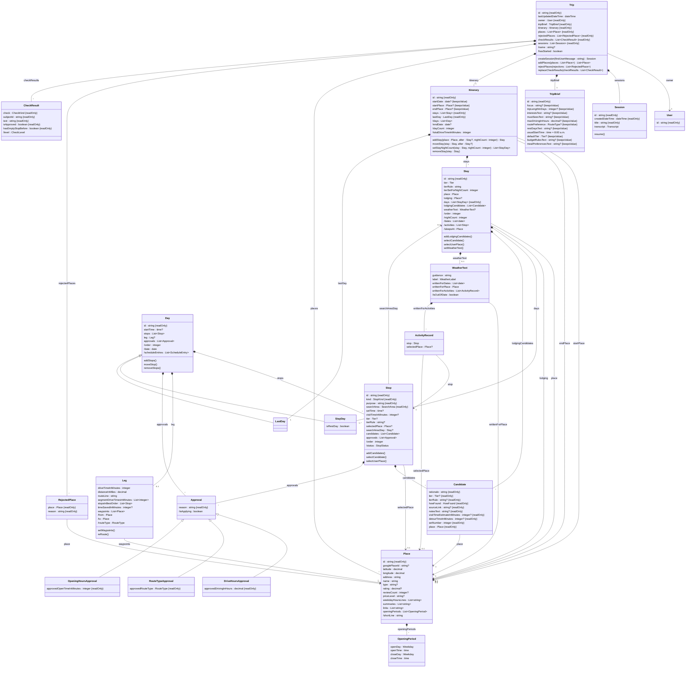

# Road Trip Planner: Domain Model (MVP)

This document lists the objects in the trip planner, such as trip, stay, day, and stop. For each one it gives its properties, how it relates to the others, the operations on it, and the rules that always hold. It stays at the level of design. It has no code types and no database tables. Those come from the code during development. It's kept by hand, and when development finds something it needs, it goes here.

For the planning behavior, see the [functional spec](functional-spec.md). For the agents, workers, and feasibility checks, see the [technical spec](technical-spec.md). For each tool's inputs, see the [tool design](tool-design.md).

**Left out on purpose:**

- **Memory.** Memory design is technical spec open question 5. Memory joins this model once it's designed.
- **Worker briefs and option cards.** Neither is stored. A worker brief is written fresh for each worker call (technical spec 5.3). An option card is how the UI shows the newest candidate set of one stop or stay (functional spec 7.5). The rules they depend on, such as which candidate set a card shows, are on the objects here.

**Draft status.** The Trip, Trip brief, Check result, and Itinerary are written so far. The diagram shows the other objects as technical spec section 3 has them, and each gets its own section as it's reviewed. Their operations are a first placement, settled when each object is reviewed. `ScheduleEntry`, and the split of `Day` into `StayDay` and `LastDay`, are defined when the Day is reviewed.

---

## 1. How to read this

**Names.** Classes are in PascalCase, such as `TripBrief`. Properties and operations are in camelCase, such as `startDate` and `rejectPlaces()`. Names have no spaces or dashes. Property names follow these rules:

- **A plural name means a list, and every list has a plural name,** such as `stops` or `scheduleEntries`.
- **A count ends in `Count`,** such as `nightCount` or `reviewCount`.
- **A measure ends in `In` and its unit,** such as `tripLengthInDays`, `visitTimeInMinutes`, or `distanceInMiles`. A plural unit doesn't make the name plural.
- **Text about several things ends in `Text`,** such as `mustSeesText` or `notesText`. It's one string in the user's or an agent's words, not a list, because only the agents read it. Other text has a plain singular name, such as `purpose` or `rationale`.
- **A yes-or-no property starts with `is` or `has`,** such as `isRestDay`.

**Stored or worked out.** A stored property is saved. A worked-out property is looked up from other stored data when it's read, and never saved. Examples: a stay's nights, a day's date, and a leg's from and to. Storing these would add a second copy that can go stale. Values that need a call to an outside service, such as a leg's drive time, are different. They're computed once and stored. In the diagram, a worked-out property starts with a slash, such as `/nightCount`.

**Types.** Each property gives the type of value it holds:

| Type | Holds | Example |
|---|---|---|
| `string` | Text | A stop's `purpose`, "dessert" |
| `integer` | A whole number | A candidate's `setNumber`, 0 |
| `decimal` | A number that can have a fraction | A place's `rating`, 4.6 |
| `boolean` | Yes or no | A day's `isRestDay` |
| `date` | A calendar date, with no time | The itinerary's `startDate`, May 13, 2027 |
| `time` | A time of day, with no date | A stop's `setTime`, 7:00 p.m. |
| `dateTime` | A date and a time together | A trip's `lastUpdatedDateTime` |
| An enumeration, such as `Tier` | One value from a fixed list. The second diagram in section 2 lists them | `value`, `midRange`, or `posh` |
| A class name, such as `Place` | A link to one object of that class | A worked-out leg's `from` |
| `List<X>` | A list of X. The notes say whether it's in order | `List<date>` for a stay's `dates` |

A `?` after the type means the property can be empty, such as `setTime : time?`. The notes say what empty means. Example: a stop's `setTime` is empty when the stop follows the one before it.

A value after `=` is the property's default, the value it has when its object is created, such as `usualStartTime : time = 8:00 a.m.`

**How an object is held.** An object with an `id` is an **entity**. The `id` is one we create (technical spec 7.1). An object with no `id` is **held by** the one object whose property holds it, such as a leg held by its day's `leg`. It exists only inside that object and goes away with it. An entity can be held too: a day holds its `stops`, and they go away with it. IDs from outside sources, such as Google's place ID, are ordinary properties.

**Order.** A list in order stores the order. An item's number is its position in that list, worked out when read. Numbers start at 0. The UI counts from 1 for people, so the day stored as 0 shows as Day 1. The examples use the people-facing labels.

**Who creates and changes it.** The coordinator, a worker, code, or the app itself, outside any agent. Each object says which.

**What this model holds.** The rules about the objects themselves. It isn't all of the app's logic. Code built on top of it adds more, and the agents' tools sit above that. One tool can use several operations here, or set properties directly.

**Rules live on the objects, not in the tools.** The agents' tools are only one way to change the data. A later version might let the user edit the trip brief in a web form. So every rule beyond a property's type is enforced by the object that holds the data, when the property is set or an operation runs. Example: the trip brief refuses a trip length over the maximum itself, so a web form can't get around the limit. A tool can add its own checks on what an agent passes in, but it never holds a rule about the data.

**Setting properties.** A stored property can be set directly, unless it's marked `{readOnly}`. The value has to fit its type and the property's own rules, such as a range. Setting the property runs those rules, and refuses a value that breaks one. The properties table and the object's rules say what they are. How code runs them, such as with a setter, is settled during development. Worked-out properties can't be set.

**Two markers** go after a property's type. In the diagram's source, each is written with `#123;` and `#125;` for the braces, because Mermaid can't take braces there.

- **`{readOnly}`:** the property can't be set directly. Either it never changes once its object exists, such as a stop's `kind`, or it changes only through an operation, which its notes name. Example: the trip's `checkResults` changes only through `replaceCheckResults()`. Reading a read-only list gives a copy that can't be changed, frozen where the language allows. So changing the copy can never change the stored list.
- **`{keepsValue}`:** the property starts empty, and can't be emptied once it has a value. Setting it to empty is refused. Example: the itinerary's `startPlace`.

In the properties tables, the type says "read only" or "keeps its value" instead.

**Operations** are listed only for a change that goes beyond setting one property: one that creates or removes objects, changes a list, or has to change other stored data with it. An operation sits on the object whose property it changes, and is named for what it changes, such as `Trip.addPlaces()`. When a rule covers more than that one object, the operation sits on the object that holds them all, so it can check the rule. Example: `Itinerary.setStayNightCount()` changes one stay's days, but the trip length limit covers every stay. An object never creates itself. Code outside it does, or the object that holds it, such as `Trip.createSession()`. For each one, the object's section says what it changes, what follows on from it, and what it refuses.

**Arguments and returns.** Each operation gives its arguments and what it returns, such as `addPlaces(places : List<Place>) : List<Place>`. An argument that can be empty has a `?` after its type. An operation with nothing after its parentheses returns nothing. These are guidance for development. Development can change them, but each change is flagged and written back here.

**At the end of every write.** Some follow-ons come from a whole write, not from one property. A write is one set of changes saved together. Code runs these once, at the end of every write that isn't refused:

- **Re-route legs.** Every leg whose start, end, selected places in order, or waypoints differ from before the write is re-routed (technical spec 3.5).
- **Check results.** When a write runs the checks, the `FeasibilityChecker` works out the current check results, compares them with the trip's saved list, and replaces the list (see Trip). Only the coordinator's writes run the checks. A worker's write doesn't (technical spec section 8).
- **Last updated.** The trip's `lastUpdatedDateTime` is set to now.

A write to a started trip is refused before anything changes (see Trip).

---

## 2. Class diagram

The diagram shows only classes that hold stored data. Classes that only do work, such as the `FeasibilityChecker`, are described in the text.

How to read the lines: a filled diamond means the object at that end holds the other one, which goes away with it. An arrow means the object points to another one it doesn't hold. An open triangle means the object below is one kind of the object above. The label on a line is the property, in the box at the line's start, that holds the link. The numbers say how many: `1` is exactly one, `0..1` is zero or one, `*` is any number, and `1..*` is one or more. Operations end in `()`.

The fixed lists that properties above use:

---

## 3. Objects

### 3.1 Trip

The trip is one planned road trip. Everything else in this model belongs to a trip, except the user.

**Held as:** an entity. Its `id` is one we create. It has the prefix `trip_` (technical spec 7.1). Agents never see it: each session's tools are made with the trip already set, so no tool takes a trip ID (tool design section 4).

**Created and changed by:** the app creates it when the user starts a new conversation from the home screen (functional spec 10.1), and creates its sessions. The coordinator rejects places. Code adds its places, replaces its check results, and sets when it was last updated. Everything else changes through the objects it holds.

| Property | Stored or worked out | Type | Notes |
|---|---|---|---|
| `id` | Stored | `string`, read only | Never shown to agents or users |
| `owner` | Stored | `User`, read only | Set when the trip is created. A user holds nothing else in this model yet: sign-in details are settled during development, and memory is left out |
| `tripBrief` | Stored | `TripBrief`, an entity held by the trip, read only | Created with the trip, empty except for its usual start time |
| `itinerary` | Stored | `Itinerary`, an entity held by the trip, read only | Created holding only its last day |
| `places` | Stored | `List<Place>`, in no order, read only | Every place a tool has returned for this trip, including search results never offered. Each is stored once. Only `addPlaces()` adds to it, and nothing removes from it |
| `rejectedPlaces` | Stored | `List<RejectedPlace>`, in the order rejected, read only | Only `rejectPlaces()` adds to it, and nothing removes from it: taking a rejection back is out of scope (functional spec 2) |
| `checkResults` | Stored | `List<CheckResult>`, in no order, read only | The check results that applied after the last coordinator write. Only replaced as a whole, never added to. See `replaceCheckResults()` |
| `sessions` | Stored | `List<Session>`, in the order created, read only | Only `createSession()` adds to it, and nothing removes from it. See Session, below |
| `lastUpdatedDateTime` | Stored | `dateTime` | Set at the end of every write. See below |
| `name` | Worked out | `string?` | The trip brief's `focus` and the start month, such as "Pacific Coast Highway, May 2027." See below |
| `hasStarted` | Worked out | `boolean` | True when today's date is on or after the itinerary's `startDate`. False while the itinerary has no `startDate`. Today's date is looked up when needed, in the start place's time zone (see Rules) |

**RejectedPlace.** Held by the trip, with no `id` of its own. It holds `place : Place` and `reason : string`, both read only. The reason is the user's, such as "too kitschy for us." The place itself stays in the trip's `places`, so the tool `find_place` can still return it, marked rejected with the reason (technical spec 3.2).

**`name`.** It's built from the trip brief's `focus` and the itinerary's start month, such as "Pacific Coast Highway, May 2027" (functional spec 10.1). While `focus` is empty, the name is empty, and the home screen shows "New trip." While the itinerary has no `startDate`, the name is `focus` alone. Renaming a trip isn't in the MVP.

**`lastUpdatedDateTime`.** Code sets it at the end of every write (section 1): to the trip brief, the itinerary, candidates, weather text, or rejected places. That includes worker writes. A refused write changes nothing, so it doesn't count. Neither does a read, or saving places from a search, since the plan doesn't change. The home screen shows it (functional spec 3).

**Session.** One conversation with the agent about this trip (functional spec 10.1). It's an entity held by the trip. Its `id` has the prefix `session_`, and agents never see it.

| Property | Stored or worked out | Type | Notes |
|---|---|---|---|
| `id` | Stored | `string`, read only | Never shown to agents or users |
| `createdDateTime` | Stored | `dateTime`, read only | The trip's session list shows its date |
| `title` | Stored | `string`, read only | A few words for the trip's session list. Set when the session is created, from the user's first message, cut to about 60 characters at a word break. Example: "Can we add a night in Big Sur and drop one in…" |
| `transcript` | Stored | `Transcript` | The conversation, restored when the user resumes the session. The Agent SDK may keep it, so its shape isn't part of this model |

A session is created and begins at the same moment, so it has no separate "start." It's never closed. The user just leaves, and can resume it later.

- **`resume()`.** The app runs it when the user picks a session from the trip's list. It restores the transcript, and the coordinator continues with that conversation's context. It works on a started trip too.

**A new trip** is created by code outside the trip, when the user starts a new conversation from the home screen. It starts with a trip brief that holds only its usual start time, an itinerary holding only its last day, and empty `places`, `rejectedPlaces`, and `checkResults`. Then `createSession()` creates its first session.

**Operations:**

- **`createSession(firstUserMessage : string) : Session`.** The app runs it when the user sends the first message of a new trip, or of a new session on a trip. It creates a session, sets its `title` from `firstUserMessage`, adds it to `sessions`, and returns it. The coordinator gets no earlier transcripts. It begins by reading the itinerary, the trip brief, and memory (technical spec 5.2). It works on a started trip too.
- **`rejectPlaces(rejections : List<RejectedPlace>)`** (the tool `reject_places`, used by the coordinator). Takes one or more rejections, each a place and the user's reason. It adds each one to `rejectedPlaces`. It removes the place from every stop's and stay's candidates. Where the place was selected, it clears the selection. A rejection undoes picks, meaning candidates and the selections made from them. It doesn't change the trip's structure.
  - **Follows on:** clearing a stop's selection clears its `visitTimeInMinutes` and removes its opening-hours approval. Clearing a stay's lodging means the party sleeps in the stay's town again. Every leg whose selected places, start, or end changed is re-routed (technical spec 3.5). A stay whose activities changed has its weather text marked out of date.
  - **Leaves alone:** the trip's structure, meaning a stay's town, the start and end places, and waypoints. None of them is picked from candidates. Changing them needs a conversation with the user, such as which days move when a stay's town goes, so the coordinator does that afterward. The rejection still keeps the place out of later searches and candidates.
  - **Already rejected:** a place already in `rejectedPlaces` is skipped without a word, like adding to a set. It keeps its first reason, and the new one is dropped.
  - **Refused:** the whole call, when a place isn't in this trip or a reason is missing.
- **`addPlaces(places : List<Place>) : List<Place>`** (code, whenever a search or lookup returns places). Takes one or more places and adds each to `places`. A place the trip already has, matched by `googlePlaceId`, isn't added again: the stored record is reused (see Place). Returns the stored places in the order given, so the caller gets the existing record's `id` for a place the trip already had.
- **`replaceCheckResults(checkResults : List<CheckResult>)`** (the `FeasibilityChecker`, at the end of every write that runs the checks). Takes the full list of current check results, which can be empty. Replaces the whole of `checkResults` in one step. Nothing can add to the list or remove one result from it. The trip only stores the list. Working out the results and comparing them with the saved list is the `FeasibilityChecker`'s job (see Check result).

**Rules:**

- **A trip belongs to one user.** Only that user, and the agents in that user's sessions, can reach it (functional spec 10.4).
- **A started trip can't be changed.** Once `hasStarted` is true, every write to the trip is refused, and the error says the trip has started (technical spec section 8). That covers the trip brief, the itinerary, candidates, weather text, and rejected places. Reads still work, sessions can still be created and resumed, and searches can still save places, since none of them changes the plan.
- **Today's date is the date in the start place's time zone,** since that's where the trip begins. It isn't a property of the trip. Code looks it up when a rule needs it. The start-date check, the started-trip lock, and the forecast rules all use it (technical spec 5.2).
- **All of a trip's times are in the start place's time zone.** A trip that crosses into another time zone shows times off by the difference after the border. That's a known limit of this version.
- **The trip brief holds what the user wants. The itinerary holds the plan.** No fact is stored in both. Changing the brief never changes the itinerary. The checks compare them, and the coordinator changes the plan with the user (technical spec 3.1).
- **Places are kept per trip.** A place found for one trip, such as a friend's address, is never visible from another trip (functional spec 10.4).

### 3.2 Trip brief

The trip brief holds what the user wants from the trip: the items in functional spec 5.2. The itinerary holds the plan, and the checks compare the two (see Trip).

**Held as:** an entity held by the trip. Its `id` has the prefix `brief_` (technical spec 7.1). Agents never see it: a trip has one brief, so the tools find it from the trip.

**Created and changed by:** the app creates it with the trip, empty except for `usualStartTime`. Each item is set directly. Today only the coordinator sets them, through the tool `update_trip_brief`. Workers never read it. Each gets the parts it needs in its worker brief (technical spec 5.3).

| Property | Stored or worked out | Type | Notes |
|---|---|---|---|
| `id` | Stored | `string`, read only | Never shown to agents or users |
| `focus` | Stored | `string?`, keeps its value | What the trip is about: a region, a route, or a theme, such as "Pacific Coast Highway" or "Texas barbecue." The trip's `name` starts with it |
| `tripLengthInDays` | Stored | `integer?`, keeps its value | How many days the user wants. From 1 to the maximum trip length (see Rules). The trip length check compares the itinerary's `dayCount` with it |
| `interestsText` | Stored | `string?`, keeps its value | In the user's words, with why they matter |
| `mustSeesText` | Stored | `string?`, keeps its value | In the user's words, with why they matter. A must-see can be one place, an area, a road, or an activity. It records no kind and links to no place. A must-see that is one place is linked through the stop the coordinator selects for it |
| `maxDrivingInHours` | Stored | `decimal?`, keeps its value | The most driving the user wants in one day. More than 0, and at most the maximum daily driving (see Rules). The daily driving check compares each day with it. It's a default, not a hard limit: a day can go over it with a drive hours approval |
| `routePreference` | Stored | `RouteType?`, keeps its value | Scenic or fastest. Each leg's route type, unless its day holds a route type approval (see Leg) |
| `restDaysText` | Stored | `string?`, keeps its value | In the user's words, such as "one day off in Moab." The coordinator decides which days, and marks them on the days |
| `usualStartTime` | Stored | `time`, 8:00 a.m. by default | When the party usually gets going. A day without a start time of its own starts at this time |
| `defaultTier` | Stored | `Tier?`, keeps its value | The tier for lodging and meals when no budget rule covers them. The coordinator reads it when it resolves each stay's and meal stop's tier (technical spec section 9). Code doesn't read it |
| `budgetRulesText` | Stored | `string?`, keeps its value | In the user's words, such as "mid-range for stays of 2+ nights" |
| `mealPreferencesText` | Stored | `string?`, keeps its value | In the user's words, such as "local cafés over hotel breakfast" |

**Required items can still be empty.** Functional spec 5.2 marks most items as required. That means the coordinator establishes each one during discovery. It doesn't mean the brief refuses to be empty while discovery is still going.

**Code reads only a few items.** It reads `focus` for the trip's name, and `tripLengthInDays`, `maxDrivingInHours`, `routePreference`, and `usualStartTime` for the checks and the schedule. Only the agents read the rest. That's why each text item is one string, not a list.

**Operations:** none. Each item is set directly, and its own rules run when it's set. When the tool `update_trip_brief` sets several items in one write and one is refused, the whole write is refused, and nothing changes. The error names the item and the rule.

**Rules:**

- **An item can be changed, but never emptied** (functional spec 10.5: trip brief items can be changed but not forgotten). Every item but `usualStartTime` is `{keepsValue}`, and `usualStartTime` is never empty. The coordinator needs every item it has to plan.
- **`tripLengthInDays` is from 1 to the maximum trip length.** That's a setting, which starts at 14 days (technical spec section 10). The itinerary has the same limit. A longer trip is refused. The coordinator explains the limit and offers a trip of the maximum length (functional spec 6.1).
- **`maxDrivingInHours` is more than 0, and at most the maximum daily driving.** That's a setting, which starts at 12 hours (technical spec section 10).
- **A check that compares against an empty item is skipped** (technical spec section 8). Example: during discovery, setting the start and end places routes the last day's leg before the user has given max driving hours, so the daily driving check doesn't run yet.
- **Changing the brief never changes the itinerary** (see Trip). Example: if the user shortens the trip from five days to four, nothing in the itinerary moves. The trip length check warns, and the coordinator removes a night with the user.

### 3.3 Check result

A check result is one finding from the feasibility checks in technical spec section 8, such as a day that drives longer than the user's max. Each one is a warning or a note. A check that refuses a write, such as a trip over the maximum length, gives an error, not a check result.

**Held as:** held by the trip's `checkResults`, with no `id`. That list holds the check results that applied after the last coordinator write. It's kept only so later writes and reads can tell which check results are new.

**Created and changed by:** the `FeasibilityChecker`, in code. A saved check result never changes. The whole list is replaced instead (`Trip.replaceCheckResults()`).

| Property | Stored or worked out | Type | Notes |
|---|---|---|---|
| `check` | Stored | `CheckKind`, read only | Which check found it. Each kind is one row of the table in technical spec section 8 |
| `subjectId` | Stored | `string`, read only | The ID of what it's about: the trip, a stay, a day, or a stop. It's an ID, not a link, because a write can remove the stop or stay before the compare runs (below) |
| `text` | Stored | `string`, read only | What the check found, such as "Day 4 needs about 5 h 20 m of driving. You agreed to 5." A current check result always has current text. The saved text is used only to describe a check result that went away |
| `isApproved` | Stored | `boolean`, read only | True when an approval that covers it applies (see Approval). Always false for a check no approval covers |
| `hasEmptyStopBefore` | Stored | `boolean`, read only | For the opening-hours checks only: true when an earlier stop on the same day is still empty, so the time checked may be too early (technical spec section 8). False for every other check |
| `level` | Worked out | `CheckLevel` | Warning or note. It comes from `check`, in the table below |

**The checks.** Each `CheckKind` has one level and one kind of subject:

| `check` | Technical spec section 8 row | Level | About | Approval that covers it |
|---|---|---|---|---|
| `tripLengthVsBrief` | Trip length vs the brief | Warning | The trip | None |
| `dailyDriving` | Daily driving | Warning | A day | Drive hours |
| `openingHoursNotLongEnough` | Opening hours: open, but not long enough | Warning | A stop | Opening hours |
| `openingHoursClosed` | Opening hours: closed for the whole visit | Warning | A stop | Opening hours |
| `openingHoursNotKnown` | Opening hours: not known | Note | A stop | None |
| `lateForSetTime` | Late for a set time | Warning | A stop | None |
| `stopOrder` | Stop order | Note | A day | None |
| `searchAreaDoesNotFitDay` | Search area doesn't fit the day | Warning | A stop | None |
| `weatherOutOfDate` | Weather out of date | Note | A stay | None |
| `forecastNowAvailable` | Forecast now available | Note | A stay | None |
| `stayTierSetForDifferentNights` | Stay tier set for different nights | Note | A stay | None |

**The `FeasibilityChecker`.** A class that only does work, so it isn't in the diagram. Its operations:

- **`workOut(trip : Trip) : List<CheckResult>`.** Runs every check in technical spec section 8 over the whole trip, and returns the check results that apply now. It saves nothing. A check that compares against an empty trip brief item is skipped. `forecastNowAvailable` is skipped once the trip has started, since nothing can be rewritten then.
- **`compare(current : List<CheckResult>, saved : List<CheckResult>) : CheckComparison`.** Matches the current check results with the saved ones. Two check results match when they have the same `check` and the same `subjectId`, whatever their text says. It returns three lists, which aren't stored:
  - **New:** a current check result with no match. Also one whose match was approved and that isn't approved now.
  - **Already known:** every other current check result.
  - **Gone:** a saved check result with no current match. Its saved `text` describes it, since its subject may no longer exist.

**When it runs.** At the end of every coordinator write, code runs `workOut()`, compares the result with the trip's `checkResults`, and then saves the current list with `Trip.replaceCheckResults()`. A worker's write runs none of this. A read runs `workOut()` and `compare()`, but saves nothing. Which check results a tool's reply includes is a rule of the tools, not of this model (tool design 2.1, and technical spec section 8).

**Rules:**

- **At most one check result per check and subject.** Example: a stop can have an `openingHoursClosed` result and a `lateForSetTime` result, but not two of either.
- **A warning whose approval stops applying is new.** Example: Moab Day 4 is approved for 5 hours of driving. A change makes it 5 hours 20 minutes. The approval no longer applies, so the daily driving warning is new, and the coordinator asks the user again.
- **A check result that goes away and comes back is new.** The write where it went away saved the list without it. If a day that was fixed goes over its driving hours again, the user should hear about it.
- **Only the coordinator's writes save the list.** A worker can't act on a check result. One saved during a worker's write would be marked already known without ever reaching the coordinator.

### 3.4 Itinerary

The itinerary is the plan: where the trip starts and ends, when it starts, its stays, and its days.

**Held as:** an entity held by the trip. Its `id` has the prefix `itin_` (technical spec 7.1). Agents never see it: a trip has one itinerary, so the tools find it from the trip.

**Created and changed by:** the app creates it with the trip, and code creates its last day at the same time. The coordinator sets the start place, end place, and start date, with the tool `update_itinerary`. It adds, moves, and removes stays, and sets their nights, with the tools `add_stay`, `update_stay`, and `remove_stay`. Code adds and removes a stay's days as its nights change. Nothing else adds or removes a day.

| Property | Stored or worked out | Type | Notes |
|---|---|---|---|
| `id` | Stored | `string`, read only | Never shown to agents or users |
| `startPlace` | Stored | `Place?`, keeps its value | Where the trip starts. Empty until the coordinator sets it during discovery. See below |
| `endPlace` | Stored | `Place?`, keeps its value | Where the trip ends. The same place as `startPlace` on a loop trip. Empty until the coordinator sets it during discovery. See below |
| `startDate` | Stored | `date?`, keeps its value | The first day's date. Empty until the coordinator sets it during discovery. See below |
| `stays` | Stored | `List<Stay>`, in order, read only | The shape of the trip. Each stay is an entity held by the itinerary, and holds its own days. Changes only through `addStay()`, `moveStay()`, and `removeStay()` |
| `lastDay` | Stored | `LastDay`, an entity held by the itinerary, read only | Created with the itinerary. Never replaced or removed |
| `days` | Worked out | `List<Day>`, in order | The calendar: each stay's days, in the stays' order, then `lastDay`. A day's date and number come from its place in this list |
| `endDate` | Worked out | `date?` | The last day's date: `startDate` plus `dayCount` minus one day. Empty while there's no `startDate` |
| `dayCount` | Worked out | `integer` | How many days the trip has, counting the last day. This is the trip's length. From 1 to the maximum trip length (see Rules) |
| `totalDriveTimeInMinutes` | Worked out | `integer` | The sum of every leg's `driveTimeInMinutes`, without the drive buffer. The trip summary shows it (functional spec 9.1). A leg with no route yet adds nothing |

**Stays hold their days.** Each stay holds the days that end with a night there, so a stay's nights are the days it holds (functional spec 4, Night). The last day ends at the end place with no night, so the itinerary holds it on its own (functional spec 4, Last day). The stays are the shape of the trip, and are what the user and coordinator change. `days` puts all the days together as the calendar.

A day touches two stays: it starts where the party slept and ends where it sleeps. It's held by the stay where it sleeps. Where it starts is worked out from the day before in `days` (see Day). Example: San Francisco Day 2 is held by the San Luis Obispo stay, and starts from the Monterey stay. A stop on Day 2 can still be near the Monterey stay, such as breakfast before the drive. That's a link from the stop to the stay, not ownership (see Stop).

**Total drive time leaves out the buffer.** It adds up the drive times Google gave, the same figure each leg shows (functional spec 9.4). The buffer for fuel and short breaks is part of the daily driving check and the day's schedule, where it spaces out the times (technical spec section 8).

**Start and end places.** Each is set directly, and can't be emptied once set. When Google has no name for the place, such as "Mike's house," the place takes the name the coordinator gives it (see Place). A new start or end place re-routes the first or last day's leg at the end of the write. Stops near the start or end place keep their candidates and selection. Nothing checks that a place is in the contiguous US (functional spec 1). That check is hard to do well at this level, so the risk is accepted. The coordinator keeps the trip in the US.

**Start date.** Set directly, and can't be emptied once set. A new start date moves every day's date, since dates are worked out. Nothing is re-routed. The checks at the end of the write see the new dates, such as a stop that now falls on a day its place is closed. Setting it is refused:

- **While `startPlace` is empty,** since today's date comes from the start place's time zone. When the tool `update_itinerary` gets a start place and a start date in one call, it sets the place first.
- **When the date isn't after today.**

**Operations:**

- **`addStay(place : Place, after : Stay?, nightCount : integer) : Stay`** (the tool `add_stay`). Creates a stay in `place`, holding `nightCount` new days, and puts it after the stay `after`, or first when `after` is empty. Returns the new stay. The tool then sets the stay's tier with `Stay.setTier()` in the same write, which records the nights it was set for (see Stay). A stay always has a tier once the write ends.
  - **Follows on:** every later day moves back, and keeps its ID. Every leg whose start or end changed is re-routed at the end of the write.
  - **Refused:** until the itinerary has a `startPlace`, an `endPlace`, and a `startDate` (technical spec 4.2). Also refused when `nightCount` is less than 1, or when the trip would be longer than the maximum trip length.
- **`moveStay(stay : Stay, after : Stay?)`** (the tool `update_stay`). Moves the stay to after the stay `after`, or first when `after` is empty. Its days move with it, since the stay holds them, with their stops, rest-day marks, start times, and approvals.
  - **Follows on:** every leg whose start or end changed is re-routed at the end of the write. A day keeps its stops, but where it starts or ends can change. The tool lists those stops for the coordinator (technical spec 3.5).
  - **Refused:** when `after` is the stay itself.
- **`setStayNightCount(stay : Stay, nightCount : integer) : List<StayDay>`** (the tool `update_stay`). Adds or removes days at the end of the stay's days until it has `nightCount` of them. It sits on the itinerary, not the stay, because the trip length limit covers every stay (section 1). A new day isn't a rest day, and has no start time, stops, or approvals. A removed day goes with its leg and approvals. Returns the days added, or an empty list when nights were removed.
  - **Follows on:** every later day moves, and keeps its ID. Every leg whose start or end changed is re-routed at the end of the write. The stay's tier still records the nights it was set for, so the checks add a note when they differ (see Stay).
  - **Refused:** when `nightCount` is less than 1. Removing a stay's last night means removing the stay. Also refused when the trip would be longer than the maximum trip length, and when a day it would remove holds stops. The refusal lists those stops.
- **`removeStay(stay : Stay)`** (the tool `remove_stay`). Removes the stay, which takes its days, lodging candidates, and weather text with it. The places stay in the trip's `places`.
  - **Follows on:** the next day now starts from the stay before, or from the start place, and its leg is re-routed at the end of the write.
  - **Refused:** while any stop is on the stay's days, or while any stop anywhere has the stay as its search area. The refusal lists those stops by name and ID. Code never removes a stop the coordinator didn't name. The coordinator asks the user what to do with each one, then moves or removes it (technical spec 3.5).

**Rules:**

- **Every stay holds at least one day,** so it has at least one night.
- **A trip is from 1 day to the maximum trip length.** That's a setting, which starts at 14 days (technical spec section 10). Any write that would make it longer is refused, and the error gives the limit (technical spec section 8).
- **The last day is created with the itinerary and never removed.** It has no stay: the party drives to the end place and doesn't sleep anywhere on the trip. A day trip is just the last day. Example: on the San Francisco trip, the Monterey stay holds Day 1, the San Luis Obispo stay holds Day 2, and Day 3 is the last day.
- **A day keeps its ID when its number or date changes.** Removing a night removes that stay's last day. Every later day keeps its ID and moves up one. Check results match by their subject's ID, and approvals sit on days, so both depend on this.
- **The start date is after today when it's set.** Once today reaches it, the trip has started and can't change (see Trip).
