# Road Trip Planner: Persistence (MVP)

This document covers how a trip, its sessions, and memory are stored and saved: what is stored together, what a write does with storage, how two writes to one trip are kept apart, how the started-trip lock is checked at save, how sessions and their transcripts are kept, how memory is kept, and which classes do each of these. It stays at the level of design. The database library and the migration tool are in section 1. The table layout and indexes are settled during development.

What a write is, and what it changes, is in the [domain model](domain-model.md), section 1, "A write." This document adds what a write does with storage. What memory holds, and the rules for writing it, are in the [technical spec](technical-spec.md), section 3.1.

---

## 1. Storage

**One Postgres database holds everything:** trips, their places, their sessions, the session transcripts, and memory.

- **Not in the app's memory.** The app runs in a container that can restart at any time ([Google design](data-sources/google.md), section 5). Anything held only in memory goes with it. It also wouldn't work across more than one copy of the app.
- **Not in object storage.** S3-style object storage, DigitalOcean Spaces, holds only the nightly backups ([systems design](systems.md), section 9). It suits large files written once. Transcripts are the opposite: many small additions, read back in order (section 6). Object storage can't add to a file that already exists, so each addition would be its own small file. One store is also simpler to run and back up.
- **Settings aren't in the database.** They're in a config file the app loads when it starts ([technical spec](technical-spec.md), section 10).

**The app sends SQL to Postgres with node-postgres (`pg`).** There's no ORM: most of a trip is one JSON document (section 2), so mapping classes to tables would be code for nothing. Rows read back are parsed with Zod ([DEVELOPMENT.md](../DEVELOPMENT.md), section 4). Every value goes into a query as a parameter, such as `$1`, never joined into the SQL text.

**Migrations are SQL files in `migrations/`, run by node-pg-migrate.** `npm run migrate` runs the new ones locally. A deploy runs them from the new `app` image ([systems design](systems.md), section 7). node-pg-migrate records each one in the `pgmigrations` table, and holds a lock while it runs, so two runs can't overlap. Migrations only go forward: a bad one is fixed by a new one.

The options compared for both are in [research/server-libraries.md](../research/server-libraries.md).

---

## 2. What is stored together

A trip is stored in four kinds of record:

| Record | Holds | One for each |
|---|---|---|
| Trip | The trip's `id` and owner, and the **plan**: one JSON document holding the trip brief, the itinerary with everything it holds, including its rejected places and check results, and last updated | Trip |
| Place | One place: its `id`, its trip, and its properties (domain model 3.10) | Place, per trip |
| Session | One session: its `id`, its trip, when it was created, its title, and the Agent SDK's ID for it (section 6) | Session |
| Transcript line | One line of a session's transcript, as the Agent SDK wrote it | Line |

**The plan is one document,** because a write always loads it whole and saves it whole (domain model section 1). Mapping each of the domain model's classes to its own table would be mostly code, with nothing for the agents.

- **An object with no `id`,** such as a leg, a candidate, or an approval, is stored inside the object that holds it.
- **A link is stored as an ID,** such as a stop's selected place, or a stop's search-area stay. The load turns each ID back into a link.
- **A time of day is stored as text,** "HH:MM" on a 24-hour clock, such as "13:00" for a trip brief's `usualStartTime`. It's the domain model's `time` type (domain model section 1). The load parses it back into a time of day.
- **The home screen reads the plan document too.** It shows each trip's name, dates, and last updated (functional spec 3). `listForOwner()` loads the user's trips, and each value comes from the `Trip`. The trip row has no extra columns for them. The name and dates are worked out from the brief and the itinerary, so a column would be a second copy that can go stale. A user has only a few trips, so loading each one whole costs little. If it ever gets slow, the query can read just those fields from the document.

**Places and sessions are stored apart from the plan.** Neither is part of the plan, and neither goes through a write. A trip can also have hundreds of places, and saving places from a search shouldn't wait for the plan (section 4).

**Places are kept per trip.** The database refuses a second place with the same trip and Google place ID, which holds "one record per trip for each Google place" (domain model 3.10). Two reasons a place isn't shared across trips or users:

- **Its name can come from the user.** When Google has no name for a place, the first name an agent gives fills it in, such as "Mike's house" for an address. Shared, another user who looked up that address would see "Mike's house." That breaks isolation between users (functional spec 10.4).
- **Its facts are a snapshot.** A place keeps Google's facts from its first lookup (domain model 3.10). Shared, a trip planned next year would get the hours and rating saved for another trip this year. Per trip, each trip starts fresh.

Sharing Google's facts across trips while keeping the name per trip would work, but it adds code and saves only a few Google calls. It isn't in the MVP.

**Memory items are stored apart from the plan,** one row each (section 8.8). User memory belongs to a user, not to any trip. Trip memory belongs to a trip, but it isn't part of the plan. So changing memory isn't a write, and takes no row lock (section 4). A memory change and a write to the plan can't lose each other's work, since they save different rows.

---

## 3. A write

A write runs the four steps in domain model section 1 inside one database transaction:

1. **Load.** Open a transaction and load the trip's row with a row lock (section 4). Then load its places.
2. **Change** the trip, with the services and the objects' operations.
3. **Finish** the write: legs, then check results, then last updated.
4. **Save.** Check the started-trip lock (section 5). Save the plan, and any place whose name was filled in. Commit.

**A refusal rolls the transaction back,** so nothing is saved. That includes a failed call to Google during the finish. **A restart in the middle of a write** does the same: Postgres sees the connection drop and rolls it back. Either way, storage still holds the trip as it was.

**Each write loads the trip fresh.** The rules always run against the newest saved trip, even when the coordinator's context is out of date, such as when another session changed the trip.

**Saving places from a search** doesn't load or save the plan. Each place is added as a row. When the trip already has a row for that Google place, the row is kept as it is, and the new facts are dropped (domain model 3.10, and section 8.6). The stored places come back in the order given. This takes no row lock, since adding rows can't lose another write's work. When two searches find the same place at once, the database keeps one row, and both get its `id`.

**A read** loads the trip without the row lock, and saves nothing. It never waits for a write. It sees the trip as of the last write that committed.

---

## 4. Two writes to one trip

**The problem.** Several workers can write to one trip at once (tool design section 4). So can two sessions of one trip, though having two open at once isn't supported (functional spec 10.1). If two writes each load the plan and save it whole, the second save loses the first one's work. Example: the Moab and Torrey stay researchers run in parallel. Each loads the plan and adds its lodging set. Torrey's save overwrites the plan holding Moab's new set.

**Writes to one trip take turns.** Each write loads the trip's row "for update," which takes a row lock in Postgres. A second write to the same trip waits at its load until the first commits or rolls back. Then it loads the trip with the first write's changes. Writes to other trips don't wait.

- **It survives a restart.** When the container dies, Postgres rolls back the write in progress and releases its lock.
- **It works with more than one copy of the app,** since the lock is in the database, not in the app.
- **The cost is waiting.** A write holds the lock through its Google calls, such as a re-route at the finish, or a leg scout's detour times (domain model 4.7). That's a few seconds at most. Saving places from a search takes no lock, so workers' searches never wait.
- **A write waits 5 seconds for the lock, and tries 3 times.** When the lock isn't free within 5 seconds, the load gives up, and `TripWriter` tries the whole write again after a 1-second pause. After the third try, the write is refused, and the error says the trip is busy. That's about 17 seconds in all. One write ahead holds the lock a few seconds at most, so 5 seconds covers it, and 3 tries cover a few workers waiting in line. Trying again is safe, since the lock is taken at the load, before anything changes. No agent has to understand the lock. The three numbers are constants in the code, not settings, since they aren't about planning.
- **Every Google call during a write has a timeout,** so a call that hangs can't hold the lock for long. A call that times out refuses the write, like any failed call (domain model 4.7).

**Turned down:** saving only if nothing changed since the load. The trip would keep a version number, and code would rerun the tool call when someone else saved first. Workers wouldn't wait, but a conflict would repeat its Google calls, and the retry is more code. Conflicts are rare in the MVP, so waiting costs little.

---

## 5. The started-trip lock at save

A started trip can't be changed (domain model 3.1). `TripWriter` refuses a write to a started trip right after loading it, before anything changes (section 8.2). The save checks again. That catches a trip that starts during a write, at midnight, and any later way in, such as a web form.

**Persistence refuses to save the plan of a started trip.** The whole write is rolled back, and the error says the trip has started, with today's date as it was worked out. Place rows and session rows always save, since neither changes the plan.

**It checks the trip as it was loaded,** under the row lock. A write could have changed the start date, so the changed trip can't tell whether the trip had started (section 8.4).

**Example.** The Moab trip starts October 10, 2027. At 11:59 p.m. on October 9, the user asks to swap the Day 2 dinner. The write loads the trip before midnight and reaches the save just after, so the save refuses it. From then on the chat is closed, so no new session or write can come in (functional spec 2).

**Trip memory is refused on a started trip too,** like the plan. User memory isn't, since it isn't about that trip. `MemoryWriter` checks right before it saves a trip item (section 8.8).

**Today's date** is in the start place's time zone (domain model 3.1). Code works out the time zone from the start place's coordinates, with a lookup in code. It needs no call to Google, and nothing new is stored.

---

## 6. Sessions and transcripts

**A session row** holds the session's `id`, its trip, `createdDateTime`, `title`, and `agentSessionId`: the Agent SDK's ID for the conversation (section 8.5). The app chooses that ID, a UUID, when it creates the session, and passes it to the SDK. So it's known before the first message. Creating a session adds a row. It takes no row lock and doesn't touch the plan, so it works on a started trip.

**The Agent SDK keeps the transcript.** On its own, the SDK writes each session's transcript to a file on local disk, one line per message, with each worker's transcript beside it. That disk goes when the container restarts, so the local file is only scratch space. The SDK's `sessionStore` option takes an adapter we write. The SDK sends it each transcript line, and on resume it asks the adapter for them back.

- **The adapter stores each line as a row,** under the session's `agentSessionId`, in the order the SDK sent them. A worker's transcript is stored under the same ID, marked with the worker's own key from the SDK.
- **Lines are sent as soon as they're written.** The SDK's "eager" setting does this. Its default sends them at the end of each turn, so a restart in the middle of a turn would lose the whole turn.
- **Resuming** asks the adapter for the session's lines, and the SDK continues the conversation from them (section 8.5).
- **Transcript lines are never changed or removed** in the MVP. Nothing deletes a trip or a session.
- **The SDK marks `sessionStore` as alpha,** meaning it may change. If it breaks, the fallback is to copy the local file to Postgres ourselves at the end of each turn, and write it back to disk before a resume.

Transcripts don't go through a write, and take no row lock.

---

## 7. What a restart leaves behind

When the container restarts in the middle of a turn:

- **Every write that committed stays.** The write in progress is rolled back (section 3).
- **The transcript loses at most its last line or two** (section 6).
- **The turn stops,** along with any workers it called. A worker's candidates saved before the restart stay, but the coordinator never hears about them. Example: the Moab Day 4 leg scout saves the Goblin Valley candidates, and the container restarts before the leg scout reports back. The candidates are in the plan, and the transcript doesn't mention them.

The user can resume the session. **A resumed coordinator reads the itinerary and memory again before changing anything** ([technical spec](technical-spec.md), 5.2). The app tells it the session was resumed (section 8.5). The same rule covers a session resumed after another session changed the trip.

---

## 8. The classes

This section names the classes that read and save a trip and its sessions, and what each one does. Like the domain model's operations, they're guidance for development: development can change them, but each change is flagged and written back here. They don't depend on the database library.

**Eight classes are the only way in.** Tools, the app, and any later web form use a writer and a reader for each kind of record: `TripWriter` and `TripReader`, `PlaceWriter` and `PlaceReader`, `SessionWriter` and `SessionReader`, and `MemoryWriter` and `MemoryReader`. The other classes are inside persistence, and nothing outside it can reach them. So no tool opens a transaction, takes the row lock, or saves a trip on its own.

### 8.1 Class diagram

```mermaid
classDiagram
    direction TB

    class TripWriter {
        write(tripId : string, by : WriteBy, change : Change) WriteResult~T~
        startTrip(owner : User) Trip
    }

    class TripReader {
        read(tripId : string) Trip
        listForOwner(owner : User) List~Trip~
    }

    class PlaceWriter {
        save(tripId : string, places : List~Place~) List~Place~
    }

    class PlaceReader {
        get(placeId : string) Place
    }

    class SessionWriter {
        start(tripId : string, firstMessage : string) Session
    }

    class SessionReader {
        listForTrip(tripId : string) List~Session~
        get(sessionId : string) Session
    }

    class MemoryWriter {
        add(userId : string, tripId : string?, text : string) MemoryItem
        update(userId : string, tripId : string, itemId : string, text : string) MemoryItem
        forget(userId : string, tripId : string, itemId : string)
    }

    class MemoryReader {
        read(userId : string, tripId : string) List~MemoryItem~
    }

    class MemoryItem {
        id : string #123;readOnly#125;
        userId : string #123;readOnly#125;
        tripId : string? #123;readOnly#125;
        text : string
        createdDateTime : dateTime #123;readOnly#125;
    }

    class Session {
        id : string #123;readOnly#125;
        tripId : string #123;readOnly#125;
        createdDateTime : dateTime #123;readOnly#125;
        title : string #123;readOnly#125;
        agentSessionId : string #123;readOnly#125;
    }

    class WriteResult~T~ {
        changeResult : T #123;readOnly#125;
        legChanges : List~LegChange~ #123;readOnly#125;
        checkComparison : CheckComparison? #123;readOnly#125;
    }

    class TripRepository {
        loadForWrite(tripId : string) EditableTrip
        load(tripId : string) Trip
        listForOwner(owner : User) List~Trip~
        add(trip : Trip)
        save(editableTrip : EditableTrip)
    }

    class EditableTrip {
        trip : Trip #123;readOnly#125;
        loadedStartDate : date? #123;readOnly#125;
        loadedStartPlace : Place? #123;readOnly#125;
        unnamedPlaceIds : List~string~ #123;readOnly#125;
        hasStarted() boolean
        placeOf(placeId : string) Place
    }

    class PlaceRepository {
        addPlaces(tripId : string, places : List~Place~) List~Place~
        loadForTrip(tripId : string) List~Place~
        get(placeId : string) Place
        fillNames(places : List~Place~)
    }

    class SessionRepository {
        add(session : Session)
        loadForTrip(tripId : string) List~Session~
        get(sessionId : string) Session
    }

    class MemoryRepository {
        add(item : MemoryItem)
        loadFor(userId : string, tripId : string) List~MemoryItem~
        get(itemId : string) MemoryItem
        save(item : MemoryItem)
        remove(itemId : string)
    }

    class TranscriptAdapter {
        <<SDK sessionStore>>
    }

    TripWriter ..> TripRepository
    TripWriter ..> WriteResult : creates
    TripReader ..> TripRepository
    TripRepository ..> PlaceRepository
    PlaceWriter ..> PlaceRepository
    PlaceReader ..> PlaceRepository
    SessionWriter ..> SessionRepository
    SessionReader ..> SessionRepository
    TripRepository ..> EditableTrip : creates
    MemoryWriter ..> MemoryRepository
    MemoryWriter ..> TripRepository
    MemoryReader ..> MemoryRepository
```

The arrows mean "uses." `Trip`, `Place`, `User`, `LegChange`, and `CheckComparison` are the domain model's. `Session` isn't part of the domain model: it's in section 8.5. Neither is `MemoryItem`: it's in section 8.8. `WriteResult` is in section 8.2.

The fixed list that the classes above use:

| Name | Values |
|---|---|
| `WriteBy` | `coordinator` `worker` |

### 8.2 TripWriter

`TripWriter` runs everything that saves. It opens each transaction, and creates the repositories it uses inside it, so every query in a write is part of the same transaction. It's created once, when the app starts.

- **`write(tripId, by, change)`** runs a write (section 3). `change` is a function the caller passes in. It takes the loaded trip, the trip's calendar and services, and `placeOf()` from the `EditableTrip` (section 8.4). It changes the trip, and returns whatever the caller needs back, such as the new stop's ID. Once the write is saved, `write()` returns a `WriteResult` (below). In order, it:
  1. Opens a transaction, and loads the trip with `TripRepository.loadForWrite()`.
  2. Refuses the write if the trip has started, before changing anything (section 5). Tools don't check this themselves.
  3. Creates the trip's calendar and services, and runs `change` with them.
  4. Runs the finish: `LegsService.updateLegs()`, which returns the leg changes, then the `FeasibilityChecker` when `by` is `coordinator`, which gives the check comparison, then sets last updated (domain model section 1).
  5. Saves with `TripRepository.save()`, and commits.
  6. Returns a `WriteResult`.

  If anything refuses or fails along the way, it rolls back and passes the error on, and returns no `WriteResult`.
- **`startTrip(owner)`** creates a new trip (domain model 3.1, "A new trip"), sets its last updated to now, adds its row, and returns it.

**A `WriteResult`** holds what a tool needs for its reply (domain model section 1, "What a write hands back"). It isn't stored.

| Property | Holds |
|---|---|
| `changeResult` | What `change` returned, such as the new stop's ID, or the stops and stays a rejection changed. Its type, `T` in the diagram, is whatever the caller's `change` returns |
| `legChanges` | The `LegChange` list from `updateLegs()`: one for each day whose leg was added, re-routed, or removed (domain model 4.7). Empty when no leg changed |
| `checkComparison` | The `CheckComparison` from the `FeasibilityChecker`: the check results that are new, already known, and gone (domain model 4.8). Empty after a worker write, since that runs no checks |

`write()` doesn't decide what goes in the reply. The tool picks the check results to report, from what the write touched (technical spec section 8, and tool design 2.1).

**Starting a new trip takes two steps.** The user clicks "New trip" on the home screen, describes the trip in a form, and submits it. The app calls `startTrip()`, then `SessionWriter.start()` with what the user wrote as the first message. Each step saves on its own. If the app fails between them, the trip is left with no session, and the home screen shows it as "New trip." That's accepted.

**A write never adds places.** Every tool that writes takes place IDs, and every place comes from a search or lookup, which saves it with `PlaceWriter.save()` first. So the Google lookup for a place never runs while the row lock is held. Example: the coordinator finds Mike's house with `find_place`, which saves the place. Then `update_itinerary` sets it as the end place, in a write that only fills in its name.

**A write turns place IDs into places with `placeOf()`,** which `TripWriter` passes into the change (section 8.4).

**WriteBy** says who a write is for: `coordinator` or `worker`. Only a coordinator write runs the checks (domain model section 1). A later web form would add its own value.

### 8.3 TripReader

`TripReader` reads trips. It takes no row lock, and never waits for a write (section 3).

- **`read(tripId)`** loads one trip. The tools use it for reads, such as `read_itinerary`, and the search tools use it to leave out rejected places, with `itinerary.isRejected()`.
- **`listForOwner(owner)`** loads every trip the user owns, for the home screen, newest change first. The name, dates, and last updated each come from the plan document (section 2).

**A trip from a read is never saved.** Code can change it in memory, but `TripRepository.save()` only takes an `EditableTrip`, and only `loadForWrite()` makes one (section 8.4). So a change made to a read by mistake goes nowhere.

### 8.4 EditableTrip

An `EditableTrip` is a trip loaded for a write. `TripRepository.loadForWrite()` makes it, and `TripRepository.save()` takes it. In everyday terms, it's the locked trip: loading it locks the trip's row in Postgres (section 4). The lock lasts until `TripWriter` commits or rolls back. The object itself holds no lock, and times nothing out.

**Why it exists.** It has three jobs:

- **It's the only kind of trip `save()` takes.** A `Trip` from `load()` can be changed in memory, but it can never be saved. So a change made to a read by mistake goes nowhere.
- **It keeps three things from the trip as loaded,** which the save needs (below).
- **It holds the trip's places for the write,** and hands them out through `placeOf()` (below).

Only `TripWriter` and `TripRepository` use it. Tools never see it.

**It holds one trip, and doesn't keep a copy.** The write changes that one trip object. `EditableTrip` keeps only three values from the load, because the write may change them and the save still needs them as they were:

- **`loadedStartDate` and `loadedStartPlace`,** for the started-trip check at save (section 5). `hasStarted()` works it out like `Trip.hasStarted`, but from the loaded start date, in the loaded start place's time zone. It looks up today's date when it's called. Example: the Moab trip starts October 10. A write loads the trip at 11:59 p.m. on October 9, and reaches the save just after midnight. `hasStarted()` is now true, so the save refuses. It uses the loaded start date because the write might have changed the start date, and then the changed trip could give the wrong answer.
- **`unnamedPlaceIds`:** the places that had no name when loaded. A write can fill a name in, but never change one (domain model 3.10). So these are the only places whose rows the save might update. Example: Mike's house had no name when loaded. The write sets it as the end place, with the name "Mike's house." At save, it's in `unnamedPlaceIds` and now has a name, so it goes to `PlaceRepository.fillNames()`.

Nothing else compares the trip before and after a write. Follow-on changes work another way, such as each leg remembering what it was routed for (domain model 4.7).

**`placeOf()` is passed into the change, not called on the object.** `EditableTrip` holds every place loaded with the trip. `placeOf(placeId)` returns one of them, or refuses with "no such place" when the ID isn't one of this trip's. `TripWriter` passes `placeOf()` into the write's change function. Code in the change that's handed a place ID uses it to get the place, before passing the place to a service or setting a link.

- **Example.** The Moab stay researcher calls `add_lodging_candidates` with 3 place IDs. The tool's change calls `placeOf()` for each one, builds the candidates from the places it gets back, and calls `StaysService.addLodgingCandidates()`.
- **Each place is loaded once per write,** so every link to it is the same object. Say Mike's house is both the end place and a stop's candidate. Filling in its name once shows in both, and saves once.
- **It only reads.** It changes nothing, and never calls Google or the database. Every place was saved by its search before the write began (section 8.2).

### 8.5 Sessions

A **session** is one conversation with the agent about a trip (functional spec 10.1). It isn't part of the trip, so it isn't in the domain model. The trip doesn't hold its sessions. Each session holds its trip's ID instead.

| Property | Type | Notes |
|---|---|---|
| `id` | `string`, read only | Prefix `session_` (technical spec 7.1). Never shown to agents or users |
| `tripId` | `string`, read only | The trip it's about |
| `createdDateTime` | `dateTime`, read only | The trip's session list shows its date |
| `title` | `string`, read only | A few words for the trip's session list, from the user's first message, cut to about 60 characters at a word break. Example: "Can we add a night in Big Sur and drop one in…" |
| `agentSessionId` | `string`, read only | The Agent SDK's ID for this conversation, a UUID the app chooses (section 6). The transcript's shape isn't part of this design |

Nothing about a session changes once it's created. It's never closed: the user just leaves, and can resume it later. Two sessions of one trip open at once aren't supported, and nothing enforces it (functional spec 10.1). On a started trip, the app starts and resumes no sessions, since the chat is closed (functional spec 2).

**SessionWriter** starts sessions.

- **`start(tripId, firstMessage)`** creates a session, with its title from `firstMessage`, a new `agentSessionId`, and the time now. It saves it with `SessionRepository.add()`, and returns it. The coordinator gets no earlier transcripts. It begins by reading the itinerary, the trip brief, and memory (technical spec 5.2).

**SessionReader** reads sessions.

- **`listForTrip(tripId)`** returns the trip's sessions, in the order created, for the trip's session list.
- **`get(sessionId)`** returns one session. To resume it, the app hands its `agentSessionId` and the `TranscriptAdapter` to the SDK, which restores the transcript (section 6). The coordinator then continues with that conversation's context. The app adds a line to the user's first message after the resume, saying the session was resumed, so the coordinator reads the itinerary and memory again (technical spec 5.2).

### 8.6 Places

A place is part of the trip, so it's in the domain model (domain model 3.10). The trip doesn't hold it, though. Each place is its own row, and the plan links to the places it uses. A search saves places without loading the plan (section 3).

**PlaceWriter** saves places.

- **`save(tripId, places)`** saves places from a search or lookup, with `PlaceRepository.addPlaces()`. It returns the stored places in the order given. It takes no row lock, doesn't load the plan, and runs no finish (section 3).

**PlaceReader** reads places.

- **`get(placeId)`** returns one place, without loading the trip. The tool `read_place` uses it.

**Places are never removed.** That includes search results that were never offered as candidates, which will be most of a trip's places. Cleaning them up is out of scope for the MVP.

### 8.7 The repositories

A **repository** is a class that reads and saves one kind of record (section 2). Each is created for one connection: the database itself for a read, or an open transaction for a write. They hold no rules, other than the started-trip lock at save.

**TripRepository** reads and saves trip rows, and turns them into `Trip` objects. It uses `PlaceRepository`, on the same connection, to load the trip's places, and turns each place ID in the plan back into a link.

- **`loadForWrite(tripId)`** loads the trip's row "for update," which takes the row lock (section 4). Then it loads the trip's places, and returns an `EditableTrip`. If the lock isn't free within 5 seconds, it refuses, and the error says the trip is busy. `TripWriter` tries again twice before passing the error on (section 4).
- **`load(tripId)`** does the same without the row lock, and returns the `Trip`.
- **`listForOwner(owner)`** loads every trip the user owns.
- **`add(trip)`** adds a new trip's row.
- **`save(editableTrip)`** checks the started-trip lock with `editableTrip.hasStarted()`, and refuses when it's true (section 5). Otherwise it saves the plan document. Then it passes each place in `unnamedPlaceIds` that now has a name to `PlaceRepository.fillNames()`.

**PlaceRepository** reads and saves place rows.

- **`addPlaces(tripId, places)`** adds each place as a row, unless the trip already has one with that Google place ID (section 3). It returns the stored places in the order given, so the caller gets the existing `id` for a place the trip already had.
- **`loadForTrip(tripId)`** loads every place the trip has.
- **`get(placeId)`** loads one place.
- **`fillNames(places)`** sets each place's name on its row, only where the row has none.

**SessionRepository** reads and saves session rows (section 6).

- **`add(session)`** adds a session's row.
- **`loadForTrip(tripId)`** loads the trip's sessions, in the order created.
- **`get(sessionId)`** loads one session.

**MemoryRepository** reads and saves memory item rows (section 8.8).

- **`add(item)`** adds an item's row.
- **`loadFor(userId, tripId)`** loads the user's memory and that trip's memory, in the order created.
- **`get(itemId)`** loads one item.
- **`save(item)`** saves an item's new text.
- **`remove(itemId)`** removes an item's row.

**TranscriptAdapter** is section 6's adapter for the Agent SDK's `sessionStore` option. The SDK sets its operations, so they aren't listed here. The app hands it to the SDK when it starts or resumes a session. It stores each transcript line as a row, and gives the lines back on resume.

### 8.8 Memory

A **memory item** is one plain-text note in user memory or in one trip's memory ([technical spec](technical-spec.md), section 3.1). Memory isn't part of a road trip, so it isn't in the domain model. Each item is its own row. The trip doesn't hold its memory, and nothing holds user memory. Each item holds its user's ID, and a trip item also holds its trip's ID.

| Property | Type | Notes |
|---|---|---|
| `id` | `string`, read only | Prefix `mem_` (technical spec 7.1). The coordinator sees it, so it can update or forget the item. Users never see it |
| `userId` | `string`, read only | The user it belongs to. For a trip item, that's the trip's owner |
| `tripId` | `string?`, read only | The trip, for a trip memory item. Empty for a user memory item |
| `text` | `string` | The note. At most the maximum memory item length (technical spec section 10) |
| `createdDateTime` | `dateTime`, read only | Items are read back in the order created |

**Every memory class takes the user ID,** and every query includes it. The tools pass the session's user and trip, so no agent chooses them (tool design section 4). An item whose user, or whose trip for a trip item, doesn't match is treated as one that doesn't exist.

**MemoryWriter** changes memory. None of its operations takes a row lock or loads the plan for a write (section 2).

- **`add(userId, tripId, text)`** adds an item, with a new `id` and the time now. `tripId` is the session's trip for a trip item, and empty for a user item. It refuses text over the maximum memory item length, and an add when that memory already holds the maximum memory items (technical spec section 10).
- **`update(userId, tripId, itemId, text)`** replaces an item's text. It refuses text over the maximum memory item length.
- **`forget(userId, tripId, itemId)`** removes the item's row. A forgotten item is gone, not hidden, so it can't affect anything again (functional spec 10.5).
- **Each refuses an `itemId` that isn't the user's,** or that is another trip's item, with "no such memory item." That's the same error as an ID that doesn't exist, so it doesn't say whether another user's item exists.
- **Each refuses a change to a trip item on a started trip** (section 5). It loads the trip with `TripRepository.load()`, without the row lock, and checks `Trip.hasStarted` right before it saves. User items can change on any day.

**MemoryReader** reads memory.

- **`read(userId, tripId)`** returns all of the user's memory and all of this trip's memory, in the order created. The tool `read_memory` uses it (tool design 2.2).
