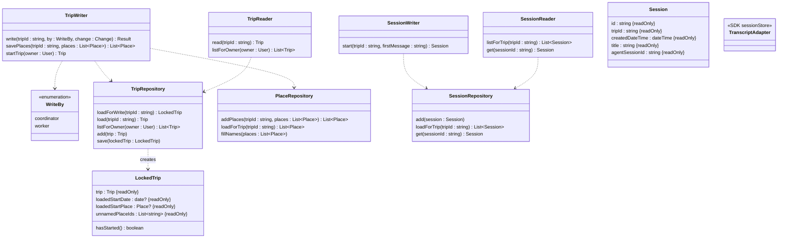

# Road Trip Planner: Persistence (MVP)

This document covers how a trip and its sessions are stored and saved: what is stored together, what a write does with storage, how two writes to one trip are kept apart, how the started-trip lock is checked at save, how sessions and their transcripts are kept, and which classes do each of these. It stays at the level of design. The database library, table layout, indexes, and migrations are settled during development.

What a write is, and what it changes, is in the [domain model](domain-model.md), section 1, "A write." This document adds what a write does with storage. Memory storage is left out, since memory design is technical spec open question 5.

---

## 1. Storage

**One Postgres database holds everything:** trips, their places, their sessions, and the session transcripts.

- **Not in the app's memory.** The app runs in a container that can restart at any time ([Google design](data-sources-google.md), section 5). Anything held only in memory goes with it. It also wouldn't work across more than one copy of the app.
- **Not in object storage.** S3-style object storage, such as DigitalOcean Spaces, is available, but nothing uses it. It suits large files written once. Transcripts are the opposite: many small additions, read back in order (section 6). Object storage can't add to a file that already exists, so each addition would be its own small file. One store is also simpler to run and back up.
- **Settings aren't in the database.** They're in a config file the app loads when it starts ([technical spec](technical-spec.md), section 10).

---

## 2. What is stored together

A trip is stored in four kinds of record:

| Record | Holds | One for each |
|---|---|---|
| Trip | The trip's `id` and owner, and the **plan**: one JSON document holding the trip brief, the itinerary with everything it holds, the rejected places, the check results, and last updated | Trip |
| Place | One place: its `id`, its trip, and its properties (domain model 3.10) | Place, per trip |
| Session | One session: its `id`, its trip, when it was created, its title, and the Agent SDK's ID for it (section 6) | Session |
| Transcript line | One line of a session's transcript, as the Agent SDK wrote it | Line |

**The plan is one document,** because a write always loads it whole and saves it whole (domain model section 1). Mapping each of the domain model's classes to its own table would be mostly code, with nothing for the agents.

- **An object with no `id`,** such as a leg, a candidate, or an approval, is stored inside the object that holds it.
- **A link is stored as an ID,** such as a stop's selected place, or a stop's search-area stay. The load turns each ID back into a link.

**Places and sessions are stored apart from the plan.** They're the two things that still save on a started trip (section 5). A trip can also have hundreds of places, and saving places from a search shouldn't wait for the plan (section 4).

**Places are kept per trip.** The database refuses a second place with the same trip and Google place ID, which holds "one record per trip for each Google place" (domain model 3.10). Two reasons a place isn't shared across trips or users:

- **Its name can come from the user.** When Google has no name for a place, the first name an agent gives fills it in, such as "Mike's house" for an address. Shared, another user who looked up that address would see "Mike's house." That breaks isolation between users (functional spec 10.4).
- **Its facts are a snapshot.** A place keeps Google's facts from its first lookup (domain model 3.10). Shared, a trip planned next year would get the hours and rating saved for another trip this year. Per trip, each trip starts fresh.

Sharing Google's facts across trips while keeping the name per trip would work, but it adds code and saves only a few Google calls. It isn't in the MVP.

---

## 3. A write

A write runs the four steps in domain model section 1 inside one database transaction:

1. **Load.** Open a transaction and load the trip's row with a row lock (section 4). Then load its places.
2. **Change** the trip, with the services and the objects' operations.
3. **Finish** the write: legs, then check results, then last updated.
4. **Save.** Check the started-trip lock (section 5). Save the plan, and any place whose name was filled in. Commit.

**A refusal rolls the transaction back,** so nothing is saved. That includes a failed call to Google during the finish. **A restart in the middle of a write** does the same: Postgres sees the connection drop and rolls it back. Either way, storage still holds the trip as it was.

**Each write loads the trip fresh.** The rules always run against the newest saved trip, even when the coordinator's context is out of date, such as when another session changed the trip.

**Saving places from a search** doesn't load or save the plan. Each place is added as a row. When the trip already has a row for that Google place, the row is kept as it is, and the new facts are dropped (domain model 3.1, `addPlaces()`). The stored places come back in the order given. This takes no row lock, since adding rows can't lose another write's work. When two searches find the same place at once, the database keeps one row, and both get its `id`.

**A read** loads the trip without the row lock, and saves nothing. It never waits for a write. It sees the trip as of the last write that committed.

---

## 4. Two writes to one trip

**The problem.** Several sessions and workers can write to one trip at once (tool design section 4). If two writes each load the plan and save it whole, the second save loses the first one's work. Example: the Moab and Torrey stay researchers run in parallel. Each loads the plan and adds its lodging set. Torrey's save overwrites the plan holding Moab's new set.

**Writes to one trip take turns.** Each write loads the trip's row "for update," which takes a row lock in Postgres. A second write to the same trip waits at its load until the first commits or rolls back. Then it loads the trip with the first write's changes. Writes to other trips don't wait.

- **It survives a restart.** When the container dies, Postgres rolls back the write in progress and releases its lock.
- **It works with more than one copy of the app,** since the lock is in the database, not in the app.
- **The cost is waiting.** A write holds the lock through its Google calls, such as a re-route at the finish, or a leg scout's detour times (domain model 4.7). That's a few seconds at most. Saving places from a search takes no lock, so workers' searches never wait.
- **Every Google call during a write has a timeout,** so a call that hangs can't hold the lock for long. A call that times out refuses the write, like any failed call (domain model 4.7).

**Turned down:** saving only if nothing changed since the load. The trip would keep a version number, and code would rerun the tool call when someone else saved first. Workers wouldn't wait, but a conflict would repeat its Google calls, and the retry is more code. Conflicts are rare in the MVP, so waiting costs little.

---

## 5. The started-trip lock at save

A started trip can't be changed (domain model 3.1). The tools refuse a write to a started trip before changing anything (tool design section 4). Persistence checks again at save. That catches a trip that starts during a write, at midnight, and any later way in, such as a web form.

**Persistence refuses to save the plan of a started trip.** The whole write is rolled back, and the error says the trip has started. Place rows and session rows always save, since neither changes the plan.

**It checks the trip as it was loaded,** under the row lock. A write could have changed the start date, so the changed copy can't tell whether the trip had started.

**Example.** The Moab trip starts October 10, 2027. On October 11, the user opens a new session and asks for a dinner spot for tonight. The session is saved. The coordinator's `find_place` saves Desert Bistro as a place. Any change to the plan, such as adding it as a stop, is refused.

**Today's date** is in the start place's time zone (domain model 3.1). Code works out the time zone from the start place's coordinates, with a lookup in code. It needs no call to Google, and nothing new is stored.

---

## 6. Sessions and transcripts

**A session row** holds the session's `id`, its trip, `createdDateTime`, `title`, and `agentSessionId`: the Agent SDK's ID for the conversation (section 8.4). The app chooses that ID, a UUID, when it creates the session, and passes it to the SDK. So it's known before the first message. Creating a session adds a row. It takes no row lock and doesn't touch the plan, so it works on a started trip.

**The Agent SDK keeps the transcript.** On its own, the SDK writes each session's transcript to a file on local disk, one line per message, with each worker's transcript beside it. That disk goes when the container restarts, so the local file is only scratch space. The SDK's `sessionStore` option takes an adapter we write. The SDK sends it each transcript line, and on resume it asks the adapter for them back.

- **The adapter stores each line as a row,** under the session's `agentSessionId`, in the order the SDK sent them. A worker's transcript is stored under the same ID, marked with the worker's own key from the SDK.
- **Lines are sent as soon as they're written.** The SDK's "eager" setting does this. Its default sends them at the end of each turn, so a restart in the middle of a turn would lose the whole turn.
- **Resuming** asks the adapter for the session's lines, and the SDK continues the conversation from them (section 8.4).
- **Transcript lines are never changed or removed** in the MVP. Nothing deletes a trip or a session.
- **The SDK marks `sessionStore` as alpha,** meaning it may change. If it breaks, the fallback is to copy the local file to Postgres ourselves at the end of each turn, and write it back to disk before a resume.

Transcripts don't go through a write, and take no row lock.

---

## 7. What a restart leaves behind

When the container restarts in the middle of a turn:

- **Every write that committed stays.** The write in progress is rolled back (section 3).
- **The transcript loses at most its last line or two** (section 6).
- **The turn stops,** along with any workers it called. A worker's candidates saved before the restart stay, but the coordinator never hears about them. Example: the Moab Day 4 leg scout saves the Goblin Valley candidates, and the container restarts before the leg scout reports back. The candidates are in the plan, and the transcript doesn't mention them.

The user can resume the session. **A resumed coordinator reads the itinerary again before changing anything** ([technical spec](technical-spec.md), 5.2). The same rule covers a session resumed after another session changed the trip.

---

## 8. The classes

This section names the classes that read and save a trip and its sessions, and what each one does. Like the domain model's operations, they're guidance for development: development can change them, but each change is flagged and written back here. They don't depend on the database library.

**Four classes are the only way in.** Tools, the app, and any later web form use `TripWriter` and `TripReader` for trips, and `SessionWriter` and `SessionReader` for sessions. The other classes are inside persistence, and nothing outside it can reach them. So no tool opens a transaction, takes the row lock, or saves a trip on its own.

### 8.1 Class diagram

The arrows mean "uses." `TripRepository` also uses `PlaceRepository`, to load a trip's places. That arrow is left out so that no lines cross. `Trip`, `Place`, and `User` are the domain model's classes. `Session` isn't part of the domain model: it's in section 8.4.

### 8.2 TripWriter

`TripWriter` runs everything that saves. It opens each transaction, and creates the repositories it uses inside it, so every query in a write is part of the same transaction. It's created once, when the app starts.

- **`write(tripId, by, change)`** runs a write (section 3). `change` is a function the caller passes in. It takes the loaded trip and the trip's calendar and services, changes the trip, and returns whatever the caller needs back, such as the new stop's ID. `write()` returns that once the write is saved. In order, it:
  1. Opens a transaction, and loads the trip with `TripRepository.loadForWrite()`.
  2. Refuses the write if the trip has started, before changing anything. This is the tools' check (section 5), done here once for every tool.
  3. Creates the trip's calendar and services, and runs `change` with them.
  4. Runs the finish: `LegsService.updateLegs()`, then the `FeasibilityChecker` when `by` is `coordinator`, then sets last updated (domain model section 1).
  5. Saves with `TripRepository.save()`, and commits.

  If anything refuses or fails along the way, it rolls back and passes the error on.
- **`savePlaces(tripId, places)`** saves places from a search or lookup, with `PlaceRepository.addPlaces()`. It returns the stored places in the order given. It takes no row lock, doesn't load the plan, and runs no finish (section 3). It works on a started trip.
- **`startTrip(owner)`** creates a new trip (domain model 3.1, "A new trip"), adds its row, and returns it.

**Starting a new trip takes two steps.** The user clicks "New trip" on the home screen, describes the trip in a form, and submits it. The app calls `startTrip()`, then `SessionWriter.start()` with what the user wrote as the first message. Each step saves on its own. If the app fails between them, the trip is left with no session, and the home screen shows it as "New trip." That's accepted.

**A write never adds places.** Every tool that writes takes place IDs, and every place comes from a search or lookup, which saves it with `savePlaces()` first. So the Google lookup for a place never runs while the row lock is held. Example: the coordinator finds Mike's house with `find_place`, which saves the place. Then `update_itinerary` sets it as the end place, in a write that only fills in its name.

**WriteBy** says who a write is for: `coordinator` or `worker`. Only a coordinator write runs the checks (domain model section 1). A later web form would add its own value.

### 8.3 TripReader

`TripReader` reads trips. It takes no row lock, and never waits for a write (section 3).

- **`read(tripId)`** loads one trip, with its places. The tools use it for reads, such as `read_itinerary`, and the search tools use it to leave out rejected places.
- **`listForOwner(owner)`** loads every trip the user owns, for the home screen.

**A trip from a read is never saved.** Code can change it in memory, but `TripRepository.save()` only takes a `LockedTrip`, and only `loadForWrite()` makes one. So a change made to a read by mistake goes nowhere.

### 8.4 Sessions

A **session** is one conversation with the agent about a trip (functional spec 10.1). It isn't part of the trip, so it isn't in the domain model. The trip doesn't hold its sessions. Each session holds its trip's ID instead.

| Property | Type | Notes |
|---|---|---|
| `id` | `string`, read only | Prefix `session_` (technical spec 7.1). Never shown to agents or users |
| `tripId` | `string`, read only | The trip it's about |
| `createdDateTime` | `dateTime`, read only | The trip's session list shows its date |
| `title` | `string`, read only | A few words for the trip's session list, from the user's first message, cut to about 60 characters at a word break. Example: "Can we add a night in Big Sur and drop one in…" |
| `agentSessionId` | `string`, read only | The Agent SDK's ID for this conversation, a UUID the app chooses (section 6). The transcript's shape isn't part of this design |

Nothing about a session changes once it's created. It's never closed: the user just leaves, and can resume it later. Starting and resuming both work on a started trip, since neither touches the plan.

**SessionWriter** starts sessions.

- **`start(tripId, firstMessage)`** creates a session, with its title from `firstMessage`, a new `agentSessionId`, and the time now. It saves it with `SessionRepository.add()`, and returns it. The coordinator gets no earlier transcripts. It begins by reading the itinerary, the trip brief, and memory (technical spec 5.2).

**SessionReader** reads sessions.

- **`listForTrip(tripId)`** returns the trip's sessions, in the order created, for the trip's session list.
- **`get(sessionId)`** returns one session. To resume it, the app hands its `agentSessionId` and the `TranscriptAdapter` to the SDK, which restores the transcript (section 6). The coordinator then continues with that conversation's context.

### 8.5 The repositories

A **repository** is a class that reads and saves one kind of record (section 2). Each is created for one connection: the database itself for a read, or an open transaction for a write. They hold no rules, other than the started-trip lock at save.

**TripRepository** reads and saves trip rows, and turns them into `Trip` objects. It uses `PlaceRepository`, on the same connection, to load a trip's places.

- **`loadForWrite(tripId)`** loads the trip's row "for update," which takes the row lock (section 4). Then it loads the trip's places, and returns a `LockedTrip`. If the lock isn't free within a time limit, the write is refused, and the error says the trip is busy.
- **`load(tripId)`** does the same without the row lock, and returns the `Trip`.
- **`listForOwner(owner)`** loads every trip the user owns.
- **`add(trip)`** adds a new trip's row.
- **`save(lockedTrip)`** checks the started-trip lock with `lockedTrip.hasStarted()`, and refuses when it's true (section 5). Otherwise it saves the plan document. Then it passes each place in `unnamedPlaceIds` that now has a name to `PlaceRepository.fillNames()`.

**LockedTrip** is a trip loaded for a write. It holds the trip, and what `save()` needs from the trip as it was loaded, since the write may change it:

- **`loadedStartDate`** and **`loadedStartPlace`:** the itinerary's start date and start place as loaded.
- **`hasStarted()`:** worked out like `Trip.hasStarted`, but from the loaded start date, in the loaded start place's time zone. It looks up today's date when it's called. So a trip that starts at midnight during a write counts as started at save.
- **`unnamedPlaceIds`:** the places that had no name when loaded. A write can only fill a name in, never change one (domain model 3.10). So these are the only places `save()` might need to update.

**PlaceRepository** reads and saves place rows.

- **`addPlaces(tripId, places)`** adds each place as a row, unless the trip already has one with that Google place ID (section 3). It returns the stored places in the order given, so the caller gets the existing `id` for a place the trip already had.
- **`loadForTrip(tripId)`** loads every place the trip has.
- **`fillNames(places)`** sets each place's name on its row, only where the row has none.

**SessionRepository** reads and saves session rows (section 6).

- **`add(session)`** adds a session's row.
- **`loadForTrip(tripId)`** loads the trip's sessions, in the order created.
- **`get(sessionId)`** loads one session.

**TranscriptAdapter** is section 6's adapter for the Agent SDK's `sessionStore` option. The SDK sets its operations, so they aren't listed here. The app hands it to the SDK when it starts or resumes a session. It stores each transcript line as a row, and gives the lines back on resume.

---

## 9. Left for development

- The database library. It should send queries to Postgres directly, rather than map each class to a table of its own, since the plan is one document (section 2).
- Table and column layout, indexes, and migrations.
- How the home screen finds each trip's name, dates, and last updated, from the plan document or from extra columns.
- The transcript adapter's code, and where the SDK's local scratch files go.
- How long a write waits for the row lock, and each Google call's timeout.
- The time zone lookup.
- Where sign-in records are kept (domain model 3.1).
