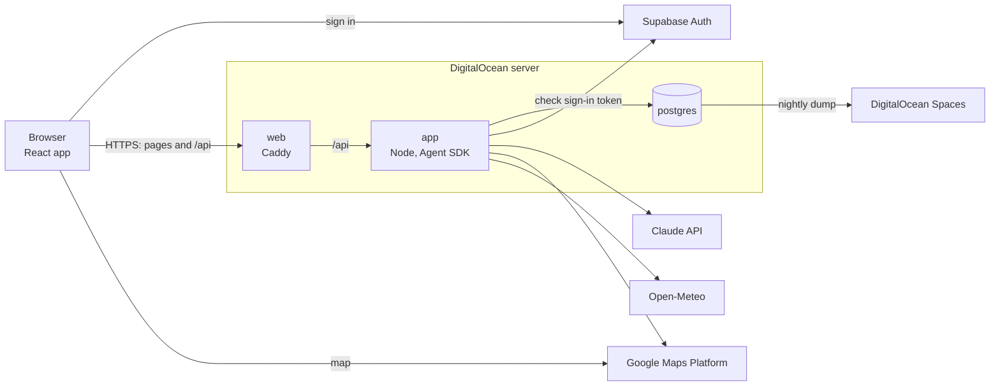

# Road Trip Planner: Systems Design (MVP)

This document covers where the app runs and how its parts connect: the server and its containers, sign-in, how the browser talks to the app, the outside services, local development, deploys, secrets, and backups. It stays at the level of design. Exact config files, such as the Docker Compose file, the Caddy config, and the GitHub workflow, are written during development.

For what the agents and tools do, see the [technical spec](technical-spec.md). For how a trip, its sessions, and memory are stored, see the [persistence design](persistence.md).

---

## 1. Overview

One server runs everything we build. The browser signs in with Supabase, then talks only to our server, except for loading the Google map. Our data never goes to Supabase.

---

## 2. The server

**One DigitalOcean server running Ubuntu,** with 2 vCPUs and 4 GB of memory. That's enough for a few users at once. Resize it if usage shows a need. App Platform is used for nothing: its compute costs more than a server of the same size.

**The server's name is `projects.jjk3.com`.** It may later run other projects, one at a time, so its name isn't tied to this app. The app's address is `roadtrip.jjk3.com`, a CNAME pointing to the server's name. Caddy gets its certificate for `roadtrip.jjk3.com`.

**Three containers, run with Docker Compose:**

| Container | Runs | Notes |
|---|---|---|
| `web` | Caddy | Serves the front end's files, and passes `/api` requests to `app`. Gets and renews the HTTPS certificate on its own |
| `app` | Our TypeScript back end, on Node | Holds the API, the agents, and the tools. The Agent SDK starts a Claude Code process for each running session, a few hundred MB each |
| `postgres` | Postgres | Its data is on a Docker volume on the server's disk |

**One web address for the front end and the API.** Caddy serves both, so the browser never calls a second site, and the app needs no cross-site setup.

**Only Caddy is open to the internet,** on ports 80 and 443. `app` is reachable only from the other containers. `postgres` is also reachable from the server itself, but not from the internet. Locally, that's how `npm run dev` reaches it. On the server, it allows an SSH tunnel to the database. SSH is open for deploys (section 7).

---

## 3. Sign-in

**Supabase Auth handles sign-in, on Supabase's free tier.** It's a managed user store and sign-in service. We use nothing else from Supabase: our data is in our own Postgres (section 2).

**Email and password, with sign-up turned off.** The admin adds each user in the Supabase dashboard, with a password. Nobody can sign up on their own (functional spec 3). No email is sent, since there's no sign-up and no email link.

**How a request is signed in:**

1. The browser signs in with Supabase's JavaScript library, and gets back a token. The token is signed by Supabase and holds the user's ID.
2. The browser sends the token with each `/api` request.
3. The app checks the token's signature with the Supabase project's public signing keys, and reads the user's ID from it. A request with no valid token is refused.
4. The app checks that the user owns the trip, then makes the session's tools with that user and trip ([persistence design](persistence.md), section 9, and [tool design](tools.md), section 4).

The app never sees a password. Sign-out drops the token in the browser.

**A user's ID is Supabase's ID for that user,** a UUID. Our trips and memory items store it (technical spec 7.1). Users live in Supabase and trips live in our Postgres, so no database link joins them.

**One Supabase project serves both development and production.** The same users can sign in to both. Each has its own database (section 6), so a user's trips in one aren't in the other.

**A free project pauses after a week with no activity.** Supabase sends a notice first, and signing in to the Supabase dashboard brings it back. While it's paused, nobody can sign in. Our data isn't touched. That's accepted, since the app is used actively while it's deployed.

---

## 4. The browser and the app

**The front end is React, built with Vite into plain static files.** Caddy serves them.

- **React** is the most widely used choice. That gives the most ready-made parts, such as the Google map and a chat view, and the most examples to work from.
- **Static files** need no server of their own for the UI. Frameworks that render pages on a server, such as Next.js, would add one more thing to run, for nothing the app needs.
- **TypeScript** lets the front end use the same data shapes as the back end (technical spec section 2).

**Requests are JSON over HTTPS, under `/api`.** A user's message is one request. The coordinator's reply streams back on that request with **Server-Sent Events**: the server sends each part of the reply as it's ready, and the browser shows it. The Agent SDK hands the app its messages one at a time, so the app passes each one on. Server-Sent Events only flow from the server to the browser, which is all a reply needs. WebSockets would carry messages both ways, with more code for reconnecting, and nothing needs that.

**A closed tab doesn't stop a turn.** The turn finishes on the server, and its transcript is saved as it goes ([persistence design](persistence.md), section 6). When the user comes back, the session shows the finished reply, and the itinerary shows any changes.

**The map loads in the browser,** with Google's browser key ([Google design](data-sources/google.md), section 1).

---

## 5. Outside services

| Service | Used for | Called from |
|---|---|---|
| Supabase Auth | Sign-in (section 3) | The browser, to sign in. The app, for the public signing keys |
| Claude, on the owner's Max plan | The agents, through the Agent SDK | The app |
| Google Maps Platform | Routes, places, weather, and the map ([Google design](data-sources/google.md)) | The app. The browser, for the map |
| Open-Meteo | Seasonal weather averages | The app |
| DigitalOcean Spaces | Database backups (section 9) | The server |
| GitHub | The code, the builds, and the container images (section 7) | Developers and the deploy |

**The Agent SDK runs on the owner's Claude Max plan.** The plan's monthly API credits cover the Agent SDK, and so do its subscription limits ([Anthropic's note on Agent SDK use](https://support.claude.com/en/articles/15036540-use-the-claude-agent-sdk-with-your-claude-plan), as of October 7, 2026). The app is for the owner's own non-commercial learning. Web search uses the same plan ([web search design](data-sources/web-search.md), section 1).

---

## 6. Local development

- **`npm run dev` runs the app and the front end on the developer's machine.** Vite serves the front end and passes `/api` to the app, the same split as Caddy in production.
- **The same Docker Compose file runs on the server and locally.** Locally, it usually starts only Postgres. It can also build and start the whole stack, to try out production before a merge. Caddy reads its site name from the environment: `roadtrip.jjk3.com` on the server, `localhost` locally.
- **Sign-in uses the same Supabase project as production** (section 3). Nothing about sign-in runs locally.
- **Keys are in the repo's git-ignored `.env` file** ([Google design](data-sources/google.md), section 1). Google's browser key also allows `localhost`, so the map works locally.

There's no staging server. A change goes from local development straight to production.

The commands, code standards, and tests are in [DEVELOPMENT.md](../DEVELOPMENT.md).

---

## 7. Deploys

**A merge to `main` deploys it.** A GitHub Actions workflow:

1. Builds two images: `app`, with the back end, and `web`, with Caddy and the front end's built files.
2. Pushes them to GitHub's container registry.
3. Connects to the server over SSH, and pulls the new images.
4. Runs the database migrations, from the new `app` image, before the new app starts.
5. Restarts the containers with the new images.

`postgres` uses the standard Postgres image, so a deploy doesn't change it.

**A migration** is a script that creates or changes tables. The migration tool is chosen during development, along with the database library ([persistence design](persistence.md), section 9).

**A deploy restarts the app,** which cuts off any turn in progress, like any restart ([persistence design](persistence.md), section 7). The app is unavailable for a moment while it restarts. Both are accepted.

**A bad deploy is fixed with another merge,** or by restarting the containers on an earlier image.

---

## 8. Secrets

**Production secrets are in a `.env` file on the server,** made by hand once. Only the user that runs the containers can read it. Docker Compose loads it into the containers that need each value. It's never in git or GitHub.

| Secret | Used by |
|---|---|
| Claude plan credential | `app` |
| Google server key | `app` |
| Postgres password | `app` and `postgres` |
| Spaces access key | The nightly backup (section 9) |

GitHub holds only what the deploy needs: the server's address and an SSH key. It pushes images with its own built-in token.

**Some values aren't secret,** because the browser has to have them: the Supabase project's address and its public browser key, and Google's browser key. They're built into the front end. Supabase's browser key only allows what a signed-in user may do. Google's browser key is restricted to our site and the map.

**Spending limits matter more than where the secrets live.** On one server, anyone who gets in can read the secrets wherever they're kept. So each paid key has a limit on what a leak can cost:

- **The Claude plan** caps use at its limits. If the plan offers paid use past its limits, keep that turned off, so a leaked credential can't run up a bill.
- **Google's keys** are each restricted to the APIs they use, and the account has a budget alert ([Google design](data-sources/google.md), section 5).

---

## 9. Backups

**A nightly job on the server dumps the database and copies the file to DigitalOcean Spaces.** Older dumps are removed after a set number of days. To restore, load a dump into a new, empty Postgres. Test a restore once, when the job is set up.

Users aren't in the dump, since they live in Supabase (section 3).

---

## 10. Left for development

- The Docker Compose file, the Caddy config, and the GitHub Actions workflow.
- The database library and migration tool ([persistence design](persistence.md), section 9).
- How many days of backups to keep.
- Whether the container images are private, and if so, how the server signs in to pull them.
- How the app gets the Supabase project's public signing keys, and how often it refreshes them.
- How the server signs in to the Claude Max plan, such as a long-lived sign-in token or an API key drawing on the plan's credits, and which value goes in the `.env` file.
