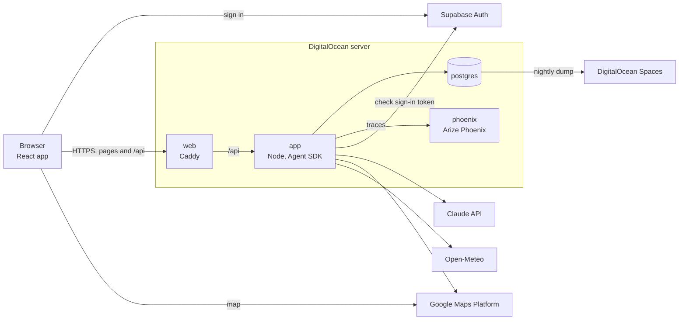

# Road Trip Planner: Systems Design (MVP)

This document covers where the app runs and how its parts connect: the server and its containers, sign-in, how the browser talks to the app, the outside services, local development, deploys, secrets, backups, and traces. It stays at the level of design. Exact config files, such as the Docker Compose file, the Caddy config, and the GitHub workflow, are written during development.

For what the agents and tools do, see the [technical spec](technical-spec.md). For how a trip, its sessions, and memory are stored, see the [persistence design](persistence.md).

---

## 1. Overview



One server runs everything we build. The browser signs in with Supabase, then talks only to our server, except for loading the Google map. Our data never goes to Supabase.

---

## 2. The server

**One DigitalOcean server running Ubuntu,** with 2 vCPUs and 4 GB of memory. That's enough for a few users at once. Resize it if usage shows a need. App Platform is used for nothing: its compute costs more than a server of the same size.

**The server's name is `projects.jjk3.com`.** It may later run other projects, one at a time, so its name isn't tied to this app. The app's address is `roadtrip.jjk3.com`, a CNAME pointing to the server's name. Caddy gets its certificate for `roadtrip.jjk3.com`.

**Three containers, run with Docker Compose:**

| Container | Runs | Notes |
|---|---|---|
| `web` | Caddy | Serves the front end's files, and passes `/api` requests to `app`. Gets and renews the HTTPS certificate on its own |
| `app` | Our TypeScript back end, on Node | Holds the API, the agents, and the tools. The Agent SDK starts a Claude Code process for each turn, which resumes the session from its stored transcript and ends with the turn. So nothing runs between turns. Starting one took about half a second, measured in #52. One process answering a short question peaked at about 250 MB, measured in phase 9 |
| `postgres` | Postgres | Its data is on a Docker volume on the server's disk |

Two more run only on the server: `backup`, the nightly backup (section 9), and `phoenix`, which keeps each chat turn's trace (section 10).

**One web address for the front end and the API.** Caddy serves both, so the browser never calls a second site, and the app needs no cross-site setup.

**Only Caddy is open to the internet,** on ports 80 and 443. `app` is reachable only from the other containers. `postgres` and `phoenix` are also reachable from the server itself, but not from the internet. Locally, that's how `npm run dev` reaches Postgres. On the server, it allows an SSH tunnel to the database, and to Phoenix (section 10). SSH is open for deploys (section 7).

---

## 3. Sign-in

**Supabase Auth handles sign-in, on Supabase's free tier.** It's a managed user store and sign-in service. We use nothing else from Supabase: our data is in our own Postgres (section 2).

**Email and password, with sign-up turned off.** The admin adds each user in the Supabase dashboard, with a password. Nobody can sign up on their own (functional spec 3). No email is sent, since there's no sign-up and no email link.

**How a request is signed in:**

1. The browser signs in with Supabase's JavaScript library, and gets back a token. The token is signed by Supabase and holds the user's ID.
2. The browser sends the token with each `/api` request.
3. The app checks the token's signature with the Supabase project's public signing keys, and reads the user's ID from it. A request with no valid token is refused, except `/api/health`, which the deploy calls (section 7).
4. The app checks that the user owns the trip, then makes the session's tools with that user and trip ([tool design](tools.md), section 4).

The app never sees a password. Sign-out drops the token in the browser.

**The app needs no Supabase secret to check a token.** The project signs tokens with an asymmetric key, `ECC (P-256)`, and publishes the public half at `<project URL>/auth/v1/.well-known/jwks.json`. The app downloads the public keys from there and keeps them in memory. It downloads them again only when a token names a key it hasn't seen, such as after a key rotation, and at most once every 30 seconds. The `jose` library does this. The app reads the project's address from `SUPABASE_URL`. The front end has its own copy, `VITE_SUPABASE_URL` (section 7).

**A user's ID is Supabase's ID for that user,** a UUID. Our trips and memory items store it (technical spec 7.1). Users live in Supabase and trips live in our Postgres, so no database link joins them.

**One Supabase project serves both development and production.** The same users can sign in to both. Each has its own database (section 6), so a user's trips in one aren't in the other.

**A free project pauses after a week with no activity.** Supabase sends a notice first, and signing in to the Supabase dashboard brings it back. While it's paused, nobody can sign in. Our data isn't touched. That's accepted, since the app is used actively while it's deployed.

---

## 4. The browser and the app

**The front end is React, built with Vite into plain static files.** Caddy serves them.

- **React** is the most widely used choice. That gives the most ready-made parts, such as the Google map and a chat view, and the most examples to work from.
- **Static files** need no server of their own for the UI. Frameworks that render pages on a server, such as Next.js, would add one more thing to run, for nothing the app needs.
- **TypeScript** lets the front end use the same data shapes as the back end (technical spec section 2).

**Requests are JSON over HTTPS, under `/api`.** A user's message is one request. The coordinator's reply streams back on that request with **Server-Sent Events**: the server sends each part of the reply as it's ready, and the browser shows it. It sends each step of the turn too, such as a tool call, for the chat's raw view (functional spec 10.1). The Agent SDK hands the app its messages one at a time, so the app passes each one on. Server-Sent Events only flow from the server to the browser, which is all a reply needs. WebSockets would carry messages both ways, with more code for reconnecting, and nothing needs that.

**The coordinator's replies are Markdown, and the browser formats them,** with `react-markdown` and its plugin for GitHub's tables, `remark-gfm`. So the coordinator writes the way it would anyway, and the chat shows bold labels and numbered lists, not their marks. Each line the coordinator ends shows as a new line, as in GitHub's comments, so one bold label per line doesn't run into one paragraph. Plain Markdown would join those lines. HTML in a reply shows as text, never runs. With the raw view on, a reply shows its Markdown as written (functional spec 10.1).

**The API runs on Hono,** on Node. Request bodies are checked with Zod through `@hono/zod-validator`, and replies stream with Hono's `streamSSE`. The options compared are in [research/server-libraries.md](../research/server-libraries.md).

**A closed tab doesn't stop a turn.** The turn finishes on the server, and its transcript is saved as it goes ([persistence design](persistence.md), section 6). When the user comes back, the session shows the finished reply, and the itinerary shows any changes.

**The map loads in the browser,** with Google's browser key ([Google design](data-sources/google.md), section 1).

---

## 5. Outside services

| Service | Used for | Called from |
|---|---|---|
| Supabase Auth | Sign-in (section 3) | The browser, to sign in. The app, for the public signing keys |
| Claude, on the owner's Max plan | The agents, through the Agent SDK | The app |
| Google Maps Platform | Routes, places, weather, and the map ([Google design](data-sources/google.md)) | The app. The browser, for the map |
| Open-Meteo | Seasonal weather averages | The app |
| DigitalOcean Spaces | Database backups (section 9) | The server |
| GitHub | The code, the builds, and the container images (section 7) | Developers and the deploy |

**The Agent SDK runs on the owner's Claude Max plan.** The plan's monthly API credits cover the Agent SDK, and so do its subscription limits ([Anthropic's note on Agent SDK use](https://support.claude.com/en/articles/15036540-use-the-claude-agent-sdk-with-your-claude-plan), as of October 7, 2026). The app is for the owner's own non-commercial learning. Web search uses the same plan ([web search design](data-sources/web-search.md), section 1).

---

## 6. Local development

- **`npm run dev` runs the app and the front end on the developer's machine.** Vite serves the front end on `localhost:5173`, and passes `/api` to the app on `127.0.0.1:3000`, the same split as Caddy in production.
- **The same Docker Compose file runs on the server and locally.** Locally, it usually starts only Postgres, with `docker compose up -d postgres`. Postgres listens on `127.0.0.1:5432`, so only the machine itself reaches it. It can also build and start the whole stack, to try out production before a merge. Caddy reads its site name from the environment: `roadtrip.jjk3.com` on the server, `localhost` locally.
- **Sign-in uses the same Supabase project as production** (section 3). Nothing about sign-in runs locally.
- **Traces go to the server's Phoenix, through an SSH tunnel** (section 10). No Phoenix runs locally.
- **Keys are in the repo's git-ignored `.env` file** ([Google design](data-sources/google.md), section 1). Google's browser key also allows `localhost`, so the map works locally.

There's no staging server. A change goes from local development straight to production.

The commands, code standards, and tests are in [DEVELOPMENT.md](../DEVELOPMENT.md).

---

## 7. Deploys

**A merge to `main` deploys it.** A GitHub Actions workflow, `.github/workflows/deploy.yml`:

1. Runs `npm run check`. If it fails, nothing is built or deployed. The check also runs on every pull request. It isn't a required status check, so a PR can still be merged when it fails, for the times that's needed.
2. Builds three images: `app`, with the back end, `web`, with Caddy and the front end's built files, and `backup`, with the nightly backup (section 9). Vite builds the browser's values into the front end (section 8). The workflow has no `.env`, so it passes them to the `web` build from GitHub repo variables: `VITE_SUPABASE_URL`, `VITE_SUPABASE_PUBLISHABLE_KEY`, and `VITE_GOOGLE_MAPS_BROWSER_KEY`. They aren't secret, but they stay out of the repo, so Google and GitHub don't flag a key as exposed. Locally, the same names are in `.env`.
3. Pushes them to GitHub's container registry, tagged with the commit.
4. Copies `compose.yaml` and the repo's `ops/` folder to the server, over SSH. The server keeps only its `.env` file between deploys.
5. Runs `ops/deploy.sh` on the server. It pulls the new images, and runs the database migrations from the new `app` image before the new app starts. Then it restarts the containers with the new images.
6. Calls `/api/health` on the live site, and fails if the site doesn't answer.

`postgres` uses the standard Postgres image, and `phoenix` uses Phoenix's, at a fixed version. So a deploy doesn't change them. `ops/deploy.sh` pulls only our own images, which are private (section 8). `docker compose up` pulls Phoenix's public image on its own, the first time.

**The images are private** (section 8). On the server, the deploy tags the images it pulled as `:latest`, and `compose.yaml` runs `:latest`. So `:latest` on the server is always the commit that's deployed. Locally, Compose builds the same image names from the Dockerfiles.

**A migration** is a script that creates or changes tables. Migrations use node-pg-migrate ([persistence design](persistence.md), section 1). The deploy runs them with `node dist/app/migrate.js`, in a one-off container from the new `app` image.

**A deploy restarts the app,** which cuts off any turn in progress, like any restart ([persistence design](persistence.md), section 7). The app is unavailable for a moment while it restarts. Both are accepted.

**A bad deploy is fixed with another merge,** or by restarting the containers on an earlier image. Two ways to do that: re-run an earlier workflow run's deploy job in GitHub, or on the server, tag an earlier commit's images as `:latest` and run `docker compose up -d`. The server keeps unused images of this app for a week.

---

## 8. Secrets

**Production secrets are in a `.env` file on the server,** made by hand once. Only the user that runs the containers can read it. Docker Compose loads it into the containers that need each value. It's never in git or GitHub.

| Secret | Used by |
|---|---|
| Claude plan token, `CLAUDE_CODE_OAUTH_TOKEN` | `app` |
| Google server key, `GOOGLE_MAPS_SERVER_KEY` | `app` |
| Postgres password | `app` and `postgres` |
| Spaces access key | `backup` (section 9) |

**The app signs in to the Claude Max plan with a token,** made once by running `claude setup-token` on the owner's machine. The token lasts a year and can only make model requests. When it runs out, make a new one, put it in both `.env` files, and restart the app. The Agent SDK ships its own Claude Code program, and the app passes the token to it. Anthropic's docs give this token as the sign-in for the SDK and other automated use.

- **Not a login saved on a volume.** Running `/login` inside the container would save a login that renews itself, but it needs a Docker volume and a login on the server. Anthropic's docs don't say how often it renews, and if it lapses, the agents stop with no warning.
- **An `ANTHROPIC_API_KEY` would win over the token,** and bill an API account instead of the plan. So the app leaves every `ANTHROPIC_` variable out of the environment it gives Claude Code. A developer's shell that has a key set can't change which account the app uses.

GitHub holds what the deploy needs: the server's address, its SSH host keys, and an SSH key, as secrets, and the browser's values as repo variables (section 7). It pushes images with its own built-in token. It also holds the keys for the code review's two GitHub Apps.

**The code reviewer and the fixer each have a GitHub App,** so their comments and commits show under their own names ([code review design](code-review.md) section 4.6). Each app's private key is a `.pem` file that GitHub made once.

- **In CI,** the key's contents are a repo secret, `REVIEWER_APP_PRIVATE_KEY` or `FIXER_APP_PRIVATE_KEY`. The app's ID is a repo variable, `REVIEWER_APP_ID` or `FIXER_APP_ID`. An ID isn't secret, since it's no use without the key.
- **On Joe's machine,** the key file is in a folder outside the repo. `.env` holds the ID and the file's path, as `REVIEWER_APP_ID` and `REVIEWER_APP_PRIVATE_KEY_PATH`, and the same for the fixer. `src/code-review/app-token.ts` makes an hour's token from them.
- **A leaked key** lets anyone act as its app on this repo, within the app's permissions, until the key is deleted in the app's settings on GitHub. Then make a new one, and update the secret and the local file.

**The container images are private,** which is GitHub's default for a new image. The server has no registry credential of its own. Each deploy passes the workflow's built-in token to the server over SSH, and the server signs in with it only to pull that deploy's images. The sign-in is kept in a temporary folder that's removed right after, and the token stops working when the workflow job ends. So nobody has to make or renew a token, and none is left on the server.

**Some values aren't secret,** because the browser has to have them: the Supabase project's address and its public browser key, and Google's browser key. They're built into the front end. Supabase's browser key only allows what a signed-in user may do. Google's browser key is restricted to our site and the map.

**Spending limits matter more than where the secrets live.** On one server, anyone who gets in can read the secrets wherever they're kept. So each paid key has a limit on what a leak can cost:

- **The Claude plan** caps use at its limits. Paid use past the limits, which Anthropic calls extra usage or usage credits, is turned off, so a leaked token can't run up a bill. It's under Settings > Usage on claude.ai. Joe checked it on 2026-10-15.
- **Google's keys** are each restricted to the APIs they use, and the account has a budget alert ([Google design](data-sources/google.md), section 5).

---

## 9. Backups

**A `backup` container on the server dumps the database each night and copies the file to DigitalOcean Spaces.** Dumps older than 3 days are removed, so the last 3 nightly dumps are kept. To restore, load a dump into a new, empty Postgres. Test a restore once, when the job is set up.

- **It's a Compose service, not a cron job,** so nothing is installed on the server itself. `docker compose down` stops it with everything else. It's in the `production` profile, and the server's `.env` sets `COMPOSE_PROFILES=production`, so it only starts there. Locally, `docker compose up` doesn't start it.
- **It has its own image, `backup`,** built and deployed like `app` and `web` (section 7). It's built on the Postgres image, so its `pg_dump` matches the database's version, and it adds rclone for the upload. The scripts are in the image, from `docker/backup-now.sh` and `docker/backup-nightly.sh`.
- **The container waits until 09:00 UTC, backs up, and waits again.** Its output is the container's log: `docker compose logs backup`. To back up once, now: `docker compose run --rm backup backup-now`.
- **The dump is `pg_dump`'s custom format,** taken over the Compose network. It's compressed, and `pg_restore` loads it.
- **Dumps go to the `jjk3-backups` bucket,** in the `road-trip-agent/` folder, named by the time they were made in UTC, such as `2026-10-15T090000Z.dump`. The container only writes and removes dumps in that folder.

Users aren't in the dump, since they live in Supabase (section 3).

---

## 10. Traces

**A trace is the record of one chat turn,** kept in Arize Phoenix, a tool for looking at how agents worked. Joe uses it to see how the coordinator worked on a turn once it's over, which the chat's raw view doesn't keep (functional spec 10.1). Agent evaluations (#53) will build on it too. Each trace is made of **spans**: one for the turn, and under it, in order, one for each model call and one for each tool call.

| Span | Kind | Holds |
|---|---|---|
| `coordinator.turn` | AGENT | The message the model got, with the app's lines (technical spec 5.2), the reply, the agent session ID as `session.id`, and the user's ID as `user.id` |
| `coordinator.model_call` | LLM | The call's thinking summary, text, and the tool calls it asked for, with its model and tokens |
| A tool's name, such as `mcp__trip__read_trip_brief` | TOOL | The tool's input and its reply. A refused call is marked as an error, with the tool's error text |
| `<worker>.turn`, under the `Agent` call that started it | AGENT | The worker's prompt, and the result the coordinator got. Its model calls and tool calls go under it |

- **Our own code makes the spans,** from the Agent SDK's messages: `TurnTrace`, in `src/agent/turn-trace.ts`. Phoenix's instrumentation for the Agent SDK was tried first, in #132. It showed the user's message as `{}`, left out the model calls and the thinking, and counted only the input tokens that weren't cached. So a 48,255-token turn showed as 8.
- **Each model call's tokens come from the SDK's stream events.** Each block of a call carries the tokens from the call's start. The call's `message_delta` event has its final output count. So the coordinator's options turn on `includePartialMessages`. The input count includes the tokens read from, and written to, the prompt cache, as the raw view's does.
- **Tokens are on the LLM spans,** since Phoenix adds up tokens, and works out a price, only from those. The Sessions view groups a chat's turns by `session.id`, with their totals.
- **A worker's model calls come from its transcript,** read with the SDK's `getSubagentMessages()` from our session store once the turn is over (persistence design, section 6). The SDK sends none of a worker's stream events, and none of its text or thinking. A worker's output tokens can be low: its transcript sometimes has a call's count from the call's start. The #136 spike saw 762 against the SDK's 909, in 1 turn of 4. That's accepted. No worker exists yet (#60, #61, #64).
- **Not in a trace:** the system prompt, and the input each model call got.

**One Phoenix runs on the server,** as the `phoenix` container, with the `arizephoenix/phoenix:20.26.0` image.

- **It's in the `production` profile,** like `backup`, so it starts only on the server.
- **It listens on the server's `127.0.0.1:6006`,** for its web UI, its REST API, and the traces. The server's app reaches it as `http://phoenix:6006`, over the Compose network.
- **There's no sign-in,** and Phoenix's own telemetry is off. Nothing new is open to the internet, so a scanning bot can't reach it.
- **Its data is a SQLite file in its own volume, `phoenix-data`,** not in our Postgres. So it isn't in the nightly backup (section 9), and losing it loses only traces.

**Joe's machine reaches it through an SSH tunnel,** the same way as the server's Postgres:

```sh
ssh -N -L 6006:127.0.0.1:6006 root@projects.jjk3.com
```

With the tunnel up, `npm run dev` and `npm run chat` send their traces to `http://127.0.0.1:6006`, and a browser opens the Phoenix UI at the same address. Putting Phoenix on the internet through Caddy was the other choice. It would need Phoenix's sign-in, an API key for sending traces, and a second site.

**The server's traces and local ones go to two Phoenix projects.** A project holds its own traces, sessions, and token totals. The server sends to `road-trip-agent`, and Joe's machine to `road-trip-agent-local`. Local traces are mostly test chats against the local database, so mixed in, they'd skew the server's sessions and totals. Two environment values set this, checked when the app starts: `PHOENIX_URL` and `PHOENIX_PROJECT`. `compose.yaml` sets them for the server's app, so the server's `.env` doesn't have them. Locally, they're in `.env`.

**Spans that can't be sent are lost,** with no retry. They're sent in batches, every few seconds, and the app and `npm run chat` send what's left when they stop. The chat works the same whether Phoenix can be reached or not.

**The page shows whether the app can reach Phoenix,** with a green check or a red X next to the health line (functional spec 10.1). `/api/health` asks Phoenix's own health check, `/healthz`, and gives up after 2 seconds. The app does the check, since it's what sends the traces, and on the server the browser can't reach Phoenix. Only the database decides the reply's status, so the deploy's call to `/api/health` doesn't fail when Phoenix is down. The check says only that Phoenix can be reached, not that each turn's spans arrived.
