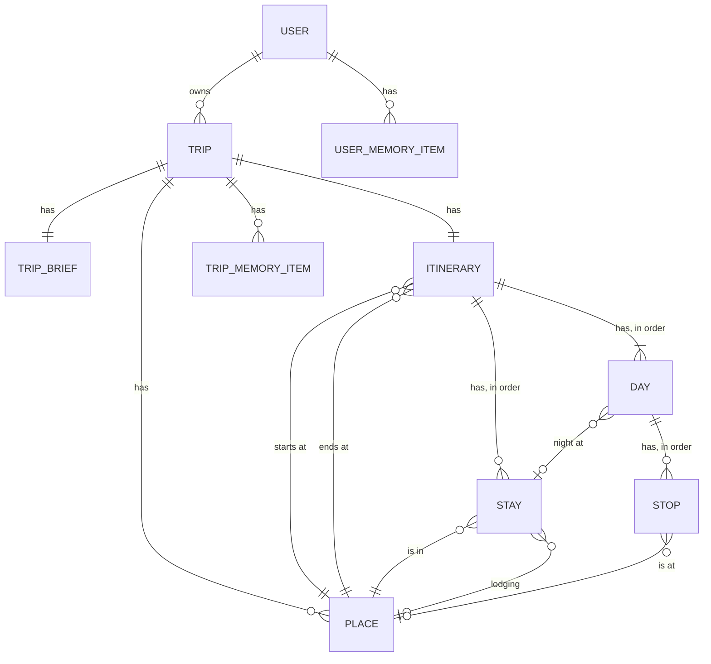

# Road Trip Planner: Technical Specification (MVP)

This document covers how the app works under the hood. So far it covers the agents: which agents exist, what each one does, which tools each one gets, and what goes in each agent's instructions. Sessions, memory, and other parts will be added as they are designed. It is written at the level of design, not of any one SDK's configuration. For the planning behavior it implements, see the [functional spec](functional-spec.md). For each tool's server, inputs, and which agents get it, see the [tool design](tool-design.md). For the tools' data sources, see the [data sources index](data-sources.md).

---

## 1. Overview

One **coordinator** agent talks to the user for the whole trip. It sends research to **worker** subagents and keeps the conversation, the itinerary's structure, and memory to itself.

| Agent | Talks to the user | Writes the itinerary | Writes memory | Runs |
|---|---|---|---|---|
| Coordinator | Yes | Yes | Yes | For the whole session |
| Stay researcher | No | Adds candidates only | No | Once per stay, in parallel |
| Leg scout | No | Adds candidates only | No | Once per leg, in parallel |
| Weather and clothing | No | Saves each stay's weather text only | No | Once most of the fill's selections are made, and again for stays whose weather is out of date |

A worker is called like a tool. It gets a worker brief, does its work, and returns one result. It can't ask the user anything. If it needs a decision, it says so in its result, and the coordinator asks.

---

## 2. Decisions

- **TypeScript for the whole app, on the Claude Agent SDK.** The back end and the UI share one definition of the data model: the itinerary, places, candidates, and option cards. The trip tools write these shapes, the read tool returns them, and the UI draws them. In two languages, every field change would be made twice.
- **Each agent sees only its own tools.** Tools are grouped into servers by job, and each agent gets a list of exactly the tools it uses (the [tool design](tool-design.md), section 3).
- **No separate interview agent, for now.** We considered an agent that scopes the trip with the user, then hands a summary to the coordinator once and ends. Discovery and refinement mix too often for a split to pay off yet (functional spec 5.3: the user can jump around). Revisit it if the coordinator's discovery turns out weak. If it is added later, the summary it hands over is the trip brief in section 5.3, so the coordinator doesn't change.
- **Workers write candidates directly and return a short summary.** Full place details go on the place, and from there to the option cards. The coordinator sees only one line per candidate (section 7).
- **Mechanical feasibility checks run in code.** The itinerary write tool checks every change and returns any broken rules (section 8). The agent handles the judgment: which trade-offs to offer.
- **The coordinator resolves budget rules into a tier before briefing a worker.** A worker gets "mid-range, from rule: 2+ nights", never the rule text (section 9).

---

## 3. Data model

This section lists what gets stored, how the pieces relate, and who creates or changes each one. Fields are settled during development.

**Every entity's ID is one we create.** IDs from outside sources, such as Google's place ID, are stored as ordinary properties and can be empty.

**Anything numbered in order starts at 0.** That covers a stay's order, a day's order, a stop's order in its day, and a candidate's set number. The UI counts from 1 for people, so the day stored as 0 shows as Day 1. The examples below use the people-facing labels.

**"Worked out" means looked up from other stored data when read, and not stored.** Examples: a stay's nights, a day's date, a leg's from and to, and a candidate's status. Storing these would add a second copy that can go stale. Values that need a call to an outside service, such as a leg's drive time, are different. They are computed once and stored (3.3).

### 3.1 Entities



How to read the line ends: `||` is exactly one, `o|` is zero or one, `o{` is zero or more, and `|{` is one or more. For example, `DAY }o--o| STAY` means a day points to zero or one stay, and a stay can have many days pointing to it.

Candidates and legs are not in the diagram. They are value objects: candidates are held inside stops and stays (3.2), and a leg is held inside its day (3.3).

| Entity | Belongs to | What it is |
|---|---|---|
| Trip | User | The container for everything below. The app creates it when the user starts a new conversation (functional spec 10.1). Holds the trip's rejected places, each a place and the user's reason (3.2). Its name and region are worked out from the trip brief's region, route, or theme and the itinerary's start date, not stored |
| Trip brief | Trip | The items in functional spec 5.2. Created empty with the trip |
| Itinerary | Trip | Points to a start place and an end place. Holds a start date. The coordinator sets all three during discovery, before the skeleton (4.2). Holds the stays and the days, each in order. Created with the trip, holding only its last day (see below) |
| Place | Trip | Any real location: a town, hotel, restaurant, bar, attraction, friend's house, or campground. Holds the facts about it: Google's place ID, coordinates, and the details a tool returned, such as Google's name, rating, review count, price level, weekly hours, summary, and links. Cards show Google's name whenever Google has one. A name given by an agent is used only for a place Google has no name for, which in practice means an address, such as "Mike's house." It is set by the first candidate that offers the place, or by `update_itinerary` for a start or end place. So a user's nickname, such as "the pink hotel," never replaces "Madonna Inn." The type cards show is set by the first candidate that offers it. Places are matched by Google place ID only. The kind of place doesn't limit how it's used. A hotel can be a stay's lodging, or a stop for its bar. On a loop trip, the start and end are the same place |
| Stay | Itinerary | One overnight location: the place it's in, usually a town, and order. Its nights are the number of days that point to it, worked out rather than stored. Changing its nights adds or removes its days. Its lodging is a place, empty until selected. Holds its lodging candidates, and a tier with the rule that produced it and the number of nights it was set for (section 9). Its dates are worked out: the dates of its nights, plus the morning the party leaves. Holds its weather and clothing text, labeled forecast or seasonal averages, with the place, dates, and activities it was written for (6.3). That text is empty until the weather worker runs |
| Day | Itinerary | One day of the trip: rest day or not, its own start time if the user agreed to one (below), its stops in order, its leg, if it has one (3.3), and its approvals (section 8). Points to the stay where the party sleeps that night. The last day points to none. Its date is worked out: the itinerary's start date plus the day's order |
| Stop | Day | A visit during the day: a meal or an attraction. Holds its kind, its purpose, its search area, its order in the day, its set time or none, and its visit time (below). The purpose is a short note on what the stop is for, never when, such as "dessert" or "stargazing." It can say how long, such as "a long hike in Arches, about 5 hours." The search area says where its candidates are searched: near a stay, by the stay's ID, or along the day's leg. Kind, purpose, and search area are set when the stop is added and never change (6). Its place is empty until selected. Holds its candidates. Meal stops have a tier and the rule that produced it. The drive to it is stored with the day's leg, not on the stop (3.3). Holds its approvals, such as one to keep it despite its opening hours (section 8) |
| Trip memory item | Trip | One free-text note (functional spec 10.2) |
| User memory item | User | One standing preference (functional spec 10.3) |

**A day has at most one leg.** Whether it has one depends on what the day does. The three cases below are descriptions, not day types. The only one that is stored is whether the day is a rest day:

- **Moving to a new stay, or to the end place:** the leg runs from last night's stay, or the start place, to tonight's stay, or the end place. The last day always has a leg, but it has no route until the start and end places are both set.
- **Staying put, with selected stops:** the leg starts and ends at the same stay, and passes through the day's selected stops. The day gets its leg when its first stop is selected, and loses it when the last selected stop is cleared or removed. Empty stops have no place, so there is nothing to route through.
- **A rest day:** no leg. The coordinator marks the day as a rest day, meaning no driving (functional spec 5.2). Any stops on it, such as dinner, are near the lodging and aren't routed. Nothing places them in time, so each one needs a set time. Only a day that stays put can be a rest day: a day that moves to a new stay, and the last day, have to drive. Marking a rest day removes the day's leg, with its waypoints. The day's approvals stay. Unmarking it brings the leg back from the selected stops, without the old waypoints.

**The itinerary holds two lists.** The stays are the shape of the trip, and are what the user and coordinator change. The days are the calendar. Each day points to the stay where the party sleeps that night. A stay can't belong to one day, because it can span several.

**Days follow from the stays.** Each stay has one day per night, and the days run in the stays' order. After them comes the **last day**, which has no stay: the party drives to the end place and doesn't sleep anywhere on the trip. Every trip has a last day, so the itinerary is created with it, and it is never removed. A day trip is just the last day.

- **Adding a night in Big Sur** adds a day pointing to the Big Sur stay, at the end of that stay's days. Every later day moves back one.
- **Moving a stay** moves its days with it.
- **A day has no date of its own.** Its date is the start date plus its order, so the first day, at order 0, falls on the start date. Changing the start date moves every day at once.
- **Trip length** is the number of days. The end date is worked out from it, never stored.

**The trip brief holds what the user wants. The itinerary holds the plan.** No fact is stored in both. The start date and the start and end places live only in the itinerary. The brief holds wishes that the plan is checked against, such as the trip length, max driving hours, and route preference. Code reads the brief to run those checks, but changing the brief never changes the itinerary. Example: if the user shortens the trip in the brief from five days to four, nothing in the itinerary moves. The trip-length check warns, and the coordinator removes a night with the user.

**A day has a schedule, worked out in code.** The itinerary shows a time for every stop and drive. It is a plan, not a promise: drive times are averages, and visit times are estimates. The checks need real times, and the user expects to see them.

- **The day starts at its start time.** A day holds its own start time when the user agrees to one, such as 5:30 a.m. for a sunrise hike. Otherwise it uses the trip brief's usual start time, which defaults to 8 a.m. On a day with a leg, the party leaves where it slept at that time.
- **A day's stops are in one order.** The coordinator sets it, and code never reorders stops.
- **A stop either has a set time or follows the stop before it.** A set time means "not before," such as dinner at 7 or a sunrise hike at 6. Most stops have none. If the party would get there early, it leaves later, so it arrives at the set time. The wait shows as free time before the drive. The schedule doesn't say where the party spends it. Example: on Moab Day 4, Capitol Gorge ends at 4:40 p.m., then free time until 12:35 a.m., then the drive to Panorama Point for stargazing at 1:00 a.m. If the party would get there late, the late check warns (section 8).
- **Code works out every time when the itinerary is read.** Each stop has two times: its arrival and its end. A stop's arrival is when the stop before it ends plus the drive to it, or its set time if that is later, since the party waits before driving rather than after. An empty stop has no drive, so the drive to the next selected stop starts from the selected stop before it. It ends after its visit time. After the last stop comes the drive to where the party sleeps, or to the end place, with its own times. Each drive includes the buffer from the daily driving check (section 8). Nothing new is stored: each segment's drive time is already stored with the leg (3.3), and everything else is worked out.
- **A stop with no selected place takes no time.** It has no place, so it has no drive time or visit time. The schedule shows it at its set time if it has one, and otherwise with no time: "time set once a place is picked." Times firm up as stops are selected. Until then, the stops after an empty stop show times that may be too early (section 8). Its worker learns roughly when it happens from the worker brief, not from the schedule (5.3).
- **A stop holds its own visit time.** Selecting a place sets it: the candidate's estimate for an attraction, the time the user gave for a place they named, or one hour for a meal. The coordinator can change it when the user asks, such as "plan five hours for that hike." Selecting a different place sets it again, since it's a different place. The candidate keeps the worker's estimate.
- **A time describes a stop. It doesn't judge it.** No rule says when a place belongs in the day. Denny's can be at any time, and a speakeasy that opens at 7 p.m. only works at night. Whether a place is open then is the hours check's job.
- **A meal is just a meal.** It has no type, such as breakfast or dinner. Its time says when, and its purpose says what, such as "burgers and shakes" or "dessert," never "lunch" or "about 1 a.m." A purpose never changes, so it must not say when: a stop can move.
- **A day can run past midnight.** It runs from its start time until its last stop ends. A stop after midnight stays on the day it follows. Its set time is written as the next day, such as "1:00 a.m., next day," so it can't be mistaken for an early start. The opening-hours check reads the real date and time. Example: stargazing at 1 a.m. after Moab Day 4 is the last stop on Day 4, not the first on Day 5.
- **A late-night stop near the lodging is routed on the way in.** Moab Day 4 is routed Capitol Gorge → Panorama Point → Torrey hotel, though the party really checks in first and drives out again at night. The times barely differ, because Panorama Point is close to Torrey.

**Places are kept per trip.** A place returned twice within a trip, such as the same restaurant offered on two days, is stored once, matched by Google's place ID. Keeping places per trip means a place the user names, such as a friend's address, is never visible outside that trip (functional spec 10.4).

In the examples below, labels such as Leg, Stop, meal, attraction, and rest day are terms from this model. Anything in parentheses is a comment, not data.

**Example: three days on the road.** San Francisco to a friend's house in Los Angeles, along the coast.

```
Trip brief (only the items this example uses)
  Trip length       3 days
  Route preference  scenic
  Usual start time  8:00 a.m.

Itinerary
  Start place: San Francisco
  End place:   Mike's house, Silver Lake, Los Angeles   (an address the user named)
  Start date:  May 13, 2027

  Stays, in order
    Monterey stay         1 night   lodging → (a Monterey hotel)
    San Luis Obispo stay  1 night   lodging → (an SLO hotel)

  Days, in order
    Day 1, Thu May 13 (worked out)             night at → Monterey stay
      Starts        8:00 a.m.       (worked out: the trip brief's usual start time)
      Leg
        from        San Francisco   (worked out: the start place)
        to          Monterey        (worked out: tonight's stay)
        drive time  computed through the selected stops below
      Stops, in order (times worked out, rounded)
                    (all five named by the user, so no worker fills them)
        Stop 1, meal        → Millbrae Pancake House        8:25 a.m.
        Stop 2, attraction  → Hangar One, Moffett Field     9:50 a.m.
        Stop 3, meal        → Philz Coffee, San Jose        12:05 p.m.
        Stop 4, attraction  → Santa Cruz Beach Boardwalk    1:55 p.m.
        Stop 5, meal        → The Whaling Station           7:00 p.m.  (set time)

    Day 2, Fri May 14 (worked out)             night at → San Luis Obispo stay
      Starts        8:00 a.m.        (worked out: the trip brief's usual start time)
      Leg
        from        Monterey         (worked out: last night's stay)
        to          San Luis Obispo  (worked out: tonight's stay)
        waypoints   Big Sur village  (keeps it on Highway 1 during the fill)
        drive time  computed through the selected stops below
      Stops, in order (times worked out, rounded)
        Stop 1, meal        → First Awakenings, Monterey    8:10 a.m.
                              (search area: near the Monterey stay, before the drive)
        Stop 2, attraction  → Point Lobos State Natural Reserve      9:25 a.m.
        Stop 3, attraction  → Bixby Creek Bridge viewpoint  11:10 a.m.
        Stop 4, meal        → Nepenthe, Big Sur             12:05 p.m.
        Stop 5, attraction  → Piedras Blancas elephant seal rookery  2:35 p.m.
        Stop 6, meal        → Firestone Grill, San Luis Obispo       6:30 p.m.  (set time)
        Stop 7, meal        → Copper Café, Madonna Inn (pink champagne cake)  7:35 p.m.

    Day 3, Sat May 15, the last day            no stay
      Starts        8:00 a.m.        (worked out: the trip brief's usual start time)
      Leg
        from        San Luis Obispo  (worked out: last night's stay)
        to          Mike's house     (worked out: the end place)
        drive time  computed with no stops
        arrives     about 12:00 p.m.
      Approvals
        route type   fastest (the user wants to get to LA quickly)
```

The Monterey stay exists once, but two days use it: Day 1 sleeps there, and Day 2 starts from it. Neither leg stores Monterey. Stop 7 is a café inside a hotel, so it uses the café's own listing, not the hotel's (6.4). Meals have no type: Nepenthe is a meal at noon, and the cake at the Madonna Inn's café is a meal after dinner. Stop 7's purpose, "dessert," is what tells its worker to look for cake. Only the dinners have set times. The other stops follow one another, and the gap before each dinner shows as free time. Day 2's waypoint keeps the route on the coast during the fill, when the leg scout searches along it and few stops are selected yet. It stays once stops are selected. Code places it among them, between Bixby Creek Bridge and Nepenthe, where it changes nothing (3.3). Day 3 differs from the trip's scenic default, so it holds a route type approval with the user's reason.

**Example: a three-night stay with a rest day.** Moab, between Grand Junction and Torrey.

```
Trip brief (only the items this example uses)
  Trip length       5 days
  Usual start time  8:00 a.m.
  Max driving       4 hours a day
  Route preference  scenic
  Budget            value by default, mid-range for stays of 2+ nights

Itinerary
  Start place: Grand Junction, CO
  End place:   Salt Lake City
  Start date:  October 10, 2027

  Stays, in order
    Moab stay    nights: 3 (worked out: Days 1–3 point here)
                 lodging → (a Moab hotel)
                 tier: mid-range, from rule: stays of 2+ nights
    Torrey stay  nights: 1 (worked out: Day 4 points here)
                 lodging → (a Torrey hotel)
                 tier: value, from rule: the trip default

  Days, in order
    Day 1, Sun Oct 10 (worked out)            night at → Moab stay
      Starts        8:00 a.m.        (worked out: the trip brief's usual start time)
      Leg
        from        Grand Junction   (worked out: the start place)
        to          Moab hotel       (worked out: tonight's lodging)
        waypoints   Dewey Bridge     (keeps it on Highway 128 along the river)
      Stops, in order (times worked out, rounded)
        Stop 1, attraction  → Fisher Towers viewpoint       9:50 a.m.
                              (assume: Google has no hours for it, so its hours aren't known)
        Stop 2, meal        → Moab Brewery                  6:00 p.m.  (set time)

    Day 2, Mon Oct 11 (worked out)            night at → Moab stay
      Starts        5:30 a.m.        (the day's own: the user agreed to it for the sunrise hike)
      Leg                            (from and to are the same stay)
        from        Moab hotel       (worked out: last night's lodging)
        to          Moab hotel       (worked out: tonight's lodging)
        drive time  computed through the selected stops below
      Stops, in order (times worked out, rounded)
        Stop 1, attraction  → Delicate Arch trail, Arches   6:00 a.m.  (set time)
                              (assume: open 24 hours, so it's open long enough)
        Stop 2, attraction  → Windows Section, Arches       8:50 a.m.
        Stop 3, meal        → Love Muffin Cafe (back in town)   10:20 a.m.
        Stop 4, meal        → Milt's Stop & Eat             12:00 p.m.  (set time)
                              (assume: closes at 12:30 p.m., so it's open but not long enough)
        Stop 5, attraction  → Corona Arch trail             1:15 p.m.
        Stop 6, meal        → Desert Bistro                 7:00 p.m.  (set time)

    Day 3, Tue Oct 12 (worked out), rest day  night at → Moab stay
      No leg
      Stops, in order
        Stop 1, meal        → The Spoke on Center (near the hotel)   6:30 p.m.  (set time)

    Day 4, Wed Oct 13 (worked out)            night at → Torrey stay
      Starts        8:00 a.m.        (worked out: the trip brief's usual start time)
      Leg
        from        Moab hotel       (worked out: last night's lodging)
        to          Torrey hotel     (worked out: tonight's lodging)
        drive time  computed through the selected stops below
                    (about 4 hours of road time, plus the buffer, over the 4-hour default)
      Approvals
        drive hours  5       (the user wants Goblin Valley and Capitol Reef on the way)
      Stops, in order (times worked out, rounded)
        Stop 1, attraction  → Goblin Valley State Park      9:55 a.m.
        Stop 2, meal        → Gifford Homestead, Capitol Reef (pie)   1:20 p.m.
                              (assume: closed Wednesdays, so it's closed)
        Stop 3, attraction  → Capitol Gorge, at the end of the Scenic Drive   2:40 p.m.
        Stop 4, attraction  → Panorama Point, Capitol Reef (stargazing)
                                                            1:00 a.m., next day  (set time)
                              (search area: near the Torrey stay)

    Day 5, Thu Oct 14 (worked out), the last day   no stay
      Starts        10:00 a.m.       (the day's own: a late start after stargazing)
      Leg
        from        Torrey hotel     (worked out: last night's lodging)
        to          Salt Lake City   (worked out: the end place)
        drive time  computed with no stops
        arrives     about 1:45 p.m.
```

Day 2's leg starts and ends at the Moab hotel without any new rule: "where the party slept last night" and "where it sleeps tonight" are both the Moab hotel. Because Day 2 has a leg, its driving is checked. If the coordinator put Monument Valley on it, about two and a half hours each way, the driving check would warn about it. Day 3 is a rest day, so it has no leg, and its dinner is close to the hotel. Days 2 and 3 start and end at the Moab stay, so every stop on them is near it. Panorama Point is at 1 a.m. after Day 4, so it is Day 4's last stop. It is near the Torrey stay, where the party sleeps that night.

The hours marked "assume" are for walking through the example, not real hours. Between them, Fisher Towers, Delicate Arch, Milt's, and Gifford Homestead cover the four results of the opening-hours check (section 8). Milt's and Gifford Homestead are planted problems. The example shows them before they are settled, so neither has an approval. In a finished itinerary they would be moved, swapped, or approved. The Moab stay is mid-range and the Torrey stay is value, from the trip's budget rule (section 9). Day 4 runs over the trip's 4-hour default, so it holds a drive hours approval with the user's reason. The stargazing stop's time is written as the next day (3.1). Day 2 starts at 5:30 a.m. for the sunrise hike, and Day 5 starts at 10 a.m. after the late night. The user agreed to both, so each day holds its own start time. The other days use the trip brief's 8 a.m.

### 3.2 Candidates

A **candidate** is one place offered for a stop or for a stay's lodging, with the reason it was offered. It is a value object, not an entity. It has no ID of its own and exists only inside the stop or stay that holds it. Each candidate holds:

- The place it offers
- **Rationale:** one or two sentences on why it was offered here, tied to the user's preferences. The UI shows it as a tooltip on the option card. The coordinator reads it when the user asks "why that one?"
- Tier, and the rule that produced it, for lodging and meal stops. A place the user named has none: its card shows "your choice"
- How it was found (Google or web search, with the source link), and notes about the place, such as "closed Mondays" or "reservations advised" (functional spec 7.5). Notes never name the trip's dates. Candidates never change, and the dates can move. Whether a place's hours clash with the trip goes in the worker's result and comes from the opening-hours check (section 8)
- **Visit time,** for attraction stops: the worker's estimate, labeled as one (6.1). Selecting the candidate copies it to the stop, and the schedule uses the stop's copy (3.1)
- **Detour time,** for stops along the drive: the extra minutes off the leg's route. The tool works it out when the candidate is added, not the worker, with one routing call per candidate against the leg as it is then. The call includes the leg's waypoints, placed the same way as for the leg (3.3), so both routes take the same road. The candidate is placed at its stop's position among the leg's selected stops, so a pie stop between Goblin Valley and Capitol Gorge is measured there. Nothing from the worker's search is reused, so nothing has to be stored or cleared. It's a rough figure ([Google design](data-sources-google.md), 2.4), and the card labels it as of when it was offered. Once the stop is selected, the leg's stored segment times give the real figure
- **Set number:** which batch it came in. The tool works it out when it adds the batch: one more than the highest set the stop or stay still has, or 0 when it has none. Nothing is stored to count with. A set holds one to three candidates. A place the user specifies is a set of one

The facts about the place, such as rating and hours, live on the place. Only the reason for offering it lives on the candidate. That matters when one place is offered twice for different reasons. Example: the Palace Hotel in San Francisco, offered as lodging because "posh, from rule: last night is special," and as a stop because "Maxfield Parrish's Pied Piper painting hangs in the bar."

**Status comes from two properties,** so it isn't stored:

| Place | Candidates | Status |
|---|---|---|
| Empty | Empty list | Empty |
| Empty | Some | Proposed |
| Set | Some | Selected |

**The selected place must be one of the candidates.** When the user specifies a place directly, such as "dinner at the Whaling Station," a separate select tool adds one candidate for it, then selects it. Its rationale is the user's reason, and how it was found is "specified by the user." The coordinator gives it a name and type, such as "Mike's house," which is what the card shows for a place looked up by address. For an attraction, the coordinator asks the user how long they'll spend there, offering a typical figure. Example: "People usually spend about two hours at Hearst Castle. Does that sound right?" Every selection then has a rationale (functional spec 7.6).

**The list keeps every candidate offered, in the order offered.** Only a rejection removes one. The option card shows the newest set, the one with the highest set number still present. A set number is needed because sets vary in size: a worker may find only two good hotels in a small town. The older candidates let the user go back to one offered earlier ("actually, the hotel with the pool"), and tell the worker what to leave out on "more options." Candidates never change after they're written. "More options" adds new ones.

**Not being selected isn't a rejection.** Passing over a candidate on a card, asking for more options, or changing tier rejects nothing. A place is rejected only when the user turns it down, such as "not the Sardine Factory, I hate it" or "skip the Madonna Inn, it's too kitschy for us." A reason about the date or time isn't about the place. "Skip Gifford, it's closed that day" is answered by selecting another candidate, not by a rejection, since Gifford may fit if the dates move.

**A rejection is about the place, for the whole trip.** The coordinator rejects places with their reasons, whether or not they are selected, candidates, or tied to any stop. The trip keeps the list. A rejected place is removed from every stop's and stay's candidates. If it was selected anywhere, that selection is cleared, and the legs are re-routed. The search tools leave rejected places out of their results, and the candidate and select tools refuse them. `find_place` still returns them, marked rejected with the user's reason, so the coordinator can say why when the user asks for one again. So a hotel rejected on the first night in Austin is never offered on a second night there. A rejection is permanent for the trip in the MVP. Taking one back is out of scope (functional spec 2). Example: the user picked Gifford Homestead from a set of three pie places, then rejects it ("we read it's always mobbed"). Gifford leaves the candidates, and the stop goes back to proposed. The card shows the other two from that set, with no worker call. The user picks one, or asks for more options. If no candidates are left, the stop's status is empty, and the coordinator sends a worker.

**A rejection that isn't about one place** goes to trip memory or user memory, such as "never suggest McDonald's." Workers never see memory, so the coordinator turns it into places or kinds of places to leave out in the worker brief (5.3).

### 3.3 Legs

A **leg** is the drive on one day. It is a value object held by its day, not an entity. It has no ID of its own. A day has a leg when it moves to a new stay or to the end place, or when it stays put with selected stops and isn't a rest day (3.1). When the day stays put, from and to are the same stay. A leg has no type. Whether it returns to the same stay is just what its from and to work out to, not a stored property. The drive between two stops on a leg is a **segment**. Google Routes uses different names: it calls a segment a "leg" and our leg a "route". Code that calls Google needs a comment saying so. The functional spec's "loop" means a trip that ends where it started, not a leg. The leg scout is briefed with the day's ID.

| Property | Where it comes from | Stored |
|---|---|---|
| From | Worked out: where the party slept the night before, or the start place | No |
| To | Worked out: where the party sleeps that night, or the end place | No |
| Drive time, distance, route line, and each segment's drive time | Computed by code with Google Routes, through the day's selected stops in the day's order, with the leg's waypoints placed among them (3.1). Segments run in route order, from the leg's start through each selected stop to its end, so the drive after the last stop is one of them | Yes |
| Route type (scenic or fastest) | Worked out: the day's route type approval if it has one, otherwise the trip brief's route preference | No |
| Waypoints | Set by the coordinator | Yes |
| Best order and time saved | Computed by code with the stop-order check (section 8) | Yes |

The leg holds no approvals. The day does (section 8), so they survive when a leg goes away, such as on a day marked as a rest day.

**Drive time, distance, and route line are stored because each one costs a paid call to Google Routes.** Working them out on every read would be slow and would use up the quota. Code computes them again only when something the route depends on changes. Section 3.5 is the one list of what that is.

**Where the party sleeps is the stay's lodging once one is selected, and the stay's place until then.** That place is usually a town, and a town is a place like any other. Before a hotel is picked, the leg routes to the town. When one is picked, the leg is re-routed to it. For most towns this barely changes the drive time. In a big city it can: a hotel in Santa Monica and one in Pasadena are far apart.

**A waypoint is a point the route must pass through, without stopping.** The coordinator adds waypoints to steer a scenic route. Example: the fastest route from Monterey to San Luis Obispo runs inland on US-101. To keep it on Highway 1 through Big Sur, the coordinator adds a waypoint at Big Sur village. A waypoint stays on the leg after stops are selected. Once the selected stops pull the route onto the road, it changes nothing. The coordinator can remove it then, but doesn't have to. The coordinator picks a waypoint on the road it wants, so it doesn't need to see the route to know the leg uses that road. Only Highway 1 goes through Big Sur village.

| | Stop | Waypoint |
|---|---|---|
| The party gets out | Yes | No |
| A time in the day's schedule | Yes | No |
| Candidates and option cards | Yes | No |
| Opening hours check | Yes | No |
| Shown to the user | As a visit | Only as the route line on the map |

Users don't pick waypoints. They pick scenic or fastest, and the coordinator picks the waypoints.

**A waypoint is a place ID, never a plain name.** A name can resolve somewhere unexpected without any error. In testing, "Dewey Bridge, UT" resolved to Salt Lake City and turned a 2-hour drive into an 8-hour one. The coordinator looks a waypoint up with `find_place` first.

**Code places each waypoint among the day's selected stops.** The coordinator doesn't say where a waypoint goes in the day's order. Code lists the leg's from, its selected stops in order, and its to. It puts the waypoint in the gap between two neighbors where it adds the least straight-line distance. That distance comes from the coordinates already stored on each place, so this needs no call to Google. A leg with more than one waypoint has them placed one at a time, in the order the coordinator gave. Example: on San Francisco Day 2, with only First Awakenings in Monterey selected, Big Sur village goes between First Awakenings and San Luis Obispo. Between the Monterey hotel and First Awakenings it would add about 50 miles, going south and back. Straight-line distance can guess wrong where the road bends far from it, such as around a bay. It works because a waypoint sits on the road the coordinator wants.

**Route type isn't stored on the leg.** It changes nothing in the call to Google, so a stored label could only be compared with itself. A leg's route type is the trip brief's route preference, unless its day holds a route type approval (section 8). The coordinator makes a leg scenic with waypoints, or with stops that already pull the route onto the scenic road. Google's avoid-highways option was tested as a scenic setting and rejected. It stayed on US-101 instead of Big Sur, added hours to long Western legs, and picked old back roads such as the TransAmerica Trail.

### 3.4 Who creates and changes what

- **The coordinator,** through its tools: the trip brief, the itinerary's start place, end place, and start date, stays and their nights, rest days, each day's start time, each day's stops with their set times and visit times, each leg's waypoints, approvals on days and stops, memory, selections, and rejected places.
  - It lays out a day by adding empty stops, each with a kind, a purpose, a search area, a set time or none, and an order in the day. It sets the order. Code never reorders stops.
- **Code inside the tools:**
  - Places, created or reused when a tool returns one.
  - Days, added and removed as stays' nights change. The last day is created with the itinerary.
  - A leg's drive time, distance, and route line, computed and stored whenever something the route depends on changes (3.5). Its from and to are worked out when read. The coordinator's own routing tool is for rough checks, such as the shape sketches (4.2).
  - Check results (section 8).
- **Workers:** candidates, and the places they point to. A worker gets the IDs of stops or a stay that already exist, and can only add candidates to those. It can't create, change, or select anything. The weather worker is the exception: it saves each stay's weather and clothing text, and adds no candidates.
- **The UI:** nothing directly. A card click becomes a message to the coordinator (7.2).

### 3.5 What happens when something changes

The itinerary tools carry changes through, so the coordinator doesn't have to. This is the one list of what re-routes a leg. Other sections point here rather than repeat it. Code re-routes a leg only when its start, its end, its selected places in order, or its waypoints differ before and after a write. The bullets below say what changes them.

- **The start or end place changes:** the first day's leg or the last day's leg is re-routed. On a day trip, the last day is the first day, so its one leg is re-routed.
- **A stay is added, or moved to a new spot in the order:** days are added or move with it, and every leg whose start or end changed is re-routed. A day keeps its stops, but where it starts or ends can change. Example: adding a Big Sur stay after Monterey puts a new, empty day after Monterey's. The day that drove Monterey to San Luis Obispo now drives Big Sur to San Luis Obispo, and still holds the Monterey breakfast, Point Lobos, and Bixby, which are now behind the party. The tools leave those stops alone, because which day each one belongs on is a judgment call. The write's reply lists the stops on every day whose start or end changed, and the check results warn about any stop whose search area no longer fits its day (section 8). The coordinator talks them through with the user, then moves or removes them. A stop along the leg can move to the new day when that day also drives to a new stay or to the end place, keeping its candidates and selection.
- **A stay moves to a different town:** the legs on either side are re-routed. The tools leave its lodging and the stops on its days alone, because whether they still fit is a judgment call. The coordinator talks it through with the user. Then it removes the stops that no longer fit, and rejects the hotel if it no longer fits, with a reason such as "the stay moved to Bakersfield." Example: moving from Monterey to Carmel keeps every stop and the hotel. Skipping Monterey to drive I-5 to Bakersfield removes every stop on its days and rejects the hotel. The other old-town candidates stay in older sets, and the new worker's set becomes the newest card (3.2).
- **A stay's lodging is selected, or rejected and cleared:** every leg that starts or ends at the stay is re-routed (3.3). For a three-night stay, that is the day in, the days that stay put, and the day out.
- **A night is added or removed:** a day is added or removed at the end of that stay's days, and every leg whose start or end changed is re-routed. Removing Moab's last night leaves the Torrey day starting at the Moab hotel, so that leg isn't re-routed. Later days move, and their dates with them. Removing a night is refused while that day holds stops. The stay's tier was set for its old number of nights, so the check results include a note for it (section 9).
- **The start date changes:** every day's date moves with it. Nothing is re-routed, but the opening-hours check runs again, since each day can now fall on a different weekday.
- **A stay's place, dates, or activities change:** its weather and clothing text is kept, but marked out of date, because what it was written for no longer matches. Its dates change whenever the start date or an earlier stay's nights change. For seasonal averages, a date change counts only when the new dates fall outside the window the averages were built from: the stay's dates plus 7 days on each side ([Open-Meteo design](data-sources-open-meteo.md), 2.2). So moving the trip by a day or two doesn't rerun anything. A forecast goes out of date on any date change. Its activities change when an attraction stop is added, removed, or moved in or out of the stay's activities, or when its place is selected, changed, or cleared, including its first selection (6.3). Meals don't count. The UI labels the text as out of date, and the check results include a note for it (section 8). The coordinator reruns the weather worker for those stays at the end of a turn, once no change is still being discussed with the user. Example: adding a Big Sur night and then removing it raises the note and then clears it, with no rerun.
- **A stay is removed:** its days go away. The next day's leg now starts from the stay before it, and is re-routed. Removing a stay is refused while any stop is on its days, or while any stop anywhere has the stay as its search area. The error lists those stops by name and ID. The coordinator asks the user what to do with each one, then moves or removes it. Code never deletes a stop the coordinator didn't name.
- **A stop's selected place, date, or time changes:** the opening-hours check runs fresh. A stop's time changes whenever anything before it on its day changes, since times are worked out (3.1). Its date changes when the start date moves, when an earlier stay gains or loses a night, or when the stop moves to another day. Its opening hours approval stays while the place is the same, and applies while no less of the visit falls within opening hours (section 8). When the stop's selected place changes or is cleared, code removes the approval.
- **The places a leg passes through change, or their order does:** that day's leg is re-routed through the selected stops. Code compares the leg's selected places, in order, before and after the write, and re-routes only if they differ. Selecting a place, selecting a different one, a rejection that clears one, and moving or removing a selected stop all re-route. Adding, moving, or removing an empty stop doesn't, and neither does changing a stop's set time, visit time, tier, or approvals. The schedule is worked out from the stored drive times (3.1), so it needs no new route. A day that stays put gains a leg when its first stop is selected, unless it is a rest day, and loses it when the last selected stop goes.
- **A leg's waypoints change:** the leg is re-routed.
- **A day is marked or unmarked as a rest day:** marking it removes the day's leg and its waypoints. Unmarking it brings the leg back from the selected stops, without the old waypoints, and routes it (3.1).

When a stop or stay goes away, its candidates go with it. The places stay. The coordinator then sends new worker briefs for new stops, and for any stop or lodging whose candidates no longer fit.

---

## 4. How a trip is planned

### 4.1 Anchors and stretches

Every trip has **anchors**: start, end, must-sees, and sometimes a named road. Between two anchors is a **stretch**. On each stretch, one of two things is fixed:

- **The road is fixed.** Example: Pacific Coast Highway. The agent finds stops along it, using the along-leg place search.
- **The places are fixed.** Example: Texas barbecue. The agent picks the towns first, then works out the route, using region place search and the routing tool's option to put stays in the best order.

The coordinator decides which kind each stretch is during discovery and records it in trip memory. One trip can mix both.

### 4.2 Rounds

Planning goes from broad to narrow. This is the usual order in which the coordinator works through the planning activities in functional spec 5.3. The user can still move to any of them at any time.

1. **Discovery.** The coordinator establishes the items in functional spec 5.2, a few questions at a time. It also sets the itinerary's start date, start place, and end place. The skeleton can't be built without them, and `add_stay` rejects a call until all three are set.
2. **Shape.** The coordinator offers two or three sketches of the trip in plain chat. Each sketch is a name, the rough path, and a few sentences on why someone would pick it. Example: "A loop out of Austin through the Hill Country, 7 days" vs "One-way from Dallas to Houston, through Lockhart and Taylor."
   - Sketches come from the model's own knowledge, not from research. The coordinator makes one routing call per sketch to get a rough total drive time, so it doesn't pitch a trip that can't work.
   - Seasonal closures and hazards at this stage also come from the model's own knowledge. Workers may report a closure they find, but code checks only weekly hours (section 8).
   - Skip this round when the user already gave a fixed route.
3. **Skeleton.** For the chosen shape: stays, nights per stay, and legs with drive times. The coordinator builds this itself with the routing and place tools, and writes it to the itinerary.
   - **Must-sees come first.** For each must-see that is one place, the coordinator adds a stop and selects it right away with `select_user_place`. The user already named it, so no worker is needed. The selected stops pull each leg through them, so the route and the times are built around the must-sees. Example: selecting the Santa Cruz Boardwalk pulls San Francisco Day 1 onto the coast from Santa Cruz south. Without it, the route stays inland on US-101 all the way to Monterey.
   - **Must-sees that aren't one place.** For an area, such as Capitol Reef or Arches, the coordinator makes sure the leg passes through it, adding a waypoint inside it if needed. Then it lays out stops that name the area in their purpose, such as "a short hike in Capitol Reef," for a worker to fill. For a road, such as the Big Sur coast, it sets waypoints (4.1). For an activity, such as stargazing, it adds a stop with that purpose for a worker to fill.
   - **The route preference is for the stretches nobody has decided.** Before the fill, the coordinator sets waypoints on scenic legs where the road is still open. Example: a leg from Half Moon Bay to Santa Cruz goes down Highway 1, not inland on US-101 and back to the coast on CA-92. Stops the user chose decide their own part of the road. If they are inland, the leg runs inland there, and the coordinator doesn't question it. A day with its own route type approval, such as San Francisco Day 3, gets no scenic waypoints.
4. **Fill.** The coordinator lays out each day's other stops, around the must-sees. Then it briefs, all at once, one stay researcher for each stay with something empty, meaning lodging not yet selected or an empty stop whose search area is that stay, and one leg scout for each leg with empty stops along it. Stops the user named are already selected, so they need no worker: San Francisco Day 1 gets no leg scout. A day that starts and ends at the same stay has no leg scout. Its stops are near that stay, so that stay's researcher fills them. The workers add candidates to the stops and lodging, which makes them proposed.
5. **Weather and clothing.** Once the user has made most of the fill's selections, because clothing advice depends on the planned activities. A selected place can also be far from the stay's town, such as Tuolumne Meadows on a Yosemite stay, and an empty stop has no place to look up. Stops still empty then are covered by their purpose. A later selection marks that stay's weather out of date, and the worker reruns for it (3.5). Reruns are cheap: seasonal averages come from a free source, and the text is short.
6. **Refine.** Changes from chat or option card actions. "More options", "Higher tier", and "Lower tier" each send one worker for that one stop or lodging. "Higher tier" and "Lower tier" also change the stored tier, with the rule "the user asked for a higher tier" or "a lower tier," so a later "More options" stays at the new tier.

---

## 5. Coordinator

### 5.1 Tools

- **Itinerary:** read the itinerary. Set the start place, end place, and start date. Add, change, and remove stays, and set their nights. Mark rest days, and set a day's start time. Add, change, move, and remove stops. Set a leg's waypoints. Record selections, reject places, and set and remove approvals on days and stops. Reads can cover the whole itinerary, or one day, stay, or stop. Every write returns what code worked out and the feasibility check results (section 8).
- **Trip brief:** read the trip brief, and update one or more items in it at once. Every update returns the feasibility check results (section 8), since items like max driving hours affect them.
- **Memory:** read, add, update, and forget items in user memory and trip memory.
- **Places:** find a named place, to resolve a town, a must-see, or a place the user names. Read a place's full record by ID, when the short line isn't enough (7.2).
- **Routing:** compute a rough route, with the option to put the middle points in the fastest order. Returns times and distances, and the place each plain name resolved to. No route line.
- **Workers:** call the stay researcher, leg scout, and weather and clothing workers.

The full list, with the server each tool is on, is in the [tool design](tool-design.md). The coordinator has no place search for hotels, restaurants, or attractions, and no web search. That work belongs to workers, which keeps place results out of the coordinator's context.

### 5.2 Instructions

The coordinator's instructions cover:

- **Conduct** (functional spec 5.4): explain trade-offs plainly, never say or imply anything is booked, stay on trip planning.
- **What to establish** (functional spec 5.2), and to confirm values from user memory instead of asking again.
- **Memory precedence** (functional spec 10.4): the current conversation, then trip memory, then user memory. When the user contradicts user memory, ask whether it applies to this trip only.
- **The planning method:** anchors and stretches (4.1) and the rounds (4.2).
- **When to send work to a worker,** and how to write a worker brief (5.3).
- **How to handle broken feasibility rules** (functional spec 6.2): say which rule fails and by how much, then offer two or three trade-offs. Raise warnings at the end of the turn, for those still open, once no change is still being discussed with the user. While the skeleton is still being built, warnings that come only from it being unfinished, such as trip length and the last day's driving, aren't worth raising. Hold an opening-hours warning marked "may be too early" until the empty stop before it is filled (section 8). Raise each warning once. "Already known" means an earlier write returned it, not that the user heard it. Raise any warning you held back once the change is settled, whatever its mark. Otherwise, stay quiet about check results marked already known. When the user turns down a note, such as a faster stop order, save that to trip memory, so a note that goes away and comes back isn't raised again (section 8).
- **Before removing a stay or a night,** ask the user what to do with each stop on it, then move or remove them (3.5). Removing a night always removes the stay's last day. If the user would rather lose a different day, move that day's stops and its rest day mark first. Say so when a removed day was a rest day the user asked for.
- **After adding or moving a stay,** go through the stops the write listed with the user before moving any of them (3.5). Don't move stops onto the new stay's days until the user has confirmed the new stay. Move a stop along the leg to another day only when its place is on that day's road, such as when a new stay splits a leg. The daily driving check catches one that isn't. If the user changes their mind first, removing the stay puts everything back. If stops were already moved onto the new stay's days, move them back first, then remove the stay. A stop near the old stay, such as the Monterey breakfast, warns that its search area doesn't fit while its day still starts at the new stay. The warning goes away once the stay is removed.
- **When the user turns down a place,** reject it with their reason, whether or not it's selected (3.2). The card then shows what's left, so a worker is needed only when no candidates are left or the user asks for more options. When the reason is about the date or time, such as "it's closed that day," select another candidate instead of rejecting. When the user asks for a rejected place again, `find_place` returns it with the reason. Say they turned it down earlier, give the reason, and say this version can't take a rejection back (functional spec 2). Then offer other options.
- **Places the user names:** when selecting one with `select_user_place`, mention any seasonal closure or reservation need you know of, such as a timed entry reservation for a national park. No worker looks at these places, and code checks only weekly hours (section 8).
- **When the user says why they chose an option,** such as "the one with the pool," save it to trip memory. The candidate's rationale says why it was offered, not why it was chosen.
- **When to rerun the weather worker:** at the end of a turn, for stays whose weather is out of date, once no change is still being discussed (3.5).
- **Today's date** is given in the coordinator's context each session. At the start of a new session, the coordinator reads the whole itinerary and the trip brief. It briefly mentions warnings that are still open, such as "Still open from last time: the trip is 4 days, and you asked for 5." The read also includes a note for any stay whose seasonal averages could now be a forecast. The coordinator offers to rerun the weather worker for it (functional spec 8). Both apply whether the result is new or already known, since a write may have listed it before anyone raised it. If the user turned the forecast down before, trip memory says so.
- **"What's left to decide?"** Answer from a full read and trip memory: stops and lodging still empty or proposed, open warnings, and open items in trip memory. Mention approved exceptions briefly. In a new session this is how a warning raised in an earlier session, and never settled, comes up again (functional spec 11, S7).
- **Budget tiers:** how to turn the user's rules into a tier for each lodging and meal stop (section 9).
- **Visit time for a place the user specifies:** ask how long they'll spend there, offering a typical figure for them to confirm or change.
- **Stops on a rest day:** give each one a set time, since no drive places it in the day (3.1).
- **Visit times and pace:** when the user wants a different visit time for a selected stop, change it on the stop. When they say something about their pace, such as "we're slow," save it to trip memory and apply it to later visit times.

### 5.3 Trip brief and worker briefs

The coordinator keeps the **trip brief** (functional spec 5.2) current with the trip brief tools (5.1).

A **worker brief** is the part of the trip brief one worker needs:

- The IDs of the stops or the stay to fill, with the day, dates, and nights they belong to. A leg scout also gets the day's ID, for the along-leg search (3.3)
- For lodging and meal stops, the resolved tier and the rule that produced it
- Each stop's purpose, such as "dessert" or "sunrise hike," its set time if it has one, and roughly when the coordinator expects it, in plain words. Example: "they leave at 10:30, so this is lunch, around noon." The schedule can't give this, because a stop with no place has no time in it (3.1). The worker brief is written fresh and not stored, so unlike a purpose it can say when. In a later session, the coordinator works this out from the stop's position in the day
- The day's other stops in order, with their times and purposes, and the names of any that are selected, so the worker knows what comes before and after each of its stops
- Interests, must-sees, and meal preferences that apply here
- Places to leave out: candidates already offered for that stop or lodging. Rejected places are left out by the tools, so the brief only adds what trip or user memory says to avoid, such as "no chain restaurants"

The weather worker's brief is just the IDs of the stays to write for. Its weather tool returns each stay's dates and activities (6.3).

Workers never see raw user memory or anything about the user beyond their worker brief.

---

## 6. Workers

The coordinator decides which worker fills each stop when it lays out the day, by setting the stop's search area (3.1). A stop near a stay goes to that stay's researcher. A stop along the leg goes to the leg scout. "More options" for a stop goes to the same worker. Example: on San Francisco Day 2, breakfast in Monterey comes before the drive south. It is near the Monterey stay, so the Monterey researcher fills it, even though the party sleeps in San Luis Obispo that night.

**A stop's search area is the stay where the party slept the night before, or where it sleeps that night,** or the day's leg. The leg is allowed only on a day that moves to a new stay or to the end place. A stop that belongs somewhere else is a different stop. So the search area never changes. A stop near a stay can still move to a day that doesn't start or end at that stay. The move goes through with a warning (section 8), so the coordinator can put stops back while undoing a new stay. A stop along the leg can move to another day that drives to a new stay or to the end place. It is then along that day's leg, and "more options" goes to that day's leg scout. It can't move to a day that starts and ends at the same stay. There, the coordinator removes the stop and adds a new one ([tool design](tool-design.md), 2.1). Kind and purpose are fixed the same way, since a stop's candidates were found for them.

### 6.1 Stay researcher

Finds candidates for one stay's lodging, and for the stops whose search area is that stay. These can be on the stay's own days, or on the next day, such as breakfast before driving on.

- **Tools:** place search near a stay or stop in its worker brief (hotels, restaurants, attractions), find a named place, to look up something found by web search, web search, both general and limited to Atlas Obscura, and tools to add candidates to the stops and stay in its worker brief.
- **Instructions:** fit candidates to the worker brief's interests and tiers. Three candidates per stop or lodging (functional spec 7.5), added in one call. Attractions carry the agent's estimate of visit time, labeled as an estimate. When a purpose says how long, such as "about 5 hours," fit the candidates and the estimate to it. Check hours against each stop's date and the time the worker brief gives, and say plainly when hours are unconfirmed. The web search rules from the [web search design](data-sources-web-search.md) apply.
- **Returns:** for each stop or lodging, the candidates it added with one line each, plus any problems found. Example: "Must-see is closed on these dates."

### 6.2 Leg scout

Finds candidates for the stops along one leg, on its driving day. These can be meals or attractions, such as breakfast on the way or a quick look at a landmark.

- **Tools:** the along-leg place search, find a named place, to look up something found by web search, web search limited to Atlas Obscura for towns the leg passes through (a hook enforces the limit), and a tool to add candidates to the stops in its worker brief.
- **Instructions:** fit candidates to the worker brief's interests and tiers, and to where each stop falls among the day's other stops. Add all of a stop's candidates in one call. The tool works out each one's detour time. When a purpose says how long, fit the candidates and the estimate to it. Check hours against each stop's date and the time the worker brief gives, and say plainly when hours are unconfirmed. Name the towns for the Atlas Obscura search from your own knowledge of the route and from the addresses in the along-leg results.
- **Returns:** for each stop, the candidates it added with one line each, plus any problems found. Example: "Gifford Homestead is closed on Wednesdays, and Day 4 is a Wednesday."

### 6.3 Weather and clothing

Writes weather and clothing guidance per stay (functional spec 8).

- **Tools:** one weather tool, which returns the Google Weather forecast when every one of a stay's dates is within 7 days, and Open-Meteo seasonal averages otherwise. Code picks which, from the stay's dates. It also returns the stay's activities. Also a tool to save each stay's weather and clothing text, which labels it forecast or seasonal averages itself.
- **Instructions:** tie clothing advice to the activities the weather tool returns. Short advice, not a packing list.
- **A stay's activities are attraction stops:** those whose search area is that stay, wherever they fall, plus those along the legs of its days. Stops along the last day's leg count with the last stay, since the last day has no stay. The weather tool gives each with its place, or its purpose if it has none, and its date and time, for the worker to write from. What is saved with the text is less: each activity's stop ID and selected place ID, or the stop ID alone for an empty stop. No dates or times. The stay's own dates cover dates (3.5), and times move with every visit-time change. Meals don't count, since clothing doesn't depend on which café the party picks. Code gathers the activities, not the coordinator, and saves them with the text. Example: Panorama Point at 1 a.m. is near the Torrey stay, so Torrey's weather text covers freezing-night stargazing.
- **Returns:** one line per stay. The worker saves the full text to the itinerary itself, the same way other workers write candidates.

### 6.4 Rules for all workers

- **No user contact and no memory access.** A question for the user goes in the result.
- **Candidates are written to the stop or stay, not into the result** (section 7).
- **Skip rejected places.** `find_place` marks them, and adding one makes the candidate tool refuse the whole set.
- **Notes are about the place, not the trip's dates,** such as "closed Wednesdays" (3.2). A clash with the trip's dates goes in the result, such as "Gifford Homestead is closed on Wednesdays, and Day 4 is a Wednesday."
- **A stop inside a bigger place uses that venue's own listing** when it has one, such as a hotel's café or bar. The opening-hours check reads the listing's hours (section 8). A hotel can still be a stop, such as for its lobby.

---

## 7. How agents refer to places and candidates

### 7.1 IDs

- **IDs are short random strings, with a prefix for the kind of item.** Example: `stop_k7m2x9qa`. The prefix is `stay_`, `day_`, `stop_`, `place_`, or `mem_` (a memory item). After it come 8 random lowercase letters and digits, leaving out ones that are easy to confuse when copied, such as `0` and `o` or `1` and `l`. That gives about a trillion combinations.
  - **Random, not counted.** A worker can only reach the stops and stay in its worker brief, because those are the only IDs it sees. Any other ID it makes up doesn't exist, so the tool rejects it. Counted IDs such as `stop-12` and `stop-13` would let a slip land on a real stop.
  - **Short, not UUIDs.** An ID like this is about 5 tokens, against about 20 for a UUID. The itinerary holds hundreds of IDs, and the coordinator reads it often ([tool design](tool-design.md), 2.1).
  - **The prefix catches mix-ups.** If a stay ID is passed to a stop tool, the error can say so, instead of just "not found."
- **A candidate is referred to by its stop or stay, plus its place.** Tools take a stop or stay ID and a place ID, such as "select place X for stop Y."
- **Users never see IDs.** They refer to a place by name ("the Van Zandt") or position ("the second one"). The coordinator maps that to an ID. "The second one" means the second candidate on the option card, in the newest set.
- **Tools reject bad IDs.** A stop, stay, or place that doesn't exist, or a place that isn't one of that stop's candidates, returns an error. The tool never guesses.

### 7.2 What the coordinator sees

The coordinator never sees full place records, such as hours tables, coordinates, review links, and long summaries. It does see each place's name and a short line about it, so it can follow the conversation when the user names a place.

- **Short line:** code builds it from the place's facts only: type, rating, price level, and area. Example: "Hotel, 4.6 stars, $$, Rainey Street." It never holds a reason for offering the place. That is the candidate's rationale, written by the worker. Example: "Walkable to the barbecue spots, fits mid-range."
- **Worker results:** each candidate's line includes its place ID, name, short line, and rationale.
- **Option card actions:** a Select click reaches the coordinator as a message with the same line, not only the IDs. Example: "User selected Hotel Van Zandt for the Austin hotel." The coordinator then calls the select tool and confirms in chat (functional spec 7.5).
- **Reading the itinerary:** the read tool returns the name and short line for every selected place and every candidate, in the order offered, with its set number. Every selected place also comes with its rationale, so the coordinator can answer "why did we pick that?" Every candidate's rationale comes only in a read scoped to one stop or stay. In a new session (functional spec 10.1) this is all the coordinator knows about the trip's places, along with trip memory.
- **Anything more,** such as "is it open Mondays?", comes from reading the place's full record by ID. That includes whether another candidate is open on the stop's date. The coordinator reads its place, or selects it and sees the check result.

---

## 8. Feasibility checks in code

The itinerary write tools run these checks after every change.

**Each check result is a warning or a note.** A **warning** means the plan probably won't work as it stands. The coordinator must raise it with the user, at the end of its turn (5.2). It stays until the plan changes or the user approves it (below). A **note** is information only. The coordinator decides whether to mention it, and it never needs approval. One limit is **refused** instead: the write doesn't happen, and the error says why.

**Check results are worked out fresh, not stored as decisions.** Code works them out from the plan after every change. The trip saves the current list only to mark each result new or already known (below). The stop-order check's best order and time saved are also stored, with the leg, because they cost paid calls (below).

**Each check result is marked new or already known.** After every change, code saves the list of check results that apply, replacing the list before. The next write compares its check results with that list, marks each one **new** or **already known**, and lists any that went away. The list is saved with the trip, not the session, so a new session doesn't treat everything as new. Two check results are the same when they come from the same check about the same thing: the trip, a stay, a day, or a stop. Each row of the table below is its own check. So a stop that goes from "open, but not long enough" to "closed for the whole visit" gets a new result. A driving warning whose hours change is still already known, and so is a stop-order note whose suggested order changes. The reply always carries the current text, so the coordinator can still decide a new order is worth raising. A check result that goes away and later comes back is new again. That is on purpose: if a day that was fixed goes over its driving hours again, the user should hear about it.

**What comes back.** A write returns the check results for everything it touched: the stops, days, and stays it changed, and the trip as a whole. A full read returns them all, with approved warnings marked approved, and each approval marked as applying or not. Example: on Moab Day 2, the user agrees to keep the stop order. Later writes still return the stop-order note, marked already known, so the coordinator doesn't raise it again. If a later change makes the note go away and then come back, it is new again, and the coordinator checks trip memory before raising it.

| Check | Level |
|---|---|
| Trip length over 14 days | Refused |
| Start date in the past | Refused |
| Trip length vs the brief | Warning |
| Daily driving | Warning |
| Opening hours: open, but not long enough | Warning |
| Opening hours: closed for the whole visit | Warning |
| Opening hours: not known | Note |
| Late for a set time | Warning |
| Stop order | Note |
| Search area doesn't fit the day | Warning |
| Weather out of date | Note |
| Forecast now available | Note |
| Stay tier set for different nights | Note |


- **Trip length:** 14 days or fewer. A hard limit, with no exceptions. A write that would make the trip longer is refused, and the error gives the limit, so the coordinator can tell the user.
- **Trip length vs the brief:** the itinerary's number of days matches the trip length in the brief. A warning if not. Example: adding a night in Big Sur makes a 3-day trip 4 days. If the user agrees to the new length, the coordinator updates the brief once the change is settled, not while it's still being discussed. No approval is needed.
- **Daily driving:** road time, including detours to the day's stops, plus a buffer for fuel and short breaks, fits the user's max hours. The buffer is a share of road time, starting at 10%, as a setting. Max hours is a preference, so a day can hold a drive hours approval (below).
- **Opening hours:** each meal and attraction stop is checked against the weekly hours on its selected place, from its worked-out arrival to the end of its visit time (3.1). There are four results:
  - **Open long enough:** nothing is said. The place is open from the party's arrival to the end of the visit. A visit that starts at opening time or ends at closing time counts. Example: a 5-hour hike starting at 9 a.m. passes at a park open from 6 a.m. to 8 p.m.
  - **Open, but not long enough:** a warning. The place is open for part of the visit: it opens after the party arrives, or closes before the visit ends. The warning gives the opening or closing time and the arrival time, and says the times are estimates. Example: "Milt's closes at 12:30 p.m. You'd get there at noon, with an hour planned. Times are estimates from average drive times."
  - **Closed for the whole visit:** a warning.
  - **Hours not known:** a note, not a warning. The card says "Hours not confirmed. Check before you go." This covers any place with no hours on Google, such as an address. A place found by web search is checked against Google's hours like any other place, when Google has them ([web search design](data-sources-web-search.md), section 4).
  - The itinerary is a plan, not a guarantee. The user can keep a warned stop anyway, and the stop then holds an approval (below).
  - **A stop after an empty stop may really come later.** An empty stop takes no time (3.1), so code marks the opening-hours result on any stop after it on the same day: "An earlier stop on this day is still empty, so this time may be too early." Other checks need no mark. An empty stop can only push later stops later, so a late or driving warning that fires while a stop is empty is real.
  - **Code reads Google's structured hours,** which give each opening and closing as a day and a time ([Google design](data-sources-google.md), 2.2). So hours that run past midnight read correctly: a bar open Monday 5 p.m. to 2 a.m. is open at 1 a.m. on Tuesday.
  - **Only weekly hours are checked.** Google's hours are a normal week only. Seasonal closures, such as an attraction open only in summer, aren't checked in code in the MVP. A worker that finds one says so in its result, and the coordinator raises it (6.1).
- **Late for a set time:** a warning when the party would reach a stop more than a set allowance after its set time. The allowance is a setting, starting at 15 minutes. Example: "You'd reach dinner at 8:15, but it's set for 7." It also catches a day that starts too late for its first set time, such as a 6 a.m. sunrise hike on a day that starts at 8. It covers a stop with no place yet when that stop has a set time: the party reaches it when the stop before it ends. It needs no approval, because every answer changes the plan. The coordinator moves the set time, changes the day's start time, or cuts or shortens something earlier. Stops with no set time just move later, so a long visit matters only when it pushes into a set time or past opening hours.
- **Stop order:** whether the day's stops could be driven in a faster order. This runs whenever the leg is re-routed and has at least two selected stops. It can't catch a backtrack that every order shares. Example: after a Big Sur stay is added, the Monterey breakfast is north of where the day starts, so every order drives north and back. The search area check and the write's stop list cover that case (3.5). Code makes one extra Routes call over the whole leg with Google's best-order option. Our waypoints are left out of this call, because Google rejects pass-through points when it picks an order. If Google's order is the same as the day's, there is no note. If it differs, code makes one more basic call: the day's own order, also without waypoints. On a leg with no waypoints, that is the leg's own stored route, so code uses its drive time instead of making the call. Comparing those two shows what the order alone would save. Comparing with the leg's real route would mix in the waypoints. Example: on San Francisco Day 2, the route through the Big Sur waypoint is slower than US-101, but that isn't the order's fault. The result is a note, not a warning, and only when the faster order saves at least a set number of minutes. The minimum is a setting, starting at 15. The note gives the time saved, the stops in the faster order, and any set times that order would miss. Code works those out from the drive times the best-order call returns, with no extra call. Example: "A faster order saves about 25 minutes by doing Corona Arch before Windows. Dinner would still be on time." The time saved is a rough signal for the coordinator that the order may be off, not a figure to quote exactly. The best order and time saved are stored with the leg, next to its drive time, and worked out again only when the leg is re-routed. Google doesn't know about set times or when meals happen, so many faster orders make no sense, such as dinner in the morning. The coordinator decides whether a note is worth raising with the user. The best-order option is billed at the Routes Pro level.
- **Search area doesn't fit the day:** a warning for each stop near a stay whose day no longer starts or ends at that stay. It names the stop and the stay. `add_stops` refuses to create this. Adding or moving a stay can create it (3.5), and so can moving a stop. The move goes through so the coordinator can sort stops out in steps, such as moving the Monterey breakfast back before removing a new Big Sur stay. Example: after a Big Sur stay is added after Monterey, the Monterey breakfast sits on a day that starts in Big Sur.
- **Weather out of date:** a stay's weather and clothing text no longer matches the stay's place, dates, or activities (3.5). Once any stay has weather text, a stay with none is out of date too. That covers a stay added after the weather round.
- **Forecast now available:** a stay's text is seasonal averages, and every one of its dates is now within 7 days. It needs only today's date and the stay's dates, with no outside call, so it is worked out on every write and full read, like the other checks. Today's date moves without any change to the plan, so the note can first appear on a write about something else. A new session starts with one (5.2).
- **Start date in the past:** refused. Code knows today's date.

**Approvals** (functional spec 6.2). An approval is an exception the user agreed to, recorded with their reason. A drive hours or opening hours approval makes the warning it covers accepted, while it applies. A warning with no approval that applies is still open. A route type approval covers no warning (below). A day and a stop each hold a list of approvals. The day holds them, not its leg, so they survive when the leg goes away. An approval is not an entity. It has a kind, the approved value, and a reason. The value's shape depends on the kind:

| Kind | On | Value |
|---|---|---|
| Drive hours | Day | The hours the user agreed to |
| Route type | Day | The route type the user agreed to, such as fastest |
| Opening hours | Stop | The place, and how many minutes of the visit fall within its opening hours |

An item holds at most one approval of each kind. Setting one replaces any of the same kind. The list changes only through the tools ([tool design](tool-design.md), 2.1). Every approval needs a reason. Removing one doesn't.

**Why a list, with a shape for each kind.** One list gives every approval the same rule: a kind, a value, and a reason. Adding a kind later doesn't add a property to the day or stop. Each kind keeps its own value shape. A single "value" field would have to hold a number for drive hours, a route type, or a place and a number of minutes, and code would have to check that the value matches the kind. In code, this is a tagged union: the `kind` field tells code which other fields are present. The tools still take one named input per kind, such as "approve drive hours," not a generic "set approval." Those are easier for the model to fill in correctly. The model never edits the list directly.

**Drive hours.** The daily driving check compares against the approved hours when there are some, and the trip brief's max when there aren't. The default lives only in the trip brief, so changing it there applies to every day at once. Storing the approved hours, instead of a yes or no flag, means nothing has to be reset. Example: the user approves 6 hours on the last day. If a later change makes that day 7 hours, it is over 6, so it gets a warning again. If a change makes it shorter, nothing is said.

**Route type.** No check reads it. Route type changes nothing in the call to Google, so a check could only compare a label with itself (3.3). The approval records the user's choice, so the coordinator doesn't raise it again, in this session or a later one, and adds no scenic waypoints that day. The itinerary shows a leg's route type only when its day holds this approval, with the reason. Other legs follow the trip's preference and show no label, since the user's own stops may have chosen the road (4.2).

**Opening hours.** The same pattern as drive hours. The approval records the selected place, and how many minutes of the visit fall within its opening hours. It applies while the place is the same and at least that many minutes are open. Approving a closed place records 0 minutes, so it applies as long as that place stays selected. Example: the user keeps Milt's with 30 of its 60 minutes before closing. If a later change cuts that to 10 minutes, or moves the stop to a day Milt's is closed, it gets a warning again. If a change gives it more time, nothing is said. A different place starts over: when the stop's selected place changes or is cleared, code removes the approval, so the coordinator never has to clear one. Recording a time instead wouldn't work: any change earlier in the day moves every later time.

**Approval goes through the coordinator.** When a check warns about a day or a stop, the coordinator offers the trade-offs in functional spec 6.2, and accepting the exception is one of them. The choice can be an option card. As with any card, the click reaches the coordinator as a message, and the coordinator records the approval. When the user already agreed in chat, such as "cut a day and drive it in one go," the coordinator sets it without asking again.

The checks that need judgment stay with the agent: must-sees vs days, seasonal risks, and seasonal closures.

---

## 9. Budget tiers

The coordinator turns the user's natural-language rules into a tier for each lodging and meal stop before briefing a worker. Example: the user says "value by default, mid-range for stays of 2+ nights." A 2-night stay's lodging is briefed as "mid-range, from rule: 2+ nights." The worker searches at that tier and stores the tier and rule with each candidate. That is where the card's "which rule produced it" comes from (functional spec 7.1).

**A stay's tier records the nights it was set for.** A rule like "2+ nights" depends on them. When the stay's nights no longer match, the check results include a note: "Moab's nights changed from 3 to 1. Its tier was set for 3." It works like out-of-date weather (3.5). The coordinator rechecks anything that depended on nights, including meal preferences such as "hotel breakfast on one-night stays, local cafés on longer ones." It asks the user before changing anything. Example: "Moab is one night now, and your rule says value for one-night stays. Keep the Red Cliffs Lodge, or see value options?" It sends a worker only if the user wants new options. A selected hotel stays selected either way. Setting the tier again, even to the same one, records the current nights and clears the note. When the rule gives the same tier for the new nights, the coordinator sets it again without asking.

**Every lodging and meal stop gets a tier.** A rule can set one for a kind of meal, such as "upscale coffee, we'll pay for a good espresso": a coffee stop gets posh, from that rule. When no rule covers a stop, it gets the trip's default tier. A meal stop whose place the user names still gets a tier when it's added, since it's added before the place is named. The tier is used if the user later asks for more options or a different tier. The named place's card shows "your choice" (3.2).

**Meal rules are applied by the coordinator.** It decides which day or place a rule covers, and asks the user when that's unclear. Example: does "mid-range for stays of 2+ nights" cover dinner in Moab on the day the party arrives?

---

## 10. Open questions

1. **Worker brief and result formats.** Section 5.3 lists the contents, not the exact fields. Settle them during development.
2. **A reviewer.** A later worker that reads the finished itinerary with fresh eyes and checks it against the trip brief. Not in the MVP.
3. **An interview agent.** See section 2.
4. **A full object model.** Section 3 describes entities and value objects in prose, and properties keep getting added piecemeal, such as the stop's approval and the stay's weather text. Write a proper model: each object's properties, the methods or rules on it, and how it's stored. A class diagram would give new properties a clear home.
