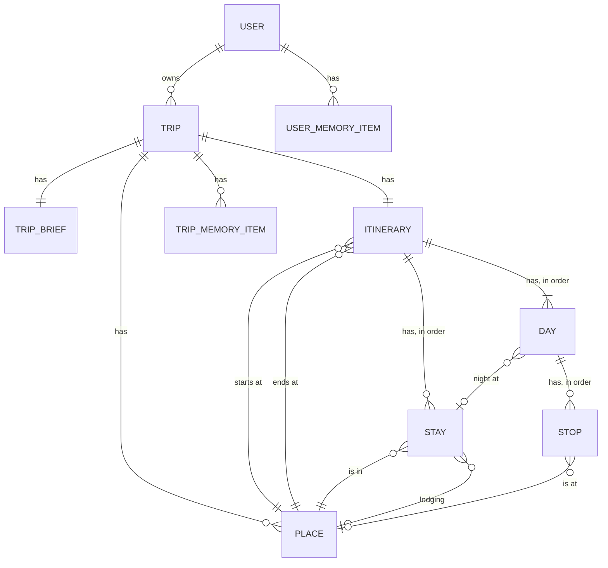

# Road Trip Planner: Technical Specification (MVP)

This document covers how the app works under the hood. So far it covers the agents: which agents exist, what each one does, which tools each one gets, and what goes in each agent's instructions. Sessions, memory, and other parts will be added as they are designed. It is written at the level of design, not of any one SDK's configuration. For the planning behavior it implements, see the [functional spec](functional-spec.md). For each tool's server, inputs, and which agents get it, see the [tool design](tool-design.md). For the tools' data sources, see the [data sources index](data-sources.md).

---

## 1. Overview

One **coordinator** agent talks to the user for the whole trip. It sends research to **worker** subagents and keeps the conversation, the itinerary's structure, and memory to itself.

| Agent | Talks to the user | Writes the itinerary | Writes memory | Runs |
|---|---|---|---|---|
| Coordinator | Yes | Yes | Yes | For the whole session |
| Stay researcher | No | Adds candidates only | No | Once per stay, in parallel |
| Leg scout | No | Adds candidates only | No | Once per leg, in parallel |
| Weather and clothing | No | Saves each stay's weather text only | No | Once per trip, after the fill round |

A worker is called like a tool. It gets a worker brief, does its work, and returns one result. It can't ask the user anything. If it needs a decision, it says so in its result, and the coordinator asks.

---

## 2. Decisions

- **TypeScript for the whole app, on the Claude Agent SDK.** The back end and the UI share one definition of the data model: the itinerary, places, candidates, and option cards. The trip tools write these shapes, the read tool returns them, and the UI draws them. In two languages, every field change would be made twice.
- **Each agent sees only its own tools.** Tools are grouped into servers by job, and each agent gets a list of exactly the tools it uses (the [tool design](tool-design.md), section 3).
- **No separate interview agent, for now.** We considered an agent that scopes the trip with the user, then hands a summary to the coordinator once and ends. Discovery and refinement mix too often for a split to pay off yet (functional spec 5.3: the user can jump around). Revisit it if the coordinator's discovery turns out weak. If it is added later, the summary it hands over is the trip brief in section 5.3, so the coordinator doesn't change.
- **Workers write candidates directly and return a short summary.** Full place details go on the place, and from there to the option cards. The coordinator sees only one line per candidate (section 7).
- **Mechanical feasibility checks run in code.** The itinerary write tool checks every change and returns any broken rules (section 8). The agent handles the judgment: which trade-offs to offer.
- **The coordinator resolves budget rules into a tier before briefing a worker.** A worker gets "mid-range, from rule: 2+ nights", never the rule text (section 9).

---

## 3. Data model

This section lists what gets stored, how the pieces relate, and who creates or changes each one. Fields are settled during development.

**Every entity's ID is one we create.** IDs from outside sources, such as Google's place ID, are stored as ordinary properties and can be empty.

**Anything numbered in order starts at 0.** That covers a stay's order, a day's order, a stop's order in its day and time block, and a candidate's set number. The UI counts from 1 for people, so the day stored as 0 shows as Day 1. The examples below use the people-facing labels.

**"Worked out" means looked up from other stored data when read, and not stored.** Examples: a stay's nights, a day's date, a leg's from and to, and a candidate's status. Storing these would add a second copy that can go stale. Values that need a call to an outside service, such as a leg's drive time, are different. They are computed once and stored (3.3).

### 3.1 Entities



How to read the line ends: `||` is exactly one, `o|` is zero or one, `o{` is zero or more, and `|{` is one or more. For example, `DAY }o--o| STAY` means a day points to zero or one stay, and a stay can have many days pointing to it.

Candidates and legs are not in the diagram. They are value objects: candidates are held inside stops and stays (3.2), and a leg is held inside its day (3.3).

| Entity | Belongs to | What it is |
|---|---|---|
| Trip | User | The container for everything below. The app creates it when the user starts a new conversation (functional spec 10.1) |
| Trip brief | Trip | The items in functional spec 5.2. Created empty with the trip |
| Itinerary | Trip | Points to a start place and an end place. Holds a start date, empty until the dates are decided. Holds the stays and the days, each in order. Created with the trip, holding only its last day (see below) |
| Place | Trip | Any real location: a town, hotel, restaurant, bar, attraction, friend's house, or campground. Holds the facts about it: Google's place ID, coordinates, and the details a tool returned, such as Google's name, rating, review count, price level, weekly hours, summary, and links. Also holds the name and type that cards show, set by the first candidate that offers it, from a worker or from the user. Until then, cards use Google's name. Places are matched by Google place ID only. The kind of place doesn't limit how it's used. A hotel can be a stay's lodging, or a stop for its bar. On a loop trip, the start and end are the same place |
| Stay | Itinerary | One overnight location: the place it's in, usually a town, and order. Its nights are the number of days that point to it, worked out rather than stored. Changing its nights adds or removes its days. Its lodging is a place, empty until selected. Holds its lodging candidates, and a tier and the rule that produced it. Holds its weather and clothing text, labeled forecast or seasonal averages, with the place and dates it was written for. That text is empty until the weather worker runs (6.3) |
| Day | Itinerary | One day of the trip: rest day or not, its stops in order, and its leg, if it has one (3.3). Points to the stay where the party sleeps that night. The last day points to none. Its date is worked out: the itinerary's start date plus the day's order |
| Stop | Day | A visit during the day: a meal or an attraction. Holds its kind, its purpose, its search area, its time block (below), and its order within that block. The purpose is a short note on what the stop is for, such as "dessert" or "stargazing, about 1 a.m." The search area says where its candidates are searched: near a stay, by the stay's ID, or along the day's leg. Kind, purpose, and search area are set when the stop is added and never change (6). Its place is empty until selected. Holds its candidates. Meal stops have a tier and the rule that produced it. Holds the drive time from the previous stop, computed and stored with the day's leg (3.3). Holds its approvals, such as one to keep it despite its opening hours (section 8) |
| Trip memory item | Trip | One free-text note (functional spec 10.2) |
| User memory item | User | One standing preference (functional spec 10.3) |

**A day has at most one leg.** Whether it has one depends on what the day does. The three cases below are descriptions, not day types. The only one that is stored is whether the day is a rest day:

- **Moving to a new stay:** the leg runs from last night's stay to tonight's.
- **Staying put, with stops to drive to:** the leg starts and ends at the same stay, and passes through the day's stops.
- **A rest day:** no leg. The coordinator marks the day as a rest day, meaning no driving (functional spec 5.2). Any stops on it, such as dinner, are near the lodging and aren't routed.

**The itinerary holds two lists.** The stays are the shape of the trip, and are what the user and coordinator change. The days are the calendar. Each day points to the stay where the party sleeps that night. A stay can't belong to one day, because it can span several.

**Days follow from the stays.** Each stay has one day per night, and the days run in the stays' order. After them comes the **last day**, which has no stay: the party drives to the end place and doesn't sleep anywhere on the trip. Every trip has a last day, so the itinerary is created with it, and it is never removed. A day trip is just the last day.

- **Adding a night in Big Sur** adds a day pointing to the Big Sur stay, at the end of that stay's days. Every later day moves back one.
- **Moving a stay** moves its days with it.
- **A day has no date of its own.** Its date is the start date plus its order, so the first day, at order 0, falls on the start date. Changing the start date moves every day at once. Until the start date is set, days have no dates, and the UI shows them as Day 1, Day 2, and so on.
- **Trip length** is the number of days. The end date is worked out from it, never stored.

The trip brief and the itinerary both mention dates, for different reasons. The brief records what the user asked for: exact dates, a window such as "sometime in May," or a length such as "about a week." The itinerary's start date records what was decided. When the user gives exact dates, both are set. The brief then says the dates are fixed, so the coordinator knows not to move them.

**A day has six time blocks, each four hours long, starting at midnight:** overnight (12–4 a.m.), early morning (4–8 a.m.), morning (8 a.m.–12 p.m.), afternoon (12–4 p.m.), evening (4–8 p.m.), and night (8 p.m.–12 a.m.). The blocks are fixed, not settings. Each stop sits in one block. A block says roughly when the party will be there, without a clock time, and gives the opening-hours check a window to test (section 8).

- **A block describes a stop. It doesn't judge it.** No rule says which block a place belongs in. Denny's can go in any block, and a speakeasy that opens at 7 p.m. only works at night. Whether a place is open then is the hours check's job.
- **A block is not an entity.** It is one of six fixed values held on the stop, the same way the stop holds its kind. Blocks hold no data of their own and are never added or removed. If a block someday needs data, such as a note that the user is busy that afternoon, make it an entity then.
- **A stop's order is counted within its day and block.** The day's full order is worked out: the blocks in clock order, then the stops in order inside each block. There is only one order, so it can't disagree with the blocks. Example: moving Denny's from dinner to breakfast sets its block to morning and places it first in that block, in one change.

- **A meal is just a meal.** It has no type, such as breakfast or dinner. The party decides what each meal is. A meal moved from the morning to the evening is simply a meal in the evening, checked against evening hours.
- **A stop after midnight belongs to the calendar day.** A 1 a.m. stop is in the next day's overnight block. A drive that runs past midnight isn't handled in the MVP.

**Places are kept per trip.** A place returned twice within a trip, such as the same restaurant offered on two days, is stored once, matched by Google's place ID. Keeping places per trip means a place the user names, such as a friend's address, is never visible outside that trip (functional spec 10.4).

In the examples below, labels such as Leg, Stop, meal, attraction, and rest day are terms from this model. Anything in parentheses is a comment, not data.

**Example: three days on the road.** San Francisco to a friend's house in Los Angeles, along the coast.

```
Trip brief (only the items this example uses)
  Dates             exact: May 13–15, 2027, fixed
  Route preference  scenic

Itinerary
  Start place: San Francisco
  End place:   Mike's house, Silver Lake, Los Angeles   (an address the user named)
  Start date:  May 13, 2027

  Stays, in order
    Monterey stay         1 night   lodging → (a Monterey hotel)
    San Luis Obispo stay  1 night   lodging → (an SLO hotel)

  Days, in order
    Day 1, Thu May 13 (worked out)             night at → Monterey stay
      Leg
        from        San Francisco   (worked out: the start place)
        to          Monterey        (worked out: tonight's stay)
        drive time  computed through the selected stops below
      Morning
        Stop 1, meal        → Millbrae Pancake House
        Stop 2, attraction  → Hangar One, Moffett Field
        Stop 3, meal        → Philz Coffee, San Jose
      Afternoon
        Stop 4, attraction  → Santa Cruz Beach Boardwalk
      Evening
        Stop 5, meal        → The Whaling Station

    Day 2, Fri May 14 (worked out)             night at → San Luis Obispo stay
      Leg
        from        Monterey         (worked out: last night's stay)
        to          San Luis Obispo  (worked out: tonight's stay)
        waypoints   Big Sur village  (keeps it on Highway 1 before any stops are selected)
        drive time  computed through the selected stops below
      Morning
        Stop 1, meal        → First Awakenings, Monterey
                              (search area: near the Monterey stay, before the drive)
        Stop 2, attraction  → Point Lobos State Natural Reserve
        Stop 3, attraction  → Bixby Creek Bridge viewpoint
      Afternoon
        Stop 4, meal        → Nepenthe, Big Sur
        Stop 5, attraction  → Piedras Blancas elephant seal rookery
      Evening
        Stop 6, meal        → Firestone Grill, San Luis Obispo
      Night
        Stop 7, meal        → Madonna Inn (for its pink champagne cake)

    Day 3, Sat May 15, the last day            no stay
      Leg
        from        San Luis Obispo  (worked out: last night's stay)
        to          Mike's house     (worked out: the end place)
        approvals
          route type   fastest (the user wants to get to LA quickly)
        drive time  computed with no stops
```

The Monterey stay exists once, but two days use it: Day 1 sleeps there, and Day 2 starts from it. Neither leg stores Monterey. Stop 7 is a hotel used as a stop. Meals have no type: Nepenthe is a meal in the afternoon block, and the cake at the Madonna Inn is a meal in the night block. The night stop's purpose, "dessert," is what tells its worker to look for cake. Day 2's waypoint keeps the route on the coast during the fill, when the leg scout searches along it and no stops are selected yet. It stays once stops are selected. Code places it among them, between Bixby Creek Bridge and Nepenthe, where it changes nothing (3.3). Day 3 differs from the trip's scenic default, so it holds a route type approval with the user's reason.

**Example: a three-night stay with a rest day.** Moab, between Grand Junction and Torrey.

```
Trip brief (only the items this example uses)
  Dates             a window: sometime in October 2027, about five days
  Max driving       4 hours a day
  Route preference  scenic
  Budget            value by default, mid-range for stays of 2+ nights

Itinerary
  Start place: Grand Junction, CO
  End place:   Salt Lake City
  Start date:  October 10, 2027   (picked by the coordinator from the window)

  Stays, in order
    Moab stay    nights: 3 (worked out: Days 1–3 point here)
                 lodging → (a Moab hotel)
                 tier: mid-range, from rule: stays of 2+ nights
    Torrey stay  nights: 1 (worked out: Day 4 points here)
                 lodging → (a Torrey hotel)
                 tier: value, from rule: the trip default

  Days, in order
    Day 1, Sun Oct 10 (worked out)            night at → Moab stay
      Leg
        from        Grand Junction   (worked out: the start place)
        to          Moab hotel       (worked out: tonight's lodging)
        waypoints   Dewey Bridge     (keeps it on Highway 128 along the river)
      Afternoon
        Stop 1, attraction  → Fisher Towers viewpoint
                              (assume: found by web search, so its hours aren't known)
      Evening
        Stop 2, meal        → Moab Brewery

    Day 2, Mon Oct 11 (worked out)            night at → Moab stay
      Leg                            (from and to are the same stay)
        from        Moab hotel       (worked out: last night's lodging)
        to          Moab hotel       (worked out: tonight's lodging)
        drive time  computed through the selected stops below
      Early morning
        Stop 1, attraction  → Delicate Arch trail, Arches (sunrise hike)
                              (assume: open 24 hours, so it's open long enough)
      Morning
        Stop 2, attraction  → Windows Section, Arches
        Stop 3, meal        → Love Muffin Cafe (late breakfast, back in town)
      Afternoon
        Stop 4, meal        → Milt's Stop & Eat
                              (assume: closes at 12:30 p.m., so it's open but not long enough)
        Stop 5, attraction  → Corona Arch trail
      Evening
        Stop 6, meal        → Desert Bistro

    Day 3, Tue Oct 12 (worked out), rest day  night at → Moab stay
      No leg
      Evening
        Stop 1, meal        → The Spoke on Center (near the hotel)

    Day 4, Wed Oct 13 (worked out)            night at → Torrey stay
      Leg
        from        Moab hotel       (worked out: last night's lodging)
        to          Torrey hotel     (worked out: tonight's lodging)
        approvals
          drive hours  5       (the user wants Goblin Valley and Capitol Reef on the way)
        drive time  computed through the selected stops below
                    (about 4 hours of road time, plus the buffer, over the 4-hour default)
      Morning
        Stop 1, attraction  → Goblin Valley State Park
      Afternoon
        Stop 2, meal        → Gifford Homestead, Capitol Reef (pie)
                              (assume: closed for the season from October 1, so it's closed)
        Stop 3, attraction  → Capitol Gorge, at the end of the Scenic Drive

    Day 5, Thu Oct 14 (worked out), the last day   no stay
      Leg
        from        Torrey hotel     (worked out: last night's lodging)
        to          Salt Lake City   (worked out: the end place)
        drive time  computed through the selected stops below
      Overnight
        Stop 1, attraction  → Panorama Point, Capitol Reef (stargazing, about 1 a.m.)
                              (the party drives back to the Torrey hotel to sleep,
                               then leaves for Salt Lake City in the morning)
                              (search area: near the Torrey stay)
```

Day 2's leg starts and ends at the Moab hotel without any new rule: "where the party slept last night" and "where it sleeps tonight" are both the Moab hotel. Because Day 2 has a leg, its driving is checked. If the coordinator put Monument Valley on it, about two and a half hours each way, the driving check would flag it. Day 3 is a rest day, so it has no leg, and its dinner is close to the hotel. Days 2 and 3 start and end at the Moab stay, so every stop on them is near it. Panorama Point is on the last day, which has no stay, so it is near the Torrey stay, where the party slept the night before.

The hours marked "assume" are for walking through the example, not real hours. Between them, Fisher Towers, Delicate Arch, Milt's, and Gifford Homestead cover the four results of the opening-hours check (section 8). The Moab stay is mid-range and the Torrey stay is value, from the trip's budget rule (section 9). Day 4 runs over the trip's 4-hour default, so it holds a drive hours approval with the user's reason. The stargazing stop is at 1 a.m., so it belongs to Day 5, in its overnight block (3.1).

### 3.2 Candidates

A **candidate** is one place offered for a stop or for a stay's lodging, with the reason it was offered. It is a value object, not an entity. It has no ID of its own and exists only inside the stop or stay that holds it. Each candidate holds:

- The place it offers
- **Rationale:** one or two sentences on why it was offered here, tied to the user's preferences. The UI shows it as a tooltip on the option card. The coordinator reads it when the user asks "why that one?"
- Tier, and the rule that produced it, for lodging and meal stops
- How it was found (Google or web search, with the source link), and notes, such as hours for these dates ("closed Mondays, and you're there on a Monday") or "reservations advised" (functional spec 7.5)
- **Visit time,** for attraction stops: the worker's estimate, labeled as one (6.1). The opening-hours check uses it (section 8)
- **Detour time,** for stops along the drive: the extra minutes off the leg's route, from the along-leg search. It's a rough figure ([Google design](data-sources-google.md), 2.4). Once the stop is selected, its stored drive time from the previous stop gives the real figure
- **Set number:** which batch it came in. The tool assigns it: 0 for the first batch offered for that stop or lodging, 1 for the next "more options" batch, and so on. A set holds one to three candidates. A place the user specifies is a set of one

The facts about the place, such as rating and hours, live on the place. Only the reason for offering it lives on the candidate. That matters when one place is offered twice for different reasons. Example: the Palace Hotel in San Francisco, offered as lodging because "posh, from rule: last night is special," and as a stop because "Maxfield Parrish's Pied Piper painting hangs in the bar."

**Status comes from two properties,** so it isn't stored:

| Place | Candidates | Status |
|---|---|---|
| Empty | Empty list | Empty |
| Empty | Some | Proposed |
| Set | Some | Selected |

**The selected place must be one of the candidates.** When the user specifies a place directly, such as "dinner at the Whaling Station," a separate select tool adds one candidate for it, then selects it. Its rationale is the user's reason, and how it was found is "specified by the user." The coordinator gives it a name and type, such as "Mike's house," which is what the card shows for a place looked up by address. For an attraction, the coordinator asks the user how long they'll spend there, offering a typical figure. Example: "People usually spend about two hours at Hearst Castle. Does that sound right?" Every selection then has a rationale (functional spec 7.6).

**The list keeps every candidate ever offered, in the order offered.** The option card shows the newest set, the one with the highest set number. A set number is needed because sets vary in size: a worker may find only two good hotels in a small town. The older candidates let the user go back to one offered earlier ("actually, the hotel with the pool"), and tell the worker what to leave out on "more options." Candidates never change after they're written. "More options" adds new ones.

### 3.3 Legs

A **leg** is the drive on one day. It is a value object held by its day, not an entity. It has no ID of its own. A day has a leg when it moves to a new stay, or when it has stops to drive to and isn't a rest day (3.1). When the day stays put, from and to are the same stay. A leg has no type. Whether it returns to the same stay is just what its from and to work out to, not a stored property. The drive between two stops on a leg is a **segment**. Google Routes uses different names: it calls a segment a "leg" and our leg a "route". Code that calls Google needs a comment saying so. The functional spec's "loop" means a trip that ends where it started, not a leg. The leg scout is briefed with the day's ID.

| Property | Where it comes from | Stored |
|---|---|---|
| From | Worked out: where the party slept the night before, or the start place | No |
| To | Worked out: where the party sleeps that night, or the end place | No |
| Drive time, distance, and route line | Computed by code with Google Routes, through the day's selected stops in the day's order, with the leg's waypoints placed among them (3.1) | Yes |
| Route type (scenic or fastest) | Worked out: the leg's route type approval if it has one, otherwise the trip brief's route preference | No |
| Waypoints | Set by the coordinator | Yes |
| Approvals | Set by the coordinator when the user agrees (section 8) | Yes |

**Drive time, distance, and route line are stored because each one costs a paid call to Google Routes.** Working them out on every read would be slow and would use up the quota. Code computes them again only when something the route depends on changes: the stays, a stay's lodging, the day's selected stops, or the leg's waypoints (3.5).

**Where the party sleeps is the stay's lodging once one is selected, and the stay's place until then.** That place is usually a town, and a town is a place like any other. Before a hotel is picked, the leg routes to the town. When one is picked, the leg is re-routed to it. For most towns this barely changes the drive time. In a big city it can: a hotel in Santa Monica and one in Pasadena are far apart.

**A waypoint is a point the route must pass through, without stopping.** The coordinator adds waypoints to steer a scenic route. Example: the fastest route from Monterey to San Luis Obispo runs inland on US-101. To keep it on Highway 1 through Big Sur, the coordinator adds a waypoint at Big Sur village. A waypoint stays on the leg after stops are selected. Once the selected stops pull the route onto the road, it changes nothing. The coordinator can remove it then, but doesn't have to.

| | Stop | Waypoint |
|---|---|---|
| The party gets out | Yes | No |
| Time block and order within it | Yes | No |
| Candidates and option cards | Yes | No |
| Opening hours check | Yes | No |
| Shown to the user | As a visit | Only as the route line on the map |

Users don't pick waypoints. They pick scenic or fastest, and the coordinator picks the waypoints.

**A waypoint is a place ID, never a plain name.** A name can resolve somewhere unexpected without any error. In testing, "Dewey Bridge, UT" resolved to Salt Lake City and turned a 2-hour drive into an 8-hour one. The coordinator looks a waypoint up with `find_place` first.

**Code places each waypoint among the day's selected stops.** The coordinator doesn't say where a waypoint goes in the day's order. Code lists the leg's from, its selected stops in order, and its to. It puts the waypoint in the gap between two neighbors where it adds the least straight-line distance. That distance comes from the coordinates already stored on each place, so this needs no call to Google. A leg with more than one waypoint has them placed one at a time, in the order the coordinator gave. Example: on San Francisco Day 2, with only First Awakenings in Monterey selected, Big Sur village goes between First Awakenings and San Luis Obispo. Between the Monterey hotel and First Awakenings it would add about 50 miles, going south and back. Straight-line distance can guess wrong where the road bends far from it, such as around a bay. It works because a waypoint sits on the road the coordinator wants.

**Route type isn't stored on the leg.** It changes nothing in the call to Google, so a stored label could only be compared with itself. A leg's route type is the trip brief's route preference, unless the leg holds a route type approval (section 8). The coordinator makes a leg scenic with waypoints, or with stops that already pull the route onto the scenic road. Google's avoid-highways option was tested as a scenic setting and rejected. It stayed on US-101 instead of Big Sur, added hours to long Western legs, and picked old back roads such as the TransAmerica Trail.

### 3.4 Who creates and changes what

- **The coordinator,** through its tools: the trip brief, the itinerary's start place, end place, and start date, stays and their nights, rest days, each day's stops, each leg's waypoints, approvals on legs and stops, memory, and selections.
  - It lays out a day by adding empty stops, each with a kind, a purpose, a search area, a time block, and an order within that block. It sets the order. Code never reorders stops.
- **Code inside the tools:**
  - Places, created or reused when a tool returns one.
  - Days, added and removed as stays' nights change. The last day is created with the itinerary.
  - A leg's drive time, distance, and route line, computed and stored whenever the stays, a stay's lodging, the leg's waypoints, or a selected stop on its day changes. Its from and to are worked out when read. The coordinator's own routing tool is for rough checks, such as the shape sketches (4.2).
  - Feasibility results (section 8).
- **Workers:** candidates, and the places they point to. A worker gets the IDs of stops or a stay that already exist, and can only add candidates to those. It can't create, change, or select anything. The weather worker is the exception: it saves each stay's weather and clothing text, and adds no candidates.
- **The UI:** nothing directly. A card click becomes a message to the coordinator (7.2).

### 3.5 What happens when something changes

The itinerary tools carry changes through, so the coordinator doesn't have to:

- **A stay moves to a different town:** the legs on either side are re-routed. The tools leave its lodging and the stops on its days alone, because whether they still fit is a judgment call. The coordinator talks it through with the user. Then it removes the stops that no longer fit, and clears the lodging selection if the hotel no longer fits. Example: moving from Monterey to Carmel keeps every stop and the hotel. Skipping Monterey to drive I-5 to Bakersfield removes every stop on its days and clears its lodging. The old lodging candidates stay in the stay's history, and the next set offered replaces them on the option card.
- **A stay's lodging is selected or cleared:** the legs on either side are re-routed (3.3).
- **A night is added or removed:** a day is added or removed at the end of that stay's days, and the legs around it are re-routed. Later days move, and their dates with them. Stops on a removed day go away.
- **The start date changes:** every day's date moves with it. Nothing is re-routed, but the opening-hours check runs again, since each day can now fall on a different weekday.
- **A stay's place or dates change:** its weather and clothing text is kept, but marked out of date, because the place and dates it was written for no longer match. Its dates change whenever the start date or an earlier stay's nights change. The UI labels the text as out of date. The coordinator reruns the weather worker for those stays before calling the itinerary done.
- **A stay is removed:** its days and their stops go away. The next day's leg now starts from the stay before it, and is re-routed.
- **A stop's selected place, date, or time block changes:** its opening hours approval stays, but no longer applies, because it records what it was given for (section 8). The opening-hours check runs fresh. A stop's date changes when the start date moves, when an earlier stay gains or loses a night, or when the stop moves to another day.
- **A stop is selected, cleared, changed, or removed:** that day's leg is re-routed through the selected stops. A day that stays put gains a leg when it gets its first stop to drive to, and loses it when the last one goes.

When a stop or stay goes away, its candidates go with it. The places stay. The coordinator then sends new worker briefs for new stops, and for any stop or lodging whose candidates no longer fit.

---

## 4. How a trip is planned

### 4.1 Anchors and stretches

Every trip has **anchors**: start, end, must-sees, and sometimes a named road. Between two anchors is a **stretch**. On each stretch, one of two things is fixed:

- **The road is fixed.** Example: Pacific Coast Highway. The agent finds stops along it, using the along-leg place search.
- **The places are fixed.** Example: Texas barbecue. The agent picks the towns first, then works out the route, using region place search and the routing tool's option to put stays in the best order.

The coordinator decides which kind each stretch is during discovery and records it in trip memory. One trip can mix both.

### 4.2 Rounds

Planning goes from broad to narrow. This is the usual order in which the coordinator works through the planning activities in functional spec 5.3. The user can still move to any of them at any time.

1. **Discovery.** The coordinator establishes the items in functional spec 5.2, a few questions at a time.
2. **Shape.** The coordinator offers two or three sketches of the trip in plain chat. Each sketch is a name, the rough path, and a few sentences on why someone would pick it. Example: "A loop out of Austin through the Hill Country, 7 days" vs "One-way from Dallas to Houston, through Lockhart and Taylor."
   - Sketches come from the model's own knowledge, not from research. The coordinator makes one routing call per sketch to get a rough total drive time, so it doesn't pitch a trip that can't work.
   - Seasonal closures and hazards at this stage also come from the model's own knowledge. Workers confirm them later with real data.
   - Skip this round when the user already gave a fixed route.
3. **Skeleton.** For the chosen shape: stays, nights per stay, legs with drive times, and dates if only a window was given. The coordinator builds this itself with the routing and place tools, and writes it to the itinerary.
4. **Fill.** The coordinator lays out each day's stops. Then it briefs one stay researcher per stay and one leg scout per leg, all at once. A day that starts and ends at the same stay has no leg scout. Its stops are near that stay, so that stay's researcher fills them. The workers add candidates to the stops and lodging, which makes them proposed.
5. **Weather and clothing.** After the fill, because clothing advice depends on the planned activities.
6. **Refine.** Changes from chat or option card actions. "More options", "Higher tier", and "Lower tier" each send one worker for that one stop or lodging.

---

## 5. Coordinator

### 5.1 Tools

- **Itinerary:** read the itinerary. Set the start place, end place, and start date. Add, change, and remove stays, and set their nights. Mark rest days. Add, change, and remove stops. Set a leg's waypoints. Record selections, clear a stop's or lodging's selection, and set and remove approvals on legs and stops. Every write returns the feasibility check results (section 8).
- **Trip brief:** read the trip brief, and update one or more items in it at once. Every update returns the feasibility check results (section 8), since items like max driving hours affect them.
- **Memory:** read, add, update, and forget items in user memory and trip memory.
- **Places:** find a named place, to resolve a town, a must-see, or a place the user names. Read a place's full record by ID, when the short line isn't enough (7.2).
- **Routing:** compute a rough route, with the option to put the middle points in the fastest order. Returns times and distances, and the place each plain name resolved to. No route line.
- **Workers:** call the stay researcher, leg scout, and weather and clothing workers.

The full list, with the server each tool is on, is in the [tool design](tool-design.md). The coordinator has no place search for hotels, restaurants, or attractions, and no web search. That work belongs to workers, which keeps place results out of the coordinator's context.

### 5.2 Instructions

The coordinator's instructions cover:

- **Conduct** (functional spec 5.4): explain trade-offs plainly, never say or imply anything is booked, stay on trip planning.
- **What to establish** (functional spec 5.2), and to confirm values from user memory instead of asking again.
- **Memory precedence** (functional spec 10.4): the current conversation, then trip memory, then user memory. When the user contradicts user memory, ask whether it applies to this trip only.
- **The planning method:** anchors and stretches (4.1) and the rounds (4.2).
- **When to send work to a worker,** and how to write a worker brief (5.3).
- **How to handle broken feasibility rules** (functional spec 6.2): say which rule fails and by how much, then offer two or three trade-offs.
- **Budget tiers:** how to turn the user's rules into a tier for each lodging and meal stop (section 9).
- **Visit time for a place the user specifies:** ask how long they'll spend there, offering a typical figure for them to confirm or change.

### 5.3 Trip brief and worker briefs

The coordinator keeps the **trip brief** (functional spec 5.2) current with the trip brief tools (5.1).

A **worker brief** is the part of the trip brief one worker needs:

- The IDs of the stops or the stay to fill, with the day, dates, and nights they belong to
- For lodging and meal stops, the resolved tier and the rule that produced it
- Each stop's purpose, such as "dessert" or "sunrise hike"
- Interests, must-sees, and meal preferences that apply here
- Places to leave out: candidates already offered for that stop or lodging, and rejected places with the reason ("no parking")

Workers never see raw user memory or anything about the user beyond their worker brief.

---

## 6. Workers

The coordinator decides which worker fills each stop when it lays out the day, by setting the stop's search area (3.1). A stop near a stay goes to that stay's researcher. A stop along the leg goes to the leg scout. "More options" for a stop goes to the same worker. Example: on San Francisco Day 2, breakfast in Monterey comes before the drive south. It is near the Monterey stay, so the Monterey researcher fills it, even though the party sleeps in San Luis Obispo that night.

**A stop's search area is the stay where the party slept the night before, or where it sleeps that night,** or the day's leg. The leg is allowed only on a day that moves to a new stay or to the end place. A stop that belongs somewhere else is a different stop. So the search area never changes: a move that would change it is rejected, and the coordinator removes the stop and adds a new one ([tool design](tool-design.md), 2.1). Kind and purpose are fixed the same way, since a stop's candidates were found for them.

### 6.1 Stay researcher

Finds candidates for one stay's lodging, and for the stops whose search area is that stay. These can be on the stay's own days, or on the next day, such as breakfast before driving on.

- **Tools:** place search near a stay or stop in its worker brief (hotels, restaurants, attractions), find a named place, to look up something found by web search, web search, both general and limited to Atlas Obscura, and tools to add candidates to the stops and stay in its worker brief.
- **Instructions:** fit candidates to the worker brief's interests and tiers. Three candidates per stop or lodging (functional spec 7.5), added in one call. Attractions carry the agent's estimate of visit time, labeled as an estimate. Check hours against the dates, and say plainly when hours are unconfirmed. The web search rules from the [web search design](data-sources-web-search.md) apply.
- **Returns:** for each stop or lodging, the candidates it added with one line each, plus any problems found. Example: "Must-see is closed on these dates."

### 6.2 Leg scout

Finds candidates for the stops along one leg, on its driving day. These can be meals or attractions, such as breakfast on the way or a quick look at a landmark.

- **Tools:** the along-leg place search, find a named place, to look up something found by web search, web search limited to Atlas Obscura for towns the leg passes through (a hook enforces the limit), and a tool to add candidates to the stops in its worker brief.
- **Instructions:** fit candidates to the worker brief's interests and tiers. Add all of a stop's candidates in one call. Give each one's detour time in minutes, from the along-leg search. It's a rough figure.
- **Returns:** for each stop, the candidates it added with one line each.

### 6.3 Weather and clothing

Writes weather and clothing guidance per stay (functional spec 8).

- **Tools:** one weather tool, which returns the Google Weather forecast when every one of a stay's dates is within 7 days, and Open-Meteo seasonal averages otherwise. Code picks which, from the stay's dates. Also a tool to save each stay's weather and clothing text.
- **Instructions:** label each stay as forecast or seasonal averages. Tie clothing advice to the planned activities in the worker brief. Short advice, not a packing list.
- **Returns:** one line per stay. The worker saves the full text to the itinerary itself, the same way other workers write candidates.
- **Runs only once the itinerary has a start date.** Without dates, there's nothing to forecast or average. The coordinator tells the user weather will come once the dates are set.

### 6.4 Rules for all workers

- **No user contact and no memory access.** A question for the user goes in the result.
- **Candidates are written to the stop or stay, not into the result** (section 7).

---

## 7. How agents refer to places and candidates

### 7.1 IDs

- **IDs are short random strings, with a prefix for the kind of item.** Example: `stop_k7m2x9qa`. The prefix is `stay_`, `day_`, `stop_`, `place_`, or `mem_` (a memory item). After it come 8 random lowercase letters and digits, leaving out ones that are easy to confuse when copied, such as `0` and `o` or `1` and `l`. That gives about a trillion combinations.
  - **Random, not counted.** A worker can only reach the stops and stay in its worker brief, because those are the only IDs it sees. Any other ID it makes up doesn't exist, so the tool rejects it. Counted IDs such as `stop-12` and `stop-13` would let a slip land on a real stop.
  - **Short, not UUIDs.** An ID like this is about 5 tokens, against about 20 for a UUID. The itinerary holds hundreds of IDs, and the coordinator reads it often ([tool design](tool-design.md), open question 2).
  - **The prefix catches mix-ups.** If a stay ID is passed to a stop tool, the error can say so, instead of just "not found."
- **A candidate is referred to by its stop or stay, plus its place.** Tools take a stop or stay ID and a place ID, such as "select place X for stop Y."
- **Users never see IDs.** They refer to a place by name ("the Van Zandt") or position ("the second one"). The coordinator maps that to an ID. "The second one" means the second candidate on the option card, in the newest set.
- **Tools reject bad IDs.** A stop, stay, or place that doesn't exist, or a place that isn't one of that stop's candidates, returns an error. The tool never guesses.

### 7.2 What the coordinator sees

The coordinator never sees full place records, such as hours tables, coordinates, review links, and long summaries. It does see each place's name and a short line about it, so it can follow the conversation when the user names a place.

- **Worker results:** each candidate's line includes its place ID, name, and gist. Example: "Hotel Van Zandt, mid-range, 4.6 stars, on Rainey Street, walkable to the barbecue spots."
- **Option card actions:** a Select click reaches the coordinator as a message with the same line, not only the IDs. Example: "User selected Hotel Van Zandt for the Austin hotel." The coordinator then calls the select tool and confirms in chat (functional spec 7.5).
- **Reading the itinerary:** the read tool returns the name and line for every selected place, and for every candidate ever offered for each stop and stay, in the order offered, with its set number. In a new session (functional spec 10.1) this is all the coordinator knows about the trip's places.
- **Anything more,** such as "is it open Mondays?", comes from reading the place's full record by ID.

---

## 8. Feasibility checks in code

The itinerary write tools run these checks after every change and return a list of flags and warnings:

- **Trip length:** 14 days or fewer. A hard limit, with no exceptions.
- **Daily driving:** road time, including detours to the day's stops, plus a buffer for fuel and short breaks, fits the user's max hours. The buffer is a setting. Max hours is a preference, so a leg can hold a drive hours approval (below).
- **Opening hours:** each meal and attraction stop is checked against the weekly hours on its selected place, on its day's date, during its time block (3.1). There are four results:
  - **Open long enough:** nothing is said. Long enough means open, within the block, for at least the stop's visit time. A meal counts as one hour. An attraction uses its candidate's visit time.
  - **Open, but not long enough:** a warning. It gives the opening or closing time and the drive time from the previous stop, and says the drive time is an average. Example: "Closes at 2 p.m. It's about 40 minutes from your previous stop, so allow extra time for traffic."
  - **Closed for the whole block:** a flag.
  - **Hours not known:** a note, not a warning. The card says "Hours not confirmed. Check before you go." This covers a place with no hours on Google, and any place found by web search, since Google's hours aren't used for those ([web search design](data-sources-web-search.md), section 4).
  - The itinerary is a plan, not a guarantee. The user can keep a warned or flagged stop anyway, and the stop then holds an approval (below).
- **Stop order:** whether the day's stops could be driven in a faster order. This runs when a selected stop on the day changes. Code makes one extra Routes call over the whole leg with Google's best-order option, and compares the result with the day's order. Our waypoints are left out of this call, because Google rejects pass-through points when it picks an order. The result is a note, not a warning, and only when the faster order saves at least a set number of minutes. The minimum is a setting, starting at 15. The note gives the time saved and which stops would move, with their blocks. Example: "A faster order saves 25 minutes. It moves Corona Arch from the afternoon to the morning." Google doesn't know when meals happen, so many faster orders make no sense, such as dinner in the morning. The coordinator decides whether a note is worth raising with the user. The best-order option is billed at the Routes Pro level.

**Approvals** (functional spec 6.2). When the user agrees to keep something a check flagged, the coordinator records an approval. A leg and a stop each hold a list of approvals. An approval is not an entity. It has a kind, the approved value, and a reason. The value's shape depends on the kind:

| Kind | On | Value |
|---|---|---|
| Drive hours | Leg | The hours the user agreed to |
| Route type | Leg | The route type the user agreed to, such as fastest |
| Opening hours | Stop | The place, date, and time block it was given for |

An item holds at most one approval of each kind. Setting one replaces any of the same kind. The list changes only through the tools ([tool design](tool-design.md), 2.1). Every approval needs a reason. Removing one doesn't.

**Why a list, with a shape for each kind.** One list gives every approval the same rule: a kind, a value, and a reason. Adding a kind later doesn't add a property and a tool input to the leg or stop. Each kind keeps its own value shape. A single "value" field would have to hold a number for drive hours, a route type, or a place, date, and block, and code would have to check that the value matches the kind. In code, this is a tagged union: the `kind` field tells code which other fields are present. The tools still take one named input per kind, such as "approve drive hours," not a generic "set approval." Those are easier for the model to fill in correctly. The model never edits the list directly.

**Drive hours.** The daily driving check compares against the approved hours when there are some, and the trip brief's max when there aren't. The default lives only in the trip brief, so changing it there applies to every leg at once. Storing the approved hours, instead of a yes or no flag, means nothing has to be reset. Example: the user approves 6 hours on the last day. If a later change makes that day 7 hours, it is over 6, so it is flagged again. If a change makes it shorter, nothing is flagged.

**Route type.** No check reads it. Route type changes nothing in the call to Google, so a check could only compare a label with itself (3.3). The approval records the user's choice, so the coordinator doesn't raise it again, in this session or a later one. It also sets the leg's route type shown in the itinerary.

**Opening hours.** The approval applies only while the stop's selected place, date, and time block all match what it was given for. When any of them changes, it stops applying, and nothing has to be cleared. This is the same pattern as the stay's weather text, which records the place and dates it was written for (3.5).

**Approval goes through the coordinator.** When a check flags a leg or a stop, the coordinator offers the trade-offs in functional spec 6.2, and accepting the exception is one of them. The choice can be an option card. As with any card, the click reaches the coordinator as a message, and the coordinator records the approval. When the user already agreed in chat, such as "cut a day and drive it in one go," the coordinator sets it without asking again.

The checks that need judgment stay with the agent: must-sees vs days, seasonal risks, and choosing dates in a window.

---

## 9. Budget tiers

The coordinator turns the user's natural-language rules into a tier for each lodging and meal stop before briefing a worker. Example: the user says "value by default, mid-range for stays of 2+ nights." A 2-night stay's lodging is briefed as "mid-range, from rule: 2+ nights." The worker searches at that tier and stores the tier and rule with each candidate. That is where the card's "which rule produced it" comes from (functional spec 7.1).

---

## 10. Open questions

1. **Worker brief and result formats.** Section 5.3 lists the contents, not the exact fields. Settle them during development.
2. **A reviewer.** A later worker that reads the finished itinerary with fresh eyes and checks it against the trip brief. Not in the MVP.
3. **An interview agent.** See section 2.
4. **A full walk-through of time blocks and the hours check.** The six time blocks, meals with no type, and the four-result hours check (section 8) were settled without running a whole trip through them. Walk both examples in 3.1, San Francisco and Moab, from laying out the days to a finished itinerary. Look for holes like the one in stop order, settled in 3.1 and section 8.
5. **A full object model.** Section 3 describes entities and value objects in prose, and properties keep getting added piecemeal, such as the stop's approval and the stay's weather text. Write a proper model: each object's properties, the methods or rules on it, and how it's stored. A class diagram would give new properties a clear home.
